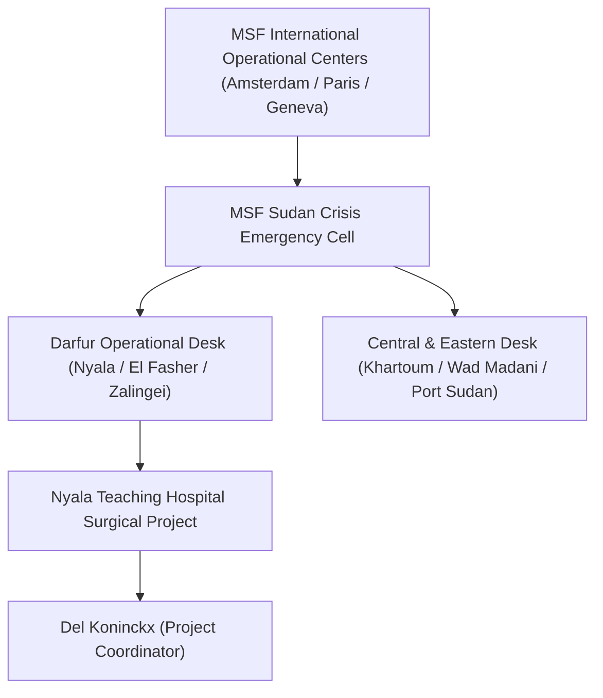

# Médecins Sans Frontières

## 1. Identity, Classification & Leadership Anchor

> [!NOTE] Identity, Classification & Leadership Anchor
> **Médecins Sans Frontières** (MSF / *Doctors Without Borders* / *أطباء بلا حدود*) is an independent, international humanitarian medical organization providing emergency healthcare, trauma surgery, and maternal care in conflict zones. In Sudan, MSF represents one of the few international medical organizations maintaining operational surgical teams and supporting key public referral facilities across both army- and paramilitary-controlled regions, including Nyala Teaching Hospital in South Darfur.

## 2. Historical Lineage, Factions & Command Structure

MSF has operated in Sudan since 1979, providing critical emergency assistance during the Darfur war of 2003–2005. Following the April 2023 war, MSF scaled up emergency trauma and surgical care despite facing systemic bureaucratic blockades, supply seizures, and physical attacks on its staff and facilities by belligerents.

## 3. Strategic Objectives, Ideology & Political Economy ("Why")

- **Neutral Medical Humanitarianism**: Preserving medical impartiality and providing lifesaving clinical trauma care regardless of political or armed affiliation.
- **Témoignage (Bearing Witness)**: Publicly documenting the devastating human toll of warfare, hospital blockades, and indiscriminate strikes on civilian population centers.
- **Safeguarding Healthcare Infrastructure**: Demanding that belligerents adhere to international humanitarian law by desisting from strikes against markets, hospitals, and medical transit corridors.

## 4. Operational Capabilities, Alliances & Foreign Backing

- **Direct Surgical Care**: Operates trauma operating theatres, malnutrition stabilization units, and triage zones across active conflict lines.
- **Forensic Verification of Blast Injuries**: MSF medical teams rigorously record injury etiologies (burns, shrapnel, gunshot wounds) and mortuary intake counts, providing ground-truth data in contested casualty environments.

## 5. Chronological Event Footprint & Accountability Record

| Date | Key Humanitarian Action / Report | Context |
| :--- | :--- | :--- |
| **2026-10-28** | Mobilized mass casualty intake at Nyala Teaching Hospital following the market drone strike | Received 36 deceased patients and treated over 150 wounded; condemned the targeting of markets |

## Related Primitives

- **Source Notes**: [[sources/2026-10-28-dabanga-nyala-market-strike-msf-tasees-death-toll]]
- **Covered Incidents**: [[2026-10-27 Nyala Tanqonj Market Drone Strike]]
- **Staff Nodes**: [[Del Koninckx]]
- **Facility Nodes**: [[Nyala]]
- **Thematic Context**: [[Systemic Healthcare Collapse and Hospital Militarization in Sudan]]
