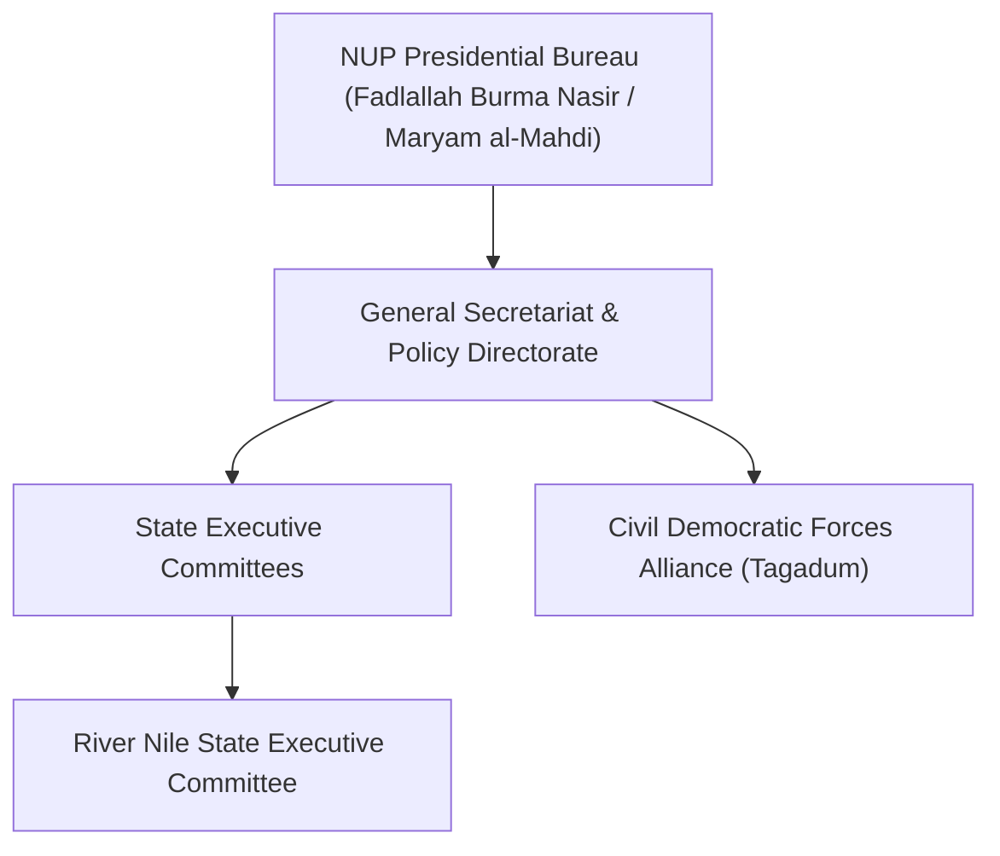

# National Umma Party

## 1. Identity, Classification & Leadership Anchor

> [!NOTE] Identity, Classification & Leadership Anchor
> The **National Umma Party** (NUP / `حزب الأمة القومي`) is one of Sudan’s largest and historically most rooted mass political parties, founded in 1945 by descendants and adherents of the 19th-century Mahdist movement (the *Ansar*). Led historically by late Prime Minister Sadiq al-Mahdi, the NUP combines traditional rural religious constituencies across Kordofan, Darfur, and the White Nile with urban technocratic reformists.

## 2. Historical Lineage, Factions & Command Structure

The NUP was a principal architect of the Forces for Freedom and Change (FFC) and later the *Tagadum* anti-war civilian coalition. During the April 2023 conflict, the party adopted a steadfast anti-war stance, rejecting the military solutions of both the SAF and RSF while maintaining regional executive branches that monitor agricultural and economic governance.

## 3. Strategic Objectives, Ideology & Political Economy ("Why")

- **Democratic Civilian Governance**: Ending military rule and establishing a federal democratic constitutional republic.
- **Agricultural Security Advocacy**: Defending smallholder farmers against predatory state wartime taxation, fuel hoarding, and utility neglect.
- **National Reconciliation**: Mediating cessation of hostilities and facilitating unhindered cross-line humanitarian relief.

## 4. Operational Capabilities, Alliances & Foreign Backing

- **Mass Base & Regional Branch Network**: Commands historical allegiance across rural agricultural belts and urban centers, with active local committees in Darfur, Kordofan, White Nile, and River Nile State.
- **Civilian Coalitions & Regional Diplomacy**: Anchors the *Tagadum* coalition alongside former Prime Minister Abdalla Hamdok, engaging directly with regional mediators in Addis Ababa, Nairobi, and Cairo.

## 5. Chronological Event Footprint & Accountability Record

| Date | Key Political Action | Context |
| :--- | :--- | :--- |
| **2026-11-01** | Issued urgent declaration demanding a state of "agricultural emergency" in River Nile State | Warned of famine caused by 3-week diesel shortages and 18-hour daily power cuts |

## Related Primitives

- **Localities**: [[River Nile State]]
- **Themes**: [[War Economy and Commercial Blockades in Sudan]], [[Energy Infrastructure Targeting in the Sudan War]]
- **Citations**: [[2026-11-01 National Umma Party Famine Emergency Declaration River Nile]]
