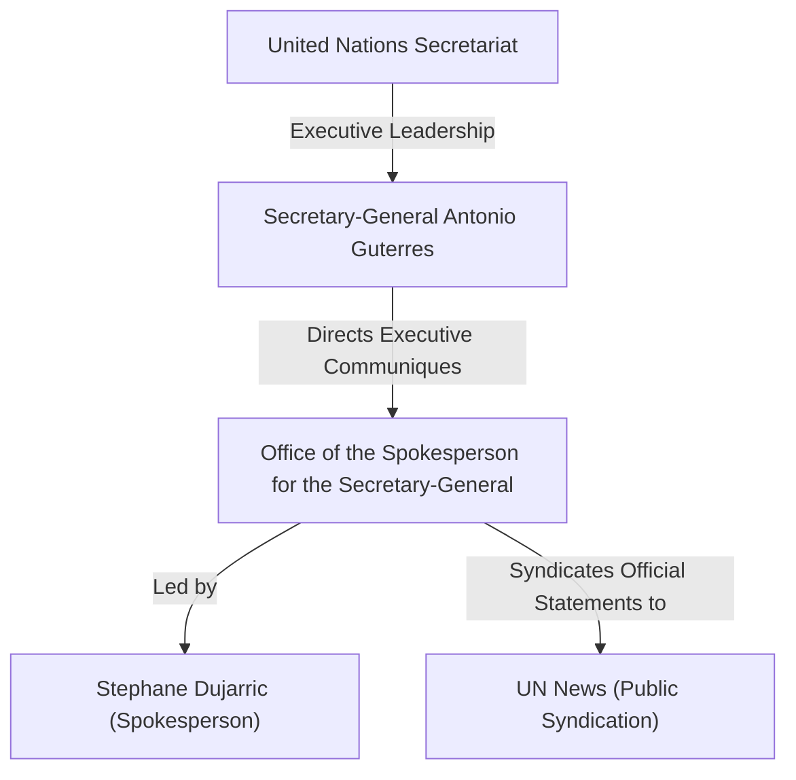

# Office of the Spokesperson for the Secretary-General

## 1. Identity, Classification & Leadership Anchor

> [!NOTE] Media Source Outlet & Executive Communications Anchor
> - **Canonical Actor**: [[Office of the Spokesperson for the Secretary-General]] (`OSSG`)
> - **Subtype**: `media_source` (`editorial_alignment: international_org`)
> - **Parent Organization**: [[United Nations]]
> - **Chief Spokesperson**: [[Stéphane Dujarric]] (serving Secretary-General [[António Guterres]])
> - **Baseline NATO Admiralty Source Reliability**: **`A` (Completely Reliable)** (`reliability_score: 0.95`)
> - **Official Portal**: [https://www.un.org/sg/en/spokesperson](https://www.un.org/sg/en/spokesperson)

The **Office of the Spokesperson for the Secretary-General** (`OSSG`) is the primary executive communications organ of the [[United Nations]] Secretariat in New York, responsible for delivering daily press briefings, readouts of high-level diplomatic engagements, and formal statements attributable to Secretary-General [[António Guterres]] ([[sources/2026-10-31-unsg-spokesperson-escalating-drone-attacks-sudan]]). Led by Spokesperson [[Stéphane Dujarric]], the office serves as an authoritative `A`-rated primary source (`subtype: media_source`) for United Nations legal, humanitarian, and diplomatic positions on the conflict in Sudan.

---

## 2. Historical Lineage, Factions & Command Structure

Operating directly within the Executive Office of the Secretary-General (`EOSG`), the [[Office of the Spokesperson for the Secretary-General]] synthesizes verified field telemetry from UN agencies and peacekeeping missions—including the Office of the High Commissioner for Human Rights ([[OHCHR]]) led by [[Volker Türk]] and the United Nations Interim Security Force for Abyei ([[UNISFA]])—into formal diplomatic communiqués and international humanitarian law (IHL) warnings ([[sources/2026-10-31-unsg-spokesperson-escalating-drone-attacks-sudan]], [[sources/2026-10-23-un-news-sudan-drone-strikes-306-killed]]).

---

## 3. Strategic Objectives, Ideology & Political Economy ("Why")

As the official voice of the [[United Nations]] Secretary-General, the [[Office of the Spokesperson for the Secretary-General]] pursues three core institutional mandates in its Sudan coverage:
1. **Normative IHL Enforcement**: Publicly identifying and condemning patterns of warfare—such as indiscriminate unmanned aerial vehicle (UAV) strikes against civilian markets, IDP shelters, and hospitals—as violations of international humanitarian law ([[Drone Proliferation and Double-Tap Strike Doctrine in Sudan]]).
2. **Diplomatic Pressure for Cessation of Hostilities**: Issuing urgent executive appeals to the [[Sudanese Armed Forces]] and [[Rapid Support Forces]] to halt hostilities, protect civilian infrastructure, and engage in good-faith mediation ([[2026-10-31 António Guterres Appeal for Immediate Cessation of Hostilities and Good-Faith Mediation in Sudan]]).
3. **Protection of UN Mandated Zones**: Reinforcing the demilitarized status of [[Abyei]] (`SD18001`) and backing [[UNISFA]] peacekeeping operations following cross-boundary aerial attacks ([[2026-10-19 Abyei Amiet Market and Todach Drone Strike]]).

---

## 4. Operational Capabilities, Alliances & Foreign Backing

The [[Office of the Spokesperson for the Secretary-General]] relies on the global reporting architecture of the [[United Nations]] system, cross-referencing casualty and incident verification from [[OHCHR]] (including spokesperson [[Seif Magango]]) and field commanders of [[UNISFA]] (including Brig. Gen. [[Adebowale Ajabge]] and Lt. Col. [[Muhammad Farooq]]) before issuing `A1`-graded attributable statements ([[sources/2026-10-31-unsg-spokesperson-escalating-drone-attacks-sudan]], [[sources/2026-10-23-un-news-sudan-drone-strikes-306-killed]]). Its communiqués are simultaneously archived on `un.org/sg` and amplified through [[UN News]].

---

## 5. Chronological Event Footprint & Accountability Record

| Publication Date ($t_{\text{reported}}$) | Source Note Published | Principal / Speaker | Events & Themes Addressed | Admiralty Rating |
| :--- | :--- | :--- | :--- | :--- |
| `2026-10-31` | [[sources/2026-10-31-unsg-spokesperson-escalating-drone-attacks-sudan]] | [[Stéphane Dujarric]] / [[António Guterres]] | [[2026-10 Sudan Drone Warfare Escalation]], [[2026-10-19 Abyei Amiet Market and Todach Drone Strike]], [[Drone Proliferation and Double-Tap Strike Doctrine in Sudan]] | **A1** |

---

## Related Primitives

- **Parent Organization & Principals**:
  - [[United Nations]] | [[António Guterres]] | [[Stéphane Dujarric]]
- **Partner UN Bodies & Media**:
  - [[UN News]] | [[OHCHR]] | [[UNISFA]] | [[Volker Türk]] | [[Seif Magango]]
- **Published Sources & Standalone Citations**:
  - [[sources/2026-10-31-unsg-spokesperson-escalating-drone-attacks-sudan]]
  - [[2026-10-31 Stéphane Dujarric UNSG Statement Condemning Escalating Drone Attacks in Sudan and Abyei]]
  - [[2026-10-31 António Guterres Appeal for Immediate Cessation of Hostilities and Good-Faith Mediation in Sudan]]
- **Events, Locations & Timelines Covered**:
  - [[2026-10 Sudan Drone Warfare Escalation]] | [[2026-10-19 Abyei Amiet Market and Todach Drone Strike]]
  - [[Abyei]] | [[West Kordofan]] | [[Blue Nile State]]
  - [[2026-10 Sudan Conflict Chronicle]] | [[Sudan Drone Warfare and Double-Tap Strike Timeline]]
