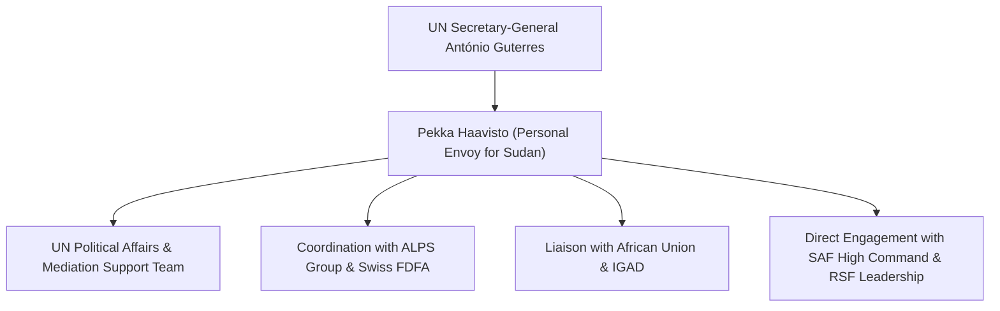

# Pekka Haavisto

## 1. Identity, Classification & Leadership Anchor

> [!NOTE] Identity, Classification & Leadership Anchor
> **Pekka Haavisto** is a seasoned Finnish diplomat, politician, and former Minister for Foreign Affairs of Finland (2019–2023) serving as the Personal Envoy of the [[United Nations]] Secretary-General for Sudan. With extensive experience in crisis mediation across the Horn of Africa dating back to the 2005 Comprehensive Peace Agreement (CPA) and the Darfur peace talks, Haavisto leads the UN's diplomatic efforts to coordinate international peace tracks, halt weapon proliferation, and broker a comprehensive nationwide ceasefire between the [[Sudanese Armed Forces]] (SAF) and the [[Rapid Support Forces]] (RSF).

## 2. Historical Lineage, Factions & Command Structure

Haavisto previously served as the European Union Special Representative for Sudan and the Horn of Africa (2005–2007) and held key roles in UNEP environmental post-conflict assessments. His appointment as UN Personal Envoy reflected a strategic push by Secretary-General António Guterres to unify fragmented regional mediation initiatives (Jeddah, IGAD, AU, Cairo, Manama) under a coherent multilateral umbrella.

## 3. Strategic Objectives, Ideology & Political Economy ("Why")

Haavisto's mediation strategy focuses on three core imperatives:
- **Mediation Track Harmonization**: Eliminating destructive forum-shopping by belligerents by aligning the African Union, IGAD, the Arab League, and the US-Swiss ALPS initiative into a single unified consultative framework.
- **De-escalation of Drone Proliferation**: Addressing the influx of advanced long-range UAVs and loitering munitions, identifying aerial warfare as the single greatest accelerator of civilian slaughter and infrastructure destruction.
- **Humanitarian Corridors & Local Trunces**: Securing binding, verified humanitarian pauses to allow aid access to besieged populations in Darfur, Kordofan, and Khartoum.

## 4. Operational Capabilities, Alliances & Foreign Backing

- **Diplomatic Neutrality & Reach**: Holds open channels with General Abdel Fattah al-Burhan, Mohamed Hamdan Dagalo (Hemedti), regional foreign ministers, and Western donor capitals.
- **Swiss Partnership**: Operates in close tactical coordination with the Swiss [[Federal Department of Foreign Affairs (Switzerland)]] and State Secretary [[Alexandre Fasel]], utilizing Geneva as an uncompromised diplomatic venue.

## 5. Chronological Event Footprint & Accountability Record

| Date | Diplomatic Initiative | Focus Area |
| :--- | :--- | :--- |
| **2024-07** | Proximity talks in Geneva between SAF and RSF delegations | Addressed localized ceasefires and humanitarian access corridors |
| **2026-10-21** | Chaired the Geneva Consultative Meeting on Peace Initiatives | Mobilized 20+ nations and multilateral bodies; issued urgent warning on escalating drone warfare killing civilians |

## ## Related Primitives
- **Sources**: [[sources/2026-10-21-un-news-geneva-peace-efforts-drone-war]]
- **Themes**: [[Multilateral Mediation and Peace Coordination Mechanisms in Sudan]], [[Drone Proliferation and Double-Tap Strike Doctrine in Sudan]]
- **Events**: [[2026-10-21 Geneva Consultative Meeting on Peace Initiatives in Sudan]]
- **Actors**: [[United Nations]], [[Alexandre Fasel]], [[Federal Department of Foreign Affairs (Switzerland)]], [[Sudanese Armed Forces]], [[Rapid Support Forces]]
- **Locations**: [[Geneva]]
