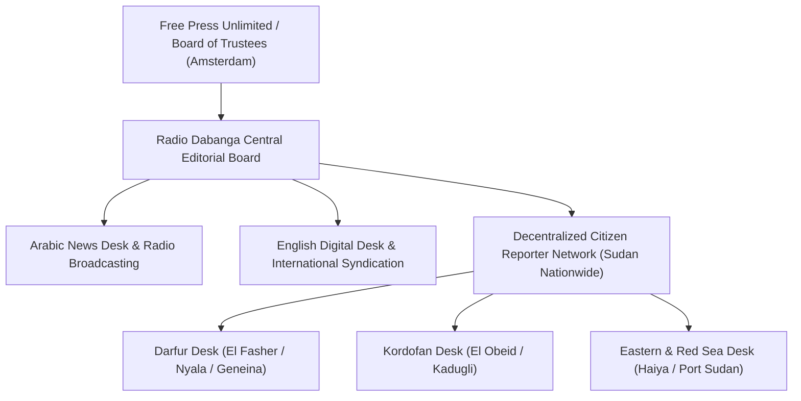

# Radio Dabanga

## 1. Identity, Classification & Leadership Anchor

> [!NOTE] Identity, Classification & Leadership Anchor
> **Radio Dabanga** is an independent, non-partisan Sudanese media organization and satellite radio broadcaster founded in 2008 in Amsterdam, Netherlands, in partnership with Dutch media NGO Free Press Unlimited. Operating under independent editorial stewardship and featuring veteran correspondents such as **[[Kamal]]**, Radio Dabanga serves as the primary grassroots vernacular news lifeline across Sudan, delivering daily bilingual (Arabic and English) news, field investigations, and humanitarian tracking.

## 2. Historical Lineage, Factions & Command Structure

Created during the height of the Darfur genocide to bypass the strict media censorship of Omar al-Bashir's regime, Radio Dabanga utilized shortwave radio transmissions to reach rural and displaced populations in IDP camps. Following the outbreak of the 2023 conflict, Radio Dabanga expanded its digital footprint, shortwave radio broadcasts, and satellite feeds to provide real-time coverage across areas suffering communications blackouts.

## 3. Strategic Objectives, Ideology & Political Economy ("Why")

Radio Dabanga's mission centers on independent public-interest journalism, human rights defense, and humanitarian documentation:
- **Civilian Protection & Voice**: Amplifying eyewitness accounts, citizen reports, and community warnings regarding frontline shelling, drone strikes, and famine conditions.
- **Bi-Belligerent Accountability**: Systematically documenting violations, war crimes, and looting committed by both the [[Sudanese Armed Forces]] (SAF) and the [[Rapid Support Forces]] (RSF), resisting narrative capture by state television or paramilitary propaganda.
- **Verification of Civilian Casualties**: Rigorously tracking civilian casualty statistics, hospital operational status, and food insecurity metrics.

## 4. Operational Capabilities, Alliances & Foreign Backing

- **Correspondent Network**: Maintains an extensive, encrypted network of citizen journalists, community organizers, doctors, and legal monitors across all 18 Sudanese states.
- **Transmission Resilience**: Operates via satellite television audio channels, daily shortwave radio broadcasts, and WhatsApp/Telegram distribution channels to pierce state and paramilitary telecoms shutdowns.
- **International Partnerships**: Cited extensively by the UN Security Council, UN Panel of Experts, and international media outlets as a verified primary source of record.

## 5. Chronological Event Footprint & Accountability Record

| Date | Investigative Dispatch / Coverage Milestone | Conflict Impact |
| :--- | :--- | :--- |
| **2024-05** | Documented first mass starvation deaths in Zamzam IDP Camp | International famine alerts |
| **2026-10-31** | Broken exclusive field details on Haiya oil pumping station drone strike | Documented Eastern infrastructure attacks |
| **2026-11-01** | Published comprehensive Arabic rendition of UNSG drone condemnation and FFM warnings | Elevated multilateral legal warnings across vernacular audiences |

## ## Related Primitives
- **Sources**: [[sources/2026-10-31-dabanga-haiya-oil-electricity-drone-attack]], [[sources/2026-11-01-dabanga-unsg-guterres-condemns-escalating-drone-attacks]]
- **Themes**: [[Energy Infrastructure Targeting in the Sudan War.md|Energy Infrastructure Targeting in the Sudan War]], [[Drone Proliferation and Double-Tap Strike Doctrine in Sudan]]
- **Events**: [[2026-10-31 Haiya Oil Pumping and Power Station Drone Strike]], [[2026-10-27 Nyala Tanqonj Market Drone Strike]]
- **Actors**: [[Kamal]], [[Sudanese Armed Forces]], [[Rapid Support Forces]], [[Independent International Fact-Finding Mission for the Sudan]]
- **Locations**: [[Haiya]], [[Nyala]], [[El Obeid]], [[El Fasher]]
