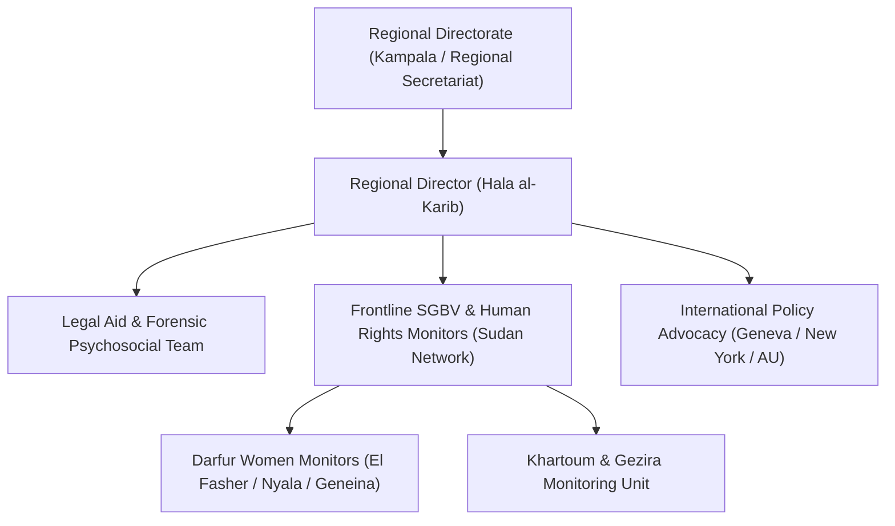

# SIHA Network

## 1. Identity, Classification & Leadership Anchor

> [!NOTE] Identity, Classification & Leadership Anchor
> The **Strategic Initiative for Women in the Horn of Africa (SIHA Network)** is a prominent regional coalition of grassroots civil society and women's rights organizations operating across eight countries in the Horn of Africa, with primary operational roots in Sudan. Led by Regional Director **[[Hala al-Karib]]**, SIHA is globally recognized as the leading frontline investigator and advocate documenting conflict-related sexual violence (CRSV), systemic rape, sexual slavery, and gendered displacement perpetrated during the Sudan war.

## 2. Historical Lineage, Factions & Command Structure

Founded in 1995 by a coalition of women's rights activists across the Horn of Africa, SIHA emerged to challenge the systemic subordination, state violence, and patriarchal legal frameworks victimizing women in conflict zones. In Sudan, SIHA played a courageous role opposing Omar al-Bashir's Public Order Laws and mobilized women during the 2018–2019 Sudanese Revolution. Following the 2023 conflict outbreak, SIHA established an emergency underground network providing emergency contraception, safe houses, and forensic documentation for survivors of sexual violence.

## 3. Strategic Objectives, Ideology & Political Economy ("Why")

SIHA's strategic and ideological commitments focus on feminist justice and holding perpetrators and their external sponsors accountable:
- **Eradication of Conflict-Related Sexual Violence**: Documenting the weaponization of rape and sexual slavery primarily by the [[Rapid Support Forces]] (RSF) and allied Janjaweed militias as a tool of terror and ethnic cleansing.
- **Exposure of External Impunity**: Publicly challenging foreign states—especially the [[United Arab Emirates]]—that supply weapons, drones, and financial backing to paramilitary perpetrators while whitewashing their complicity through humanitarian rhetoric.
- **Feminist Peacebuilding & Inclusive Transitional Justice**: Rejecting elite military-led pacts that trade civilian justice and women's safety for elite power-sharing deals.

## 4. Operational Capabilities, Alliances & Foreign Backing

- **Underground Survivor Networks**: Maintains deep trust with community mutual aid groups, Emergency Response Rooms (ERRs), and survivor collectives across Darfur, Kordofan, and Gezira, facilitating secure testimony gathering.
- **Multilateral Advocacy**: Routinely briefs the UN Security Council, UN Human Rights Council, African Commission on Human and Peoples' Rights (ACHPR), and international prosecutors at the [[International Criminal Court]].

## 5. Chronological Event Footprint & Accountability Record

| Date | Investigative Milestone / Campaign | Impact on Human Rights Record |
| :--- | :--- | :--- |
| **2023-08** | Published report: "Sudan: Sexual Violence as a Weapon of War" | Documented hundreds of gang rapes and abductions by RSF |
| **2024-04** | Launch of Pan-African Campaign on Sudan Women's Protection | Pressured African Union to prioritize civilian protection |
| **2026-10-28** | Mobilized international opposition to UAE UN Secretary-General candidacy | Regional Director Hala al-Karib issued landmark statement condemning UAE denial of El Fasher atrocities |

## ## Related Primitives
- **Sources**: [[sources/2026-10-30-the-guardian-sudanese-diaspora-uae-un-nominee-nusseibeh]]
- **Themes**: [[Ethnic Cleansing and Genocidal Patterns in Darfur]], [[Multilateral Capture and Accountability Politics in Sudan]], [[UAE Foreign Backing and Logistics Network for the Rapid Support Forces]]
- **Events**: [[2026-10-28 Global Civil Society Briefing Opposing Lana Nusseibeh Candidacy for UN Secretary-General]]
- **Actors**: [[Hala al-Karib]], [[Human Rights Watch]], [[United Arab Emirates]], [[Rapid Support Forces]], [[Mohamed Chande Othman]]
- **Locations**: [[El Fasher]], [[Nyala]], [[Geneva]]
