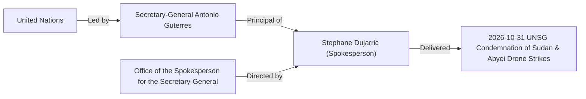

# Stéphane Dujarric

## 1. Identity, Classification & Leadership Anchor

> [!NOTE] Person Actor & Institutional Role Anchor
> - **Canonical Person**: [[Stéphane Dujarric]]
> - **Subtype**: `person`
> - **Institutional Role (`role_title`)**: Spokesperson for the United Nations Secretary-General
> - **Affiliated Organization (`affiliated_organization`)**: [[United Nations]] / [[Office of the Spokesperson for the Secretary-General]]
> - **Principal Served**: UN Secretary-General [[António Guterres]]
> - **Epistemic Reliability**: **`A1`** (`reliability_score: 0.95`)

**Stéphane Dujarric** is the Spokesperson for the [[United Nations]] Secretary-General [[António Guterres]] and head of the [[Office of the Spokesperson for the Secretary-General]] ([[sources/2026-10-31-unsg-spokesperson-escalating-drone-attacks-sudan]]). On **31 October 2026**, [[Stéphane Dujarric]] delivered a formal statement attributable to the Secretary-General strongly condemning the escalating drone attacks across Sudan and [[Abyei]] by the [[Sudanese Armed Forces]] and [[Rapid Support Forces]], declaring that strikes killing hundreds of civilians—including women and children—and hitting health facilities constitute violations of international humanitarian law ([[2026-10-31 Stéphane Dujarric UNSG Statement Condemning Escalating Drone Attacks in Sudan and Abyei]]).

---

## 2. Historical Lineage, Factions & Command Structure

As Chief Spokesperson at [[United Nations]] Headquarters, [[Stéphane Dujarric]] serves as the primary public conduit for executive statements by [[António Guterres]], consolidating field verification from [[OHCHR]] (led by [[Volker Türk]]) and [[UNISFA]] peacekeepers in [[Abyei]] into formal diplomatic warnings ([[sources/2026-10-31-unsg-spokesperson-escalating-drone-attacks-sudan]]).

---

## 3. Strategic Objectives, Ideology & Political Economy ("Why")

In his official communications on the Sudan conflict, [[Stéphane Dujarric]] articulates the [[United Nations]] Secretariat's legal and humanitarian priorities:
1. **Public Attribution of IHL Violations**: Establishing on the official UN record that escalating drone attacks across Sudan and [[Abyei]] killing hundreds of civilians, including women and children, violate international humanitarian law ([[2026-10-31 Stéphane Dujarric UNSG Statement Condemning Escalating Drone Attacks in Sudan and Abyei]]).
2. **Protection of Medical & Critical Infrastructure**: Highlighting the Secretary-General's outrage at aerial attacks directed against civilian infrastructure, specifically **health facilities** (such as the strike on Um Darfa Hospital in [[Blue Nile State]]) ([[2026-10 Sudan Drone Warfare Escalation]], [[Drone Proliferation and Double-Tap Strike Doctrine in Sudan]]).
3. **Advancing Cessation of Hostilities**: Relaying the Secretary-General's call for the conflict parties to agree without delay to a cessation of hostilities and engage in good-faith mediation ([[2026-10-31 António Guterres Appeal for Immediate Cessation of Hostilities and Good-Faith Mediation in Sudan]]).

---

## 4. Operational Capabilities, Alliances & Foreign Backing

[[Stéphane Dujarric]] directs the [[Office of the Spokesperson for the Secretary-General]], coordinating with [[UN News]], [[OHCHR]] spokesperson [[Seif Magango]], and [[UNISFA]] leadership (Brig. Gen. [[Adebowale Ajabge]]) to issue verified executive communiqués to the UN press corps and member states ([[sources/2026-10-31-unsg-spokesperson-escalating-drone-attacks-sudan]], [[sources/2026-10-23-un-news-sudan-drone-strikes-306-killed]]).

---

## 5. Chronological Event Footprint & Accountability Record

| Date ($t_{\text{valid}}$) | Standalone Citation / Event Node | Speech Act / Role | Key Forensic & Legal Substance | Source |
| :--- | :--- | :--- | :--- | :--- |
| `2026-10-31` | [[2026-10-31 Stéphane Dujarric UNSG Statement Condemning Escalating Drone Attacks in Sudan and Abyei]] | `war_crimes_warning` (`official_statement`) | Condemned escalating drone attacks across Sudan and [[Abyei]] killing hundreds of civilians (including women and children) and striking health facilities as violations of IHL. | [[sources/2026-10-31-unsg-spokesperson-escalating-drone-attacks-sudan]] |
| `2026-10-31` | [[2026-10-31 António Guterres Appeal for Immediate Cessation of Hostilities and Good-Faith Mediation in Sudan]] | Delivered on behalf of [[António Guterres]] (`ceasefire_call`) | Called on belligerents to spare civilians/infrastructure, agree without delay to a cessation of hostilities, and enter good-faith mediation. | [[sources/2026-10-31-unsg-spokesperson-escalating-drone-attacks-sudan]] |

---

## Related Primitives

- **Affiliated Organization & Principal**:
  - [[United Nations]] | [[Office of the Spokesperson for the Secretary-General]] | [[António Guterres]]
- **Standalone Citations**:
  - [[2026-10-31 Stéphane Dujarric UNSG Statement Condemning Escalating Drone Attacks in Sudan and Abyei]]
  - [[2026-10-31 António Guterres Appeal for Immediate Cessation of Hostilities and Good-Faith Mediation in Sudan]]
- **Events, Locations & Themes Referenced**:
  - [[2026-10 Sudan Drone Warfare Escalation]] | [[2026-10-19 Abyei Amiet Market and Todach Drone Strike]]
  - [[Abyei]] | [[West Kordofan]] | [[Blue Nile State]]
  - [[Drone Proliferation and Double-Tap Strike Doctrine in Sudan]]
- **Timelines & Sources**:
  - [[2026-10 Sudan Conflict Chronicle]] | [[Sudan Drone Warfare and Double-Tap Strike Timeline]]
  - [[sources/2026-10-31-unsg-spokesperson-escalating-drone-attacks-sudan]]
