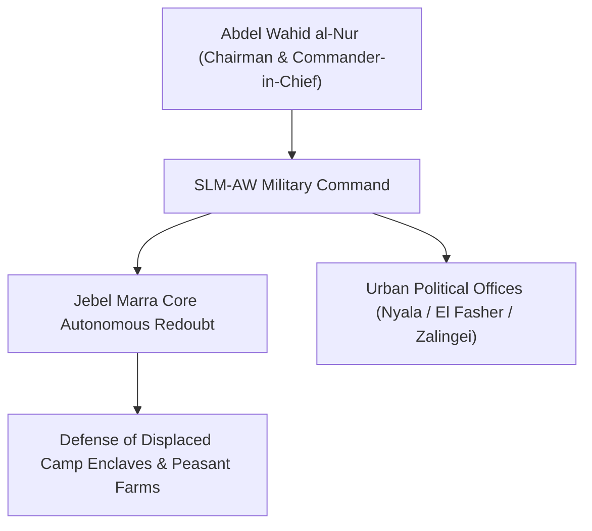

# Sudan Liberation Movement (al-Nur)

## 1. Identity, Classification & Leadership Anchor

> [!NOTE] Identity, Classification & Leadership Anchor
> The **Sudan Liberation Movement (al-Nur)** (SLM-AW / *حركة تحرير السودان - قيادة عبد الواحد محمد نور*) is a historic Darfuri armed political movement founded in the early 2000s and led by **Abdel Wahid al-Nur**. Maintaining entrenched territorial bastions across the mountainous [[Jebel Marra]] massif, SLM-AW has historically refused to sign piecemeal peace accords (such as the 2006 Abuja Agreement or the 2020 Juba Agreement) until comprehensive civilian security and refugee return are achieved.

## 2. Historical Lineage, Factions & Command Structure

During the 2023–2026 conflict, SLM-AW declared neutrality between the SAF and RSF while defending civilian populations and IDP camps across Jebel Marra. It absorbed tens of thousands of displaced persons seeking sanctuary from RSF ethnically targeted violence.

## 3. Strategic Objectives, Ideology & Political Economy ("Why")

- **Autonomous Civilian Defense**: Shielding indigenous Fur, Massalit, and Daju populations from genocidal militia violence.
- **Secular, Democratic Sudan**: Advocating for structural restructuring of Sudanese state power and complete disarmament of tribal militias.
- **Humanitarian Corridor Protection**: Securing food relief routes into the besieged Jebel Marra highlands.

## 4. Operational Capabilities, Alliances & Foreign Backing

- Highly disciplined light infantry forces familiar with mountainous terrain; widespread popular legitimacy among Darfuri IDP camp communities.

## 5. Chronological Event Footprint & Accountability Record

| Date | Key Event / Statement | Context |
| :--- | :--- | :--- |
| **2026-10-27** | Announced the death of 5 relatives of a movement member in the Nyala market drone strike | Publicly documented civilian casualties from SAF double-tap drone bombing |

## Related Primitives

- **Leader**: Abdel Wahid al-Nur
- **Key Bastion**: Jebel Marra
- **Incidents**: [[2026-10-27 Nyala Tanqonj Market Drone Strike]]
