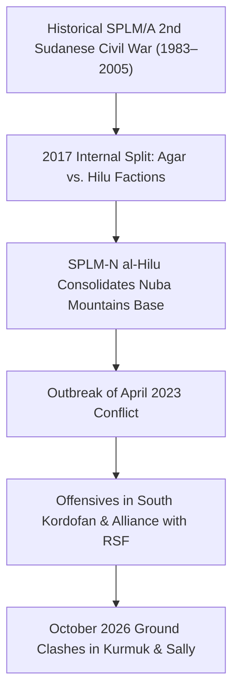

# Sudan People's Liberation Movement-North (al-Hilu)

## 1. Identity, Classification & Leadership Anchor

> [!NOTE] Armed Group & Southern Frontier Belligerent Anchor
> The **Sudan People's Liberation Movement-North (al-Hilu faction)** (SPLM-N al-Hilu) is a major armed political movement operating primarily across the Nuba Mountains of South Kordofan and the southern frontier of [[Blue Nile State]]. Commanded by veteran rebel leader **Abdelaziz al-Hilu**, the movement maintains the well-drilled Sudan People's Liberation Army-North (SPLA-North) and has historically championed a secular, decentralized Sudanese state and the self-determination rights of marginalized ethnic communities. In the evolving geopolitics of the war, SPLM-N al-Hilu formed an operational alliance with the [[Rapid Support Forces]] (RSF), escalating ground offensives around [[Kurmuk]] and Sally in October 2026.

## 2. Historical Lineage, Factions & Command Structure

Following the 2011 secession of South Sudan, SPLM-N forces in South Kordofan and Blue Nile continued their armed struggle against the Khartoum government. A bitter internal schism in 2017 divided the movement into a faction led by Malik Agar (who signed the 2020 Juba Peace Agreement and joined the Sovereignty Council) and the majority military faction led by Abdelaziz al-Hilu, which entrenched itself in Kauda. Following the outbreak of the April 2023 war, al-Hilu’s forces launched coordinated attacks on SAF garrisons in Kadugli, Dilling, and Blue Nile.

## 3. Strategic Objectives, Ideology & Political Economy ("Why")

- **Secularism and Self-Determination**: Insisting that Sudan must become a secular democratic federation with separation of religion and state, or grant self-determination to South Kordofan and Blue Nile.
- **Attrition of SAF Power Bases**: Coordinating with the RSF to pin down SAF regional divisions across southern corridors, preventing army redeployments to Khartoum and Kordofan.
- **Control of Cross-Border Trade & Mining Assets**: Securing vital border crossings with South Sudan and Ethiopia to facilitate commercial trade, fuel procurement, and weapon maintenance.

## 4. Operational Capabilities, Alliances & Foreign Backing

- **Disciplined Conventional Guerrilla Infantry**: Possesses well-trained light infantry, heavy mortars, and captured armored vehicles, leveraging rugged mountainous terrain in the Nuba mountains and Blue Nile foothills.
- **Tactical Alliance with the RSF**: Documented in UN report `A/HRC/65/CRP.1` as coordinating ground actions to split SAF attention across multiple theatres.
- **Humanitarian Access Leverage**: Controls significant liberated territories where humanitarian access requires direct negotiation through the movement's South Kordofan Relief and Rehabilitation Agency (SRRA).

## 5. Chronological Event Footprint & Accountability Record

- **2023-06-21**: Launches major offensive encircling the SAF 14th Division garrison in Kadugli, South Kordofan.
- **2024-03-15**: Deepens operational coordination with the RSF across the Kordofan and Blue Nile borderlines.
- **2026-10-19**: Engages SAF forces in intense ground clashes near [[Kurmuk]] along the Ethiopian border.
- **2026-10-20**: Conducts secondary ground assaults against SAF positions in Sally, Blue Nile State, leading to damage at Kurmuk Hospital (`A/HRC/65/CRP.1`, Para 36).

## Related Primitives

- **Sources**: [[sources/2026-10-28-un-hrc-crp1-el-obeid-civilian-devastation]]
- **Actors**: [[Sudanese Armed Forces]], [[Rapid Support Forces]], [[Transitional Sovereignty Council]]
- **Locations**: [[Blue Nile State]], [[Kurmuk]], [[El Obeid]]
- **Themes**: [[Regional Proxy Warfare and Transnational Drone Supply Networks in Sudan]], [[Multilateral Mediation and Peace Coordination Mechanisms in Sudan]]
- **Timelines**: [[2026-10 Sudan Conflict Chronicle]]
