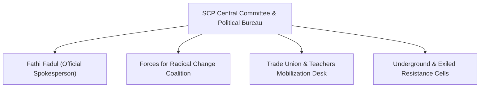

# Sudanese Communist Party

## 1. Identity, Classification & Leadership Anchor

> [!NOTE] Identity, Classification & Leadership Anchor
> The **Sudanese Communist Party** (SCP / `الحزب الشيوعي السوداني`) is one of the oldest and historically most influential leftist political parties in the Arab and African worlds, founded in 1946. Guided by Marxist-Leninist principles and grounded in Sudan’s militant trade union movement (particularly the railway workers of Atbara), the SCP champions radical socio-economic transformation, complete civilian democratic rule, and the dismantling of the military-commercial complex.

## 2. Historical Lineage, Factions & Command Structure

The SCP played leading roles in the 1964, 1985, and 2018–2019 popular uprisings. Following the 2021 military coup and the April 2023 war, the SCP refused to align with either the SAF or the RSF, categorizing the conflict as a reactionary "war of the generals" designed to abort the revolutionary goals of the December 2018 Revolution.

## 3. Strategic Objectives, Ideology & Political Economy ("Why")

- **"No to War" & Popular Mobilization**: Rejecting both belligerents and calling for a unified, grassroots-led civilian general strike and popular front to stop the war.
- **Exposure of Foreign Proxy Interests**: Denouncing external regional interventions—particularly UAE funding for the RSF and Arab/Islamist patronage for the SAF—as imperialist predation over Sudanese gold, agricultural land, and ports.
- **Accountability for War Crimes**: Demanding international criminal prosecution for all commanders responsible for ethnic massacres, drone strikes on civilian infrastructure, and the starvation of over 25 million citizens.

## 4. Operational Capabilities, Alliances & Foreign Backing

- **Clandestine Political Network & Trade Union Influence**: Maintains resilient underground party cells across key industrial, railway, and agricultural centers despite severe security repression.
- **Coalition Leadership**: Heads the Forces for Radical Change alliance, maintaining fraternal ties with international socialist, communist, and anti-war organizations across Africa and the Arab region.

## 5. Chronological Event Footprint & Accountability Record

| Date | Key Political Action | Context |
| :--- | :--- | :--- |
| **2026-11-01** | Issued high-level warning on the dangerous escalation of drone warfare | Documented over 400 civilian fatalities from drone attacks on infrastructure and condemned UAE/Islamist proxy dynamics |

## Related Primitives

- **Spokesperson**: [[Fathi Fadul]]
- **Opponents**: [[Sudanese Armed Forces]], [[Rapid Support Forces]], [[United Arab Emirates]]
- **Themes**: [[Regional Proxy Warfare and Transnational Drone Supply Networks in Sudan]], [[Drone Proliferation and Double-Tap Strike Doctrine in Sudan]]
- **Citations**: [[2026-11-01 Fathi Fadul Communist Party Warning on Drone Warfare]]
