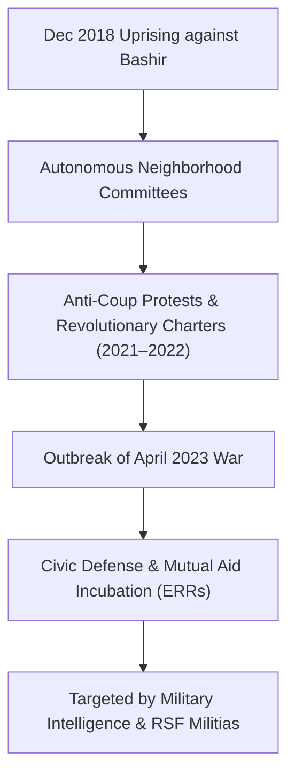

# Sudanese Resistance Committees

## 1. Identity, Classification & Leadership Anchor

> [!NOTE] Civil Society & Pro-Democracy Grassroots Anchor
> The **Sudanese Resistance Committees** (RCs) are a nationwide, decentralized network of autonomous neighborhood-based activist committees that spearheaded the December 2018 Revolution culminating in the overthrow of dictator Omar al-Bashir in April 2019. Maintaining strict commitment to non-violent civic resistance, the Resistance Committees formed the core vanguard against the October 2021 military coup and, following the outbreak of civil war in 2023, transitioned their organizational capacity into humanitarian mutual-aid frameworks, including the [[Emergency Response Rooms]].

## 2. Historical Lineage, Factions & Command Structure

The Resistance Committees operate through hyper-local general assemblies in cities and towns across Sudan, including [[Khartoum State]], [[El Obeid]], [[Atbara]], and [[Port Sudan]]. Their organizational structure avoids individual charismatic leaders, relying instead on rotating spokespersons and collective coordination charters (such as the Revolutionary Charter for Establishing People’s Power).

## 3. Strategic Objectives, Ideology & Political Economy ("Why")

The political doctrine of the Resistance Committees is defined by the slogan "Freedom, Peace, and Justice" and total opposition to military governance:
- **No Legitimacy, No Negotiation, No Partnership**: Rejecting power-sharing compromises that legitimize military juntas or paramilitary warlords.
- **Protection of Democratic Civic Space**: Opposing martial law, arbitrary detentions, forced conscription, and digital surveillance imposed by warring factions.
- **Socio-Economic Solidarity**: Preserving community cohesion, civil registries, and local public utility access during systemic state collapse.

## 4. Operational Capabilities, Alliances & Foreign Backing

- **Horizontal Mobilization**: Unmatched grassroots capacity to mobilize neighborhood populations, disseminate vital conflict security warnings, and organize relief supply chains.
- **Media and Documentation**: Operating verified social media channels, local monitoring portals, and underground communication networks to document human rights violations.
- **Severe State Repression**: Subject to lethal crackdowns, pervasive arbitrary detention by SAF Military Intelligence (GI/Mukhabarat), and torture and extrajudicial killings by RSF forces.

## 5. Chronological Event Footprint & Accountability Record

- **2018-12-19**: Resistance Committees launch street protests in Atbara and Khartoum initiating the Sudanese revolution.
- **2021-10-25**: Mobilize millions of Sudanese citizens in general strikes and mass marches opposing the Burhan-Hemedti military coup.
- **2023-04-20**: Committees establish the foundational structure of the [[Emergency Response Rooms]] to rescue stranded urban civilians.
- **2026-10-28**: UN Fact-Finding Mission report identifies widespread military intelligence crackdowns specifically targeting Resistance Committee activists in [[El Obeid]] and [[Port Sudan]].

## Related Primitives

- **Events**:
  - [[2026-10 El Obeid Siege and Drone Warfare Escalation]]
- **Actors**:
  - [[Emergency Response Rooms]]
  - [[SIHA Network]]
  - [[Independent International Fact-Finding Mission for the Sudan]]
- **Locations**:
  - [[El Obeid]]
  - [[Port Sudan]]
  - [[Atbara]]
- **Themes**:
  - [[State Surveillance and Civic Space Contraction in Sudan]]
  - [[International Accountability and Fact-Finding Mechanisms in Sudan]]
