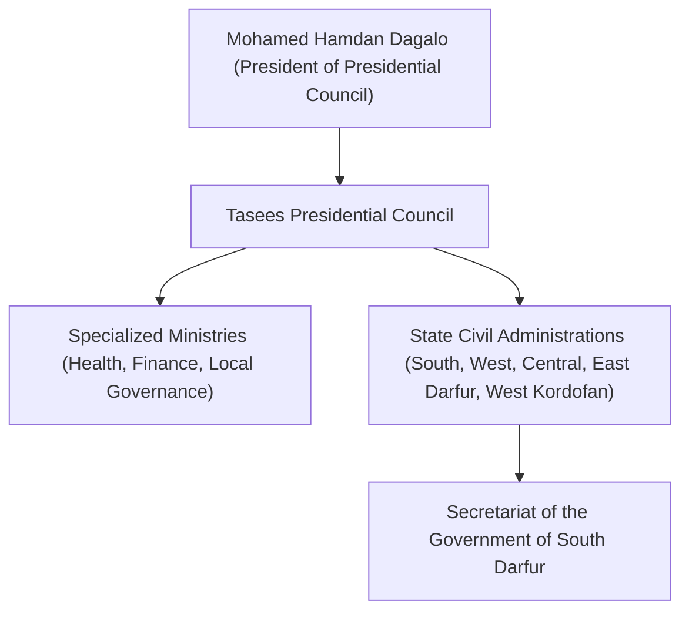

# Tasees

## 1. Identity, Classification & Leadership Anchor

> [!NOTE] Identity, Classification & Leadership Anchor
> **Tasees** (`تأسيس` / *Foundation / Founding Administration*) is the de facto civilian and administrative governance framework established by the [[Rapid Support Forces]] (RSF) across territories under paramilitary control in Darfur and Kordofan. Chaired by RSF Commander [[Mohamed Hamdan Dagalo]] ("Hemedti") as President of the Presidential Council, Tasees operates administrative secretariats, civil ministries, and local councils centered in [[Nyala]] (`SD03001`), South Darfur.

## 2. Historical Lineage, Factions & Command Structure

Established in 2024 to formalize governance across RSF-captured territories and counter the Port Sudan-based Transitional Sovereignty Council, Tasees created civil administrative bodies and founding councils. However, on 31 October 2026, Hemedti issued Presidential Decree No. (19) dissolving the 2024 Civil Administrations Document to re-centralize control into transitional secretariats.

## 3. Strategic Objectives, Ideology & Political Economy ("Why")

- **Statehood Mimicry & Legitimacy**: Projecting civilian institutional competence to international interlocutors and donors.
- **Taxation & War Economy Management**: Collecting local levies, customs on cross-border commercial trade with Chad and the CAR, and regulating commercial markets.
- **Counter-State Framing**: Challenging the sole sovereign legitimacy claimed by the SAF-led government in Port Sudan.

## 4. Operational Capabilities, Alliances & Foreign Backing

- **Administrative Reach**: Controls state secretariats and municipal offices in Nyala, El Geneina, Zalingei, and Ed Daein.
- **Telemetry & Casualty Reporting**: Operates regional health secretariats compiling casualty data from local hospitals and rural clinics, though estimates are frequently viewed with skepticism for potential political inflation.

## 5. Chronological Event Footprint & Accountability Record

| Date | Key Event / Statement | Context |
| :--- | :--- | :--- |
| **2026-10-27** | Health Ministry reported 188 deaths and 356 injuries following the Nyala market drone strike | High-end casualty estimate for the Tanqonj market double-tap attack |
| **2026-10-31** | Dissolution of Civil Administrations by Presidential Decree No. (19) of 2026 | Structural restructuring of Tasees state administrations |

## Related Primitives

- **Military Wing**: [[Rapid Support Forces]]
- **Leadership**: [[Mohamed Hamdan Dagalo]]
- **Seat of Administration**: [[Nyala]], [[South Darfur]]
- **Key Incidents**: [[2026-10-27 Nyala Tanqonj Market Drone Strike]]
