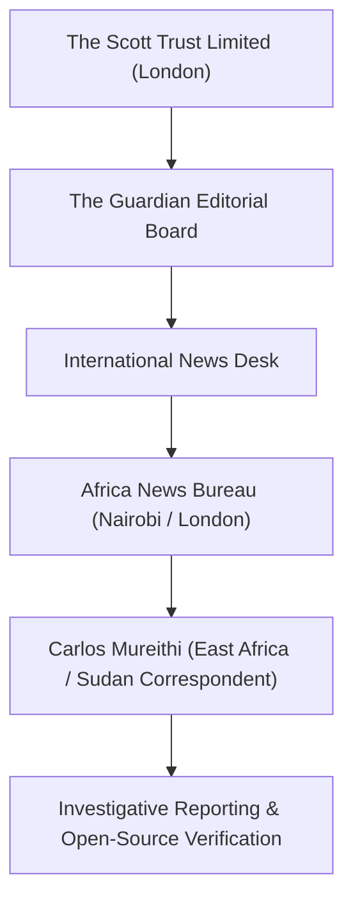

# The Guardian

## 1. Identity, Classification & Leadership Anchor

> [!NOTE] Identity, Classification & Leadership Anchor
> **The Guardian** is a British daily newspaper and global digital news publisher owned by the Scott Trust Limited, edited by Katharine Viner. Known for investigative reporting on international human rights, corporate accountability, and geopolitics, its Africa desk—featuring investigative correspondents such as **[[Carlos Mureithi]]**—regularly produces deep investigative features exposing proxy dynamics, weapons transfers, and diplomatic lobbying surrounding the war in Sudan.

## 2. Historical Lineage, Factions & Command Structure

Founded in 1821 in Manchester, The Guardian operates under a unique trust structure designed to safeguard its editorial independence from commercial or political interference. The paper's Sudan conflict coverage focuses on structural geopolitical accountability, regional proxy networks in the Horn of Africa, and the intersection between Western multilateral diplomacy and Gulf state financial influence.

## 3. Strategic Objectives, Ideology & Political Economy ("Why")

The Guardian's investigative editorial stance in the Sudan conflict focuses on:
- **Exposing External War Financiers**: Tracking the illicit supply of arms, ammunition, and dual-use drone technology from Gulf regional powers, particularly the [[United Arab Emirates]], to the [[Rapid Support Forces]].
- **Scrutinizing Multilateral Institutions**: Holding UN appointment mechanisms and diplomatic nominations accountable to conflict-of-interest standards and international human rights principles.
- **Centering Sudanese Voices and Victims**: Elevating Sudanese diaspora civil society, feminist networks, and local monitoring bodies over elite diplomatic rhetoric.

## 4. Operational Capabilities, Alliances & Foreign Backing

- **Investigative Depth**: Collaborates frequently with international watchdogs such as [[Human Rights Watch]], Amnesty International, and open-source investigative consortiums.
- **Global Reach & Influence**: Its investigations are widely circulated within diplomatic circles at the UN Security Council, European foreign ministries, and the UK Parliament, shaping policy debates and questions in legislative assemblies.

## 5. Chronological Event Footprint & Accountability Record

| Date | Investigative Milestone | Policy & Narrative Impact |
| :--- | :--- | :--- |
| **2023-09** | Investigation into UAE weapons cargo flights landing in Amdjarass, Chad | First major mainstream Western investigation of Emirati proxy logistics |
| **2024-06** | Exposé on UK government diplomatic lobbying shielding UAE over Sudan | Triggered parliamentary inquiries in Westminster |
| **2026-10-30** | Exclusive report by Carlos Mureithi on Sudanese diaspora campaign against Lana Nusseibeh | Globalized scrutiny of UAE’s multilateral influence campaign |

## ## Related Primitives
- **Sources**: [[sources/2026-10-30-the-guardian-sudanese-diaspora-uae-un-nominee-nusseibeh]]
- **Themes**: [[Multilateral Capture and Accountability Politics in Sudan]], [[UAE Foreign Backing and Logistics Network for the Rapid Support Forces]]
- **Events**: [[2026-10-28 Global Civil Society Briefing Opposing Lana Nusseibeh Candidacy for UN Secretary-General]]
- **Actors**: [[Carlos Mureithi]], [[Lana Nusseibeh]], [[United Arab Emirates]], [[Human Rights Watch]], [[SIHA Network]]
- **Locations**: [[Geneva]]
