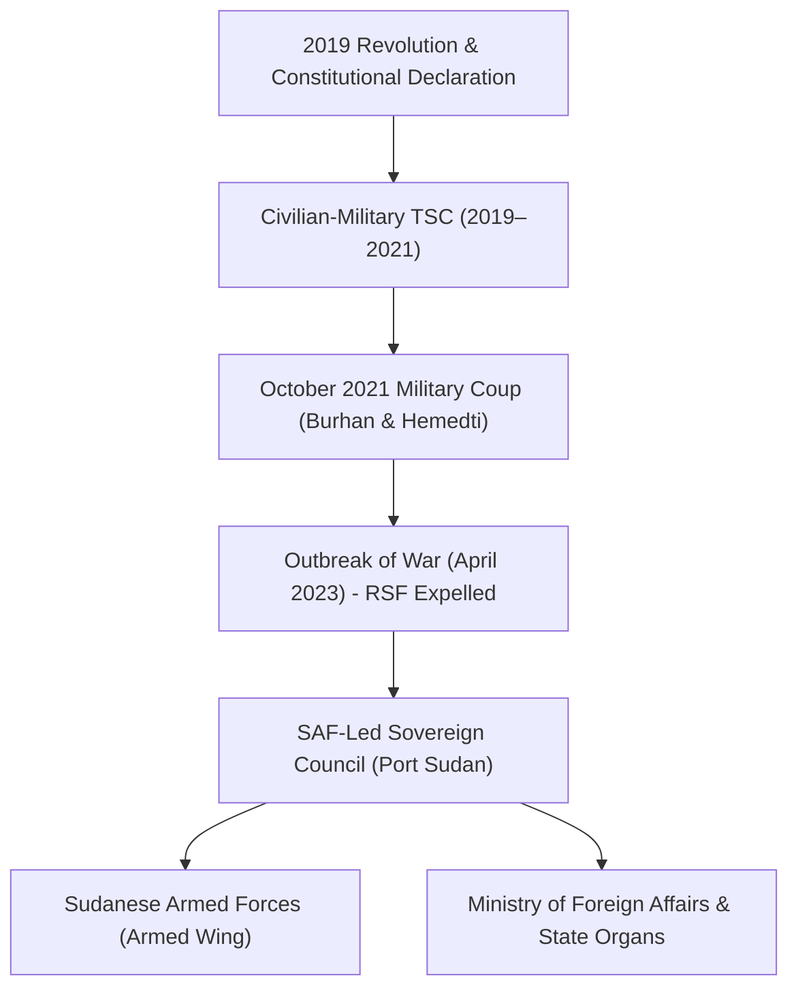

# Transitional Sovereignty Council

## 1. Identity, Classification & Leadership Anchor

> [!NOTE] State Executive Body & De Facto Government Anchor
> The **Transitional Sovereignty Council** (TSC) is the de facto executive governing council of the Republic of the Sudan, chaired by General Abdel Fattah al-Burhan, Commander-in-Chief of the [[Sudanese Armed Forces]] (SAF). Established initially in August 2019 under the Constitutional Declaration following the overthrow of Omar al-Bashir, the TSC was reconstituted after the October 2021 military coup and operates primarily out of the administrative wartime capital in [[Port Sudan]] following the outbreak of conflict in April 2023.

## 2. Historical Lineage, Factions & Command Structure

Prior to April 2023, the Council included Mohamed Hamdan Dagalo (Hemedti) as Vice-Chairman. Following the outbreak of armed clashes, Burhan officially dismissed Dagalo and restructured the Council with military loyalists and peace agreement signatories, such as Malik Agar (SPLM-N Agar) as Deputy Chairman.

## 3. Strategic Objectives, Ideology & Political Economy ("Why")

The TSC's core political doctrine revolves around state survival, international legitimacy, and national sovereignty:
- **Preservation of Institutional Continuity**: Defending the status of SAF and its administrative apparatus as the sole legitimate representatives of the Sudanese state at the [[United Nations]] and regional forums.
- **Defeat of the RSF Insurgency**: Framing the RSF as an outlaw rebel militia and proxy mercenary force, refusing peace talks that equate state forces with non-state combatants.
- **Wartime Resource Mobilization**: Managing vital economic infrastructure in eastern Sudan, including [[Red Sea State]] oil export corridors, ports, and critical electricity grids.

## 4. Operational Capabilities, Alliances & Foreign Backing

- **Diplomatic Representation**: Holds Sudan's seat in the UN General Assembly and international bodies through the [[Ministry of Foreign Affairs (Sudan)]].
- **State Alliances**: Maintains bilateral defense and logistical ties with regional partners including Egypt, Turkey, Saudi Arabia, Iran, and Russia.
- **Administrative Control**: Exercises civil and administrative governance over territories under SAF control, including Red Sea, River Nile, Northern, Kassala, and Gedaref states.

## 5. Chronological Event Footprint & Accountability Record

- **2021-10-25**: TSC Chairman Abdel Fattah al-Burhan dissolves the civilian cabinet in a military coup.
- **2023-05-19**: TSC officially strips Mohamed Hamdan Dagalo of his title as Deputy Chairman of the Sovereignty Council.
- **2023-08-27**: Burhan relocates government headquarters from the besieged General Command in Khartoum to [[Port Sudan]].
- **2026-10-31**: Following the strategic drone strikes against the Haiya pumping station, TSC and military officials accuse foreign actors and Ethiopian airspace of facilitating RSF long-range attacks.

## Related Primitives

- **Events**:
  - [[2026-10-31 Haiya Oil Pumping and Power Station Drone Strike]]
  - [[2026-10-21 Geneva Consultative Meeting on Peace Initiatives in Sudan]]
- **Actors**:
  - [[Sudanese Armed Forces]]
  - [[Ministry of Foreign Affairs (Sudan)]]
  - [[Rapid Support Forces]]
  - [[Muawiya Osman]]
- **Locations**:
  - [[Port Sudan]]
  - [[Haiya]]
  - [[Red Sea State]]
- **Themes**:
  - [[Energy Infrastructure Targeting in the Sudan War]]
  - [[Multilateral Mediation and Peace Coordination Mechanisms in Sudan]]
