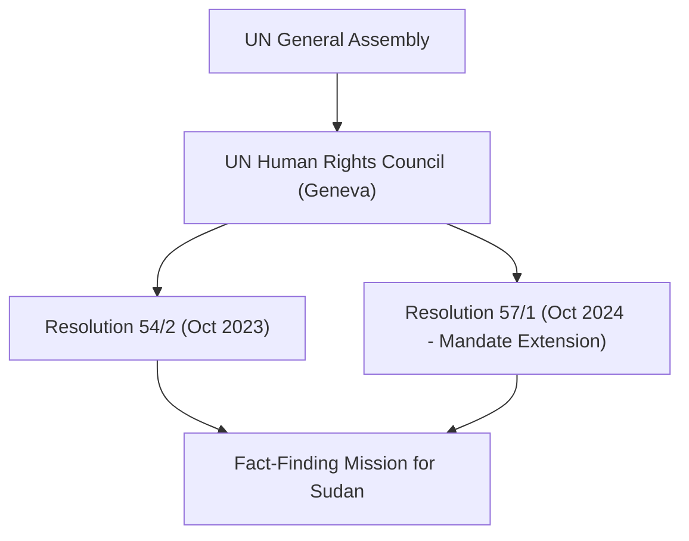

# UN Human Rights Council

## 1. Identity, Classification & Leadership Anchor

> [!NOTE] Identity, Classification & Leadership Anchor
> The **UN Human Rights Council (UNHRC)** is an intergovernmental body within the [[United Nations]] system made up of 47 Member States responsible for strengthening the promotion and protection of human rights globally. Headquartered in [[Geneva]], Switzerland, the Council serves as the authorizing and oversight mechanism for independent multilateral fact-finding missions, special rapporteurs, and investigative commissions addressing systematic atrocities in Sudan.

## 2. Historical Lineage, Factions & Command Structure

Established by UN General Assembly Resolution 60/251 in 2006, the Council operates through regular cycles and special sessions. In response to the outbreak of major hostilities in Sudan in April 2023, the Council held a Special Session on 11 May 2023, subsequently adopting Resolution 54/2 in October 2023 to establish the [[Independent International Fact-Finding Mission for the Sudan]] (FFM). Despite intense lobbying by the SAF-aligned military delegation in Port Sudan and allied regional blocs, the Council renewed the Mission's mandate under Resolution 57/1 in October 2024.

## 3. Strategic Objectives, Ideology & Political Economy ("Why")

The Council's institutional doctrine centers on universal human rights, multilateral accountability, and documenting international humanitarian law (IHL) violations:
- **Mandate Enforcement**: Monitoring grave violations, sexual and gender-based violence (SGBV), ethnic cleansing, and extrajudicial executions.
- **Evidence Archival**: Authorizing evidentiary repositories to support future universal jurisdiction prosecutions and proceedings before the [[International Criminal Court]].
- **Multilateral Legitimacy**: Countering attempts by warring factions to utilize bilateral diplomacy to evade accountability for war crimes and crimes against humanity.

## 4. Operational Capabilities, Alliances & Foreign Backing

- **Normative Powers**: The Council lacks direct enforcement or military authority, relying on diplomatic leverage, public reporting, and evidentiary referral to the UN Security Council and the International Criminal Court.
- **Coalition Politics**: Mandates on Sudan are typically championed by European Union member states, the United Kingdom, and the United States, frequently facing procedural opposition from the Arab Group, African Group coalitions prioritizing "national sovereignty," and the Sudanese government delegation.

## 5. Chronological Event Footprint & Accountability Record

| Session / Date | Multilateral Action | Impact on Sudan Conflict |
| :--- | :--- | :--- |
| **2023-10-11** | Adoption of Resolution 54/2 | Created the Independent International Fact-Finding Mission for Sudan. |
| **2024-10-09** | Adoption of Resolution 57/1 | Extended FFM mandate by one year despite Sudanese government protests. |
| **2026-02-19** | Receipt of El Fasher Special Finding | Grounded international documentation of genocidal markers in North Darfur. |
| **2026-10-28** | UNGA Third Committee Briefing | Coordinated with General Assembly on escalating drone warfare and detention camps. |

## ## Related Primitives
- **Sources**: [[sources/2026-10-28-ohchr-independent-international-fact-finding-mission-sudan-portal]], [[sources/2026-10-21-un-news-geneva-peace-efforts-drone-war]]
- **Themes**: [[International Accountability and Fact-Finding Mechanisms in Sudan]], [[Multilateral Capture and Accountability Politics in Sudan]]
- **Actors**: [[Independent International Fact-Finding Mission for the Sudan]], [[Mohamed Chande Othman]], [[Sudanese Armed Forces]], [[Rapid Support Forces]]
- **Locations**: [[Geneva]]
