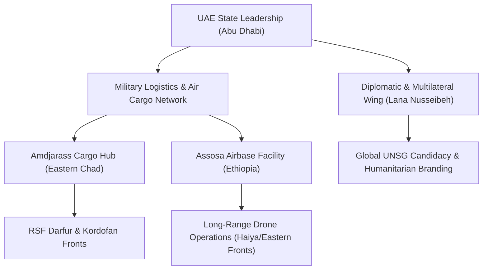

# United Arab Emirates

## 1. Identity, Classification & Leadership Anchor

> [!NOTE] State Actor & External Sponsor Anchor
> The **United Arab Emirates (UAE)** is a federation of seven emirates in the Arabian Peninsula governed by President Sheikh Mohamed bin Zayed Al Nahyan (MBZ). In the geopolitical architecture of the Sudan conflict, the UAE serves as the primary external patron, financial financier, and military logistics conduit for the paramilitary [[Rapid Support Forces]] (RSF) led by Mohamed Hamdan Dagalo (Hemedti).

## 2. Historical Lineage, Factions & Command Structure

The UAE's entanglement in Sudanese affairs deepened during the 2015 Saudi-led intervention in Yemen, where the RSF provided thousands of mercenary infantry troops to Emirati and Saudi ground coalitions. In exchange, the UAE facilitated the commercial gold export pipeline from RSF-controlled mines in Darfur (Jebel Amer) through Dubai, establishing the economic foundation for the RSF's autonomous military machine.

## 3. Strategic Objectives, Ideology & Political Economy ("Why")

Emirati strategic doctrine in Sudan is driven by three core objectives:
1. **Red Sea Maritime & Port Hegemony**: Securing deep-water commercial and naval ports along the 850 km Sudanese Red Sea coastline (e.g., the Abu Amama port development concession).
2. **Anti-Islamist & Political Control**: Neutralizing the political influence of the Sudanese Islamic Movement and the former National Congress Party (NCP) networks embedded within the SAF officer corps.
3. **Agro-Mineral Extraction**: Controlling agricultural arable land along the Nile basin and securing raw unrefined gold flows to Dubai's precious metals markets.

## 4. Operational Capabilities, Alliances & Foreign Backing

Extensive investigative reporting by the UN Security Council Panel of Experts, international media, and human rights organizations documents a sophisticated Emirati logistics corridor:
- **Aviation Corridors**: Illicit weapons and medical supply flights routed via Abu Dhabi through Uganda and Kenya to Amdjarass Airfield in Eastern Chad, masked as humanitarian relief.
- **Drone Supply Networks**: Supplying advanced loitering munitions, quadcopters, and fixed-wing UAVs, with operational launching and staging suspected from facilities such as [[Assosa]] in Western Ethiopia.
- **Diplomatic Shielding**: Deploying prominent diplomats like [[Lana Nusseibeh]] to champion humanitarian aid initiatives while denying direct military intervention.

## 5. Chronological Event Footprint & Accountability Record

| Period / Date | Documented Footprint / Escalation | Operational Arena |
| :--- | :--- | :--- |
| **2023-06** | Establishment of Amdjarass humanitarian-military logistics hub | Chad / North Darfur |
| **2024-01** | UN Panel of Experts report verifies UAE-origin weaponry in RSF possession | UN Security Council |
| **2026-10-28** | Global civil society and diaspora mobilize to block UAE candidacy for UNSG | New York / Geneva |
| **2026-10-31** | Sudan MFA formally alleges UAE-backed drone launch from Ethiopian territory | [[Haiya]], [[Red Sea State]] |

## Related Primitives
- **Sources**: [[sources/2026-10-30-the-guardian-sudanese-diaspora-uae-un-nominee-nusseibeh]], [[sources/2026-10-31-dabanga-haiya-oil-electricity-drone-attack]]
- **Themes**: [[UAE Foreign Backing and Logistics Network for the Rapid Support Forces]], [[Regional Proxy Warfare and Transnational Drone Supply Networks in Sudan]], [[Multilateral Capture and Accountability Politics in Sudan]]
- **Events**: [[2026-10-31 Haiya Oil Pumping and Power Station Drone Strike]], [[2026-10-28 Global Civil Society Briefing Opposing Lana Nusseibeh Candidacy for UN Secretary-General]]
- **Actors**: [[Rapid Support Forces]], [[Sudanese Armed Forces]], [[Lana Nusseibeh]], [[Government of Ethiopia]], [[Ministry of Foreign Affairs (Sudan)]]
- **Locations**: [[Haiya]], [[Assosa]], [[Red Sea State]]
