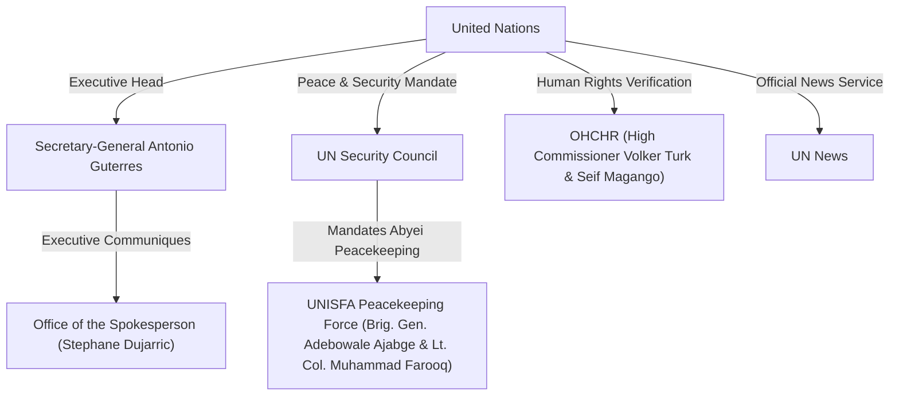

# United Nations

## 1. Identity, Classification & Leadership Anchor

> [!NOTE] Actor Identity & Institutional Mandate Anchor
> - **Canonical Actor**: [[United Nations]] (`UN`)
> - **Subtype**: `political_body` (`acled_actor_type: External/Other Forces`)
> - **Secretary-General**: [[António Guterres]]
> - **Spokesperson for the Secretary-General**: [[Stéphane Dujarric]] ([[Office of the Spokesperson for the Secretary-General]])
> - **Subordinate Organs & Missions Active in Sudan**: [[OHCHR]] (led by [[Volker Türk]]), [[UNISFA]] (led by Acting Force Commander Brig. Gen. [[Adebowale Ajabge]]), and [[UN News]]
> - **Epistemic Reliability**: **`A1`** (`reliability_score: 0.95`)

The **United Nations** (`UN`) is the primary intergovernmental organization conducting human rights verification, peacekeeping operations, humanitarian coordination, and diplomatic mediation in the Sudan conflict ([[sources/2026-10-23-un-news-sudan-drone-strikes-306-killed]], [[sources/2026-10-31-unsg-spokesperson-escalating-drone-attacks-sudan]]). Led by Secretary-General [[António Guterres]], the [[United Nations]] operates across Sudan and the disputed [[Abyei]] area (`SD18001`) through specialized human rights monitors ([[OHCHR]]), deployed peacekeeping forces ([[UNISFA]]), and executive diplomatic channels.

---

## 2. Historical Lineage, Factions & Command Structure

Within the Sudan theatre, the [[United Nations]] integrates three complementary operational pillars:
1. **Executive & Diplomatic Leadership**: Secretary-General [[António Guterres]] and Spokesperson [[Stéphane Dujarric]] ([[Office of the Spokesperson for the Secretary-General]]) issue executive condemnations, international humanitarian law (IHL) determinations, and ceasefire appeals ([[sources/2026-10-31-unsg-spokesperson-escalating-drone-attacks-sudan]]).
2. **Human Rights Monitoring ([[OHCHR]])**: High Commissioner [[Volker Türk]] and spokesperson [[Seif Magango]] verify civilian casualty counts, IDP shelter attacks, and arms transfer impacts across [[West Kordofan]], [[Blue Nile State]], and [[Abyei]] ([[sources/2026-10-23-un-news-sudan-drone-strikes-306-killed]]).
3. **Peacekeeping & Emergency Response ([[UNISFA]])**: Mandated by the UN Security Council to maintain the demilitarized status of [[Abyei]], [[UNISFA]] troops under Brig. Gen. [[Adebowale Ajabge]] and Pakistani Battalion Commander Lt. Col. [[Muhammad Farooq]] provide direct emergency firefighting and medical evacuation to the Todach field hospital ([[2026-10-19 Abyei Amiet Market and Todach Drone Strike]]).

---

## 3. Strategic Objectives, Ideology & Political Economy ("Why")

The strategic doctrine of the [[United Nations]] in Sudan centers on four objectives:
1. **Protection of Civilians & Critical Infrastructure**: Halting indiscriminate aerial and ground attacks by the [[Sudanese Armed Forces]] and [[Rapid Support Forces]] against markets, IDP shelters, water/power systems, and health facilities ([[2026-10-31 Stéphane Dujarric UNSG Statement Condemning Escalating Drone Attacks in Sudan and Abyei]]).
2. **Immediate Cessation of Hostilities & Good-Faith Mediation**: Securing an immediate nationwide ceasefire as a first step toward a sustainable political resolution reflecting the aspirations of the Sudanese people ([[2026-10-31 António Guterres Appeal for Immediate Cessation of Hostilities and Good-Faith Mediation in Sudan]]).
3. **Curbing External Arms Proliferation**: Pressing member states and conflict parties to halt the influx of advanced weapons—particularly unmanned aerial vehicles (drones)—fueling IHL violations ([[2026-10-23 Volker Türk Condemnation of Sudan Drone Escalation and Arms Influx]], [[Drone Proliferation and Double-Tap Strike Doctrine in Sudan]]).
4. **Preserving the Demilitarization of [[Abyei]]**: Enforcing UN Security Council demands that [[Abyei]] remain free of all armed forces other than [[UNISFA]] ([[2026-10-19 Abyei Amiet Market and Todach Drone Strike]]).

---

## 4. Operational Capabilities, Alliances & Foreign Backing

The [[United Nations]] commands multi-layered verification and response capabilities across Sudan:
- **Forensic Casualty Verification**: [[OHCHR]] field monitors documented at least `306` civilian deaths from UAV strikes between `1` and `23 October 2026`, including `139+` killed in the [[2026-10-18 Dibab Double-Tap Drone Strike]] in [[West Kordofan]], `31+` killed in Abu Shendi ([[Blue Nile State]]), and `25+` killed in Ghubeish and El Nuhud ([[2026-10 Sudan Drone Warfare Escalation]]).
- **Peacekeeping Trauma & Firefighting Response**: Following the `19 October 2026` drone strike on Amiet Market and Todach in [[Abyei]] (`80+` killed), [[UNISFA]] deployed quick-reaction firefighting teams and evacuated more than `27` wounded civilians to its Todach hospital ([[2026-10-23 Adebowale Ajabge Report on UNISFA Emergency Response and Todach Evacuations]]).

---

## 5. Chronological Event Footprint & Accountability Record

| Date | Event / Citation Node | UN Organ / Official | Operational & Legal Action | Source |
| :--- | :--- | :--- | :--- | :--- |
| `2026-10-01` – `2026-10-23` | [[2026-10 Sudan Drone Warfare Escalation]] | [[OHCHR]] ([[Volker Türk]], [[Seif Magango]]) | Verified `306+` civilian deaths from SAF and RSF drone attacks across [[West Kordofan]], [[Blue Nile State]], and [[Abyei]]. | [[sources/2026-10-23-un-news-sudan-drone-strikes-306-killed]] |
| `2026-10-18` | [[2026-10-18 Dibab Double-Tap Drone Strike]] | [[OHCHR]] | Verified at least `139` people killed in a repeat "double-tap" drone strike on a transport truck in Dibab, [[West Kordofan]]. | [[sources/2026-10-23-un-news-sudan-drone-strikes-306-killed]] |
| `2026-10-19` | [[2026-10-19 Abyei Amiet Market and Todach Drone Strike]] | [[UNISFA]] ([[Adebowale Ajabge]], [[Muhammad Farooq]]) & UN Security Council | Fought Amiet Market fires, evacuated `27+` wounded to Todach hospital, and condemned the strike as a potential war crime. | [[sources/2026-10-23-un-news-sudan-drone-strikes-306-killed]] |
| `2026-10-31` | [[2026-10-31 Stéphane Dujarric UNSG Statement Condemning Escalating Drone Attacks in Sudan and Abyei]] | [[António Guterres]] & [[Stéphane Dujarric]] ([[Office of the Spokesperson for the Secretary-General]]) | Condemned escalating drone strikes across Sudan and [[Abyei]] killing hundreds of civilians as violations of IHL. | [[sources/2026-10-31-unsg-spokesperson-escalating-drone-attacks-sudan]] |
| `2026-10-31` | [[2026-10-31 António Guterres Appeal for Immediate Cessation of Hostilities and Good-Faith Mediation in Sudan]] | [[António Guterres]] | Called on conflict parties to agree without delay to a cessation of hostilities and engage in good-faith mediation. | [[sources/2026-10-31-unsg-spokesperson-escalating-drone-attacks-sudan]] |

---

## Related Primitives

- **Leadership & Affiliated Officials**:
  - [[António Guterres]] | [[Stéphane Dujarric]] | [[Volker Türk]] | [[Seif Magango]] | [[Adebowale Ajabge]] | [[Muhammad Farooq]]
- **Subordinate Agencies, Missions & Media Outlets**:
  - [[OHCHR]] | [[UNISFA]] | [[Office of the Spokesperson for the Secretary-General]] | [[UN News]]
- **Belligerent Parties Addressed**:
  - [[Sudanese Armed Forces]] | [[Rapid Support Forces]]
- **Events, Themes & Timelines**:
  - [[2026-10 Sudan Drone Warfare Escalation]] | [[2026-10-18 Dibab Double-Tap Drone Strike]] | [[2026-10-19 Abyei Amiet Market and Todach Drone Strike]]
  - [[Drone Proliferation and Double-Tap Strike Doctrine in Sudan]]
  - [[2026-10 Sudan Conflict Chronicle]] | [[Sudan Drone Warfare and Double-Tap Strike Timeline]]
- **Standalone Citations**:
  - [[2026-10-31 Stéphane Dujarric UNSG Statement Condemning Escalating Drone Attacks in Sudan and Abyei]]
  - [[2026-10-31 António Guterres Appeal for Immediate Cessation of Hostilities and Good-Faith Mediation in Sudan]]
  - [[2026-10-23 Volker Türk Condemnation of Sudan Drone Escalation and Arms Influx]]
  - [[2026-10-23 Seif Magango Statement on Evisceration of Civilian Infrastructure in Sudan]]
- **Sources**:
  - [[sources/2026-10-23-un-news-sudan-drone-strikes-306-killed]]
  - [[sources/2026-10-31-unsg-spokesperson-escalating-drone-attacks-sudan]]
