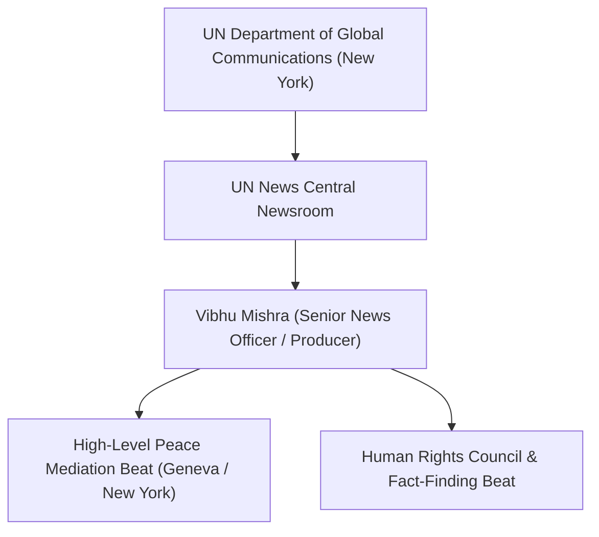

# Vibhu Mishra

## 1. Identity, Classification & Leadership Anchor

> [!NOTE] Identity, Classification & Leadership Anchor
> **Vibhu Mishra** is an international broadcast journalist and senior news officer at UN News, the central multilingual multimedia news service of the [[United Nations]] Department of Global Communications based in New York. Specializing in humanitarian affairs, international human rights investigations, and high-level peace mediation, Mishra is a primary reporter covering UN diplomatic initiatives and independent investigative findings on the war in Sudan.

## 2. Historical Lineage, Factions & Command Structure

Mishra has covered global conflict zones, refugee crises, and multilateral diplomacy across South Asia, the Middle East, and Africa for UN News. Operating from the UN headquarters newsroom and deploying to key multilateral summits in Geneva, Mishra produces verified text dispatches, radio features, and video segments documenting UN interventions in armed conflicts.

## 3. Strategic Objectives, Ideology & Political Economy ("Why")

Mishra's reporting adheres strictly to the UN Department of Global Communications editorial charter:
- **Impartial Multilateral Coverage**: Providing objective, verified summaries of UN investigative commissions, Security Council meetings, and humanitarian appeals.
- **Amplifying International Humanitarian Law**: Accurately conveying the precise legal findings of independent experts regarding war crimes, crimes against humanity, and genocidal acts.
- **Tracking Humanitarian Operations**: Highlighting operational obstacles facing aid agencies, including bureaucratic impediments and armed attacks on relief personnel.

## 4. Operational Capabilities, Alliances & Foreign Backing

- **Direct Multilateral Access**: Conducts on-the-record interviews with UN envoys, such as Personal Envoy [[Pekka Haavisto]], and international jurists including [[Mohamed Chande Othman]].
- **Global Distribution**: Reports are syndicated across UN digital networks, reaching international media, diplomatic delegations, and humanitarian practitioners worldwide.

## 5. Chronological Event Footprint & Accountability Record

| Date | Key Reporting Dispatch | Substantive Subject |
| :--- | :--- | :--- |
| **2026-02-19** | UN News Special Dispatch on El Fasher Atrocities | Reported FFM Sudan's formal warning on hallmarks of genocide in North Darfur |
| **2026-10-21** | Report on Geneva Consultative Meeting on Peace Initiatives | Chronicled multilateral talks between Swiss diplomats and UN Personal Envoy Pekka Haavisto on escalating drone warfare |

## ## Related Primitives
- **Sources**: [[sources/2026-02-19-un-news-el-fasher-hallmarks-of-genocide]], [[sources/2026-10-21-un-news-geneva-peace-efforts-drone-war]]
- **Themes**: [[Multilateral Mediation and Peace Coordination Mechanisms in Sudan]], [[International Accountability and Fact-Finding Mechanisms in Sudan]]
- **Events**: [[2025-10 El Fasher Siege and RSF Takeover Atrocities]], [[2026-10-21 Geneva Consultative Meeting on Peace Initiatives in Sudan]]
- **Actors**: [[United Nations]], [[Pekka Haavisto]], [[Alexandre Fasel]], [[Mohamed Chande Othman]], [[Independent International Fact-Finding Mission for the Sudan]]
- **Locations**: [[Geneva]], [[El Fasher]]
