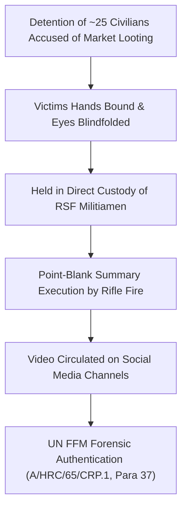

# 2026-09-24 Um Badr Market Summary Executions

## 1. Event Anchor & 5W1H Summary

> [!NOTE] 5W1H Forensic Intelligence Anchor
> - **What**: Summary extrajudicial execution of approximately 25 bound and blindfolded persons in custody.
> - **Who**: Perpetrated by combatants of the [[Rapid Support Forces]] (RSF); victims were civilian detainees accused by RSF militia elements of looting Um Badr commercial market.
> - **When**: 24 September 2026 ($t_{\text{valid}}$); forensically verified and published by the United Nations on 28 October 2026 ($t_{\text{reported}}$).
> - **Where**: [[Um Badr]] locality, northwestern [[North Kordofan]], approximately 270 kilometers northwest of [[El Obeid]].
> - **Why**: Conducted as an exemplary punitive measure and violent enforcement of militia authority following armed contestation over rural trading centers.
> - **How**: Detainees had their hands tied behind their backs, eyes blindfolded, and were shot point-blank while in RSF custody; video recording verified by UN investigators under the Berkeley Protocol.

## 2. Chronological Sequence & Tactical Mechanics ("What & How")

Following armed skirmishes and localized unrest in northwestern North Kordofan, RSF combatants operating in Um Badr rounded up approximately 25 individuals. The captives were subjected to summary field accusations of looting commercial stalls in the Um Badr central market. Digital video footage recorded on 24 September 2026 shows the victims lined up, immobilized with bound hands and blindfolds. Armed fighters wearing RSF insignias subsequently executed them en masse without judicial proceedings, investigation, or legal representation.

## 3. Causal Drivers & Strategic Motives ("Why")

The massacre at Um Badr was driven by intersecting strategic, economic, and punitive motives:
- **Enforcement of Non-State Hegemony**: Establishing absolute social dominance over rural populations through terror tactics to deter community resistance.
- **Weaponization of Criminality Pretexts**: Framing summary executions as "anti-looting policing" to rationalize extrajudicial executions and suppress local dissent.
- **Retaliation for Frontline Setbacks**: Occurring on the eve of the SAF recapture of Sodari (25 September 2026), reflecting heightened militia anxiety over losing logistical transit corridors in northwestern North Kordofan.

## 4. Humanitarian, Territorial & Geopolitical Impact

- **Severe Legal Qualification**: The UN [[Independent International Fact-Finding Mission for the Sudan]] (FFM) explicitly classified the execution of persons in custody as a direct violation of Common Article 3 of the 1949 Geneva Conventions, formally qualifying the incident as a war crime.
- **Evidentiary Referral to ICC**: Documented as prime admissible evidence for transfer to the [[International Criminal Court]] (ICC) Office of the Prosecutor under UNSC Resolution 1593.
- **Deepened Rural Terror**: Precipitated immediate civilian flight from surrounding nomadic and settled communities in Um Badr towards safer enclaves.

## 5. Competing Narratives, Attribution & Contradictions

| Attribution Angle | Claimed Position | Epistemic Status & Evidence |
| :--- | :--- | :--- |
| **UN Fact-Finding Mission** | Verified footage confirms ~25 blindfolded victims executed while in RSF custody; qualifies as a war crime. | **`A1` Confirmed**: Geolocated video corroborated by local testimonies and procedural analysis. |
| **Rapid Support Forces** | Denies formal policy of executions; alleges actions were unauthorized local infractions or anti-banditry enforcement. | **Debunked**: Command responsibility engaged by systematic failure to investigate or court-martial perpetrators. |

## Related Primitives

- **Sources**: [[sources/2026-10-28-un-hrc-crp1-el-obeid-civilian-devastation]]
- **Actors**: [[Rapid Support Forces]], [[Independent International Fact-Finding Mission for the Sudan]], [[International Criminal Court]]
- **Locations**: [[Um Badr]], [[North Kordofan]], [[El Obeid]]
- **Themes**: [[Arbitrary Detention and Custodial Torture in the Sudan War]], [[International Accountability and Fact-Finding Mechanisms in Sudan]]
- **Timelines**: [[2026-09 Sudan Conflict Chronicle]], [[Sudan Accountability and International Justice Timeline]]
