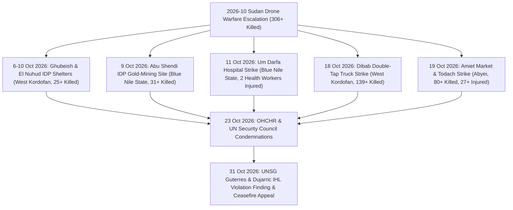

# 2026-10 Sudan Drone Warfare Escalation

## 1. Event Anchor & 5W1H Summary

> [!IMPORTANT] 5W1H Intelligence Anchor (`EVENT_ANCHOR`)
> - **What**: A nationwide October 2026 escalation in unmanned aerial vehicle (UAV / drone) strikes across Sudan and [[Abyei]] that killed **at least 306 people** ("hundreds of civilians, including women and children") and injured hundreds more, striking markets, hospitals, power stations, water infrastructure, transportation vehicles, and internally displaced persons (IDP) shelters in violation of international humanitarian law ([[sources/2026-10-23-un-news-sudan-drone-strikes-306-killed]], [[sources/2026-10-31-unsg-spokesperson-escalating-drone-attacks-sudan]]).
> - **When**: `2026-10-01` to `2026-10-31` ($t_{\text{valid}}$) | **Reported**: `2026-10-23` by [[UN News]] / [[OHCHR]] and `2026-10-31` by [[Office of the Spokesperson for the Secretary-General]].
> - **Where**: Multi-state theatre spanning [[West Kordofan]] (`SD18`), [[Blue Nile State]] (`SD17`), the disputed demilitarized region of [[Abyei]] (`SD18001`), Darfur, and Khartoum State.
> - **Who**:
>   - **Belligerents / Alleged Perpetrators**: [[Sudanese Armed Forces]] (SAF) and [[Rapid Support Forces]] (RSF).
>   - **Targets**: Displaced persons in IDP shelters and artisanal gold-mining sites, market traders and shoppers, medical workers, and civilian transport passengers.
>   - **Monitors, Mediators & First Responders**: [[United Nations]] Secretary-General [[António Guterres]] and Spokesperson [[Stéphane Dujarric]], [[OHCHR]] (led by [[Volker Türk]] and spokesperson [[Seif Magango]]), and [[UNISFA]] (commanded by Brig. Gen. [[Adebowale Ajabge]] and Pakistani battalion commander Lt. Col. [[Muhammad Farooq]]).
> - **Why**: Strategic reliance on stand-off UAV bombardment to attrit civilian livelihoods, logistics corridors, and rear-area governance in territory held by rival forces ([[Drone Proliferation and Double-Tap Strike Doctrine in Sudan]]).
> - **Epistemic Rating**: **`A1`** (`0.95`) — Aggregate casualty floor (`306+` / hundreds of civilians killed) verified by [[OHCHR]], [[UNISFA]], and the [[United Nations]] Secretary-General, with `ATTRIBUTION_CONFLICT` flags on specific strikes where perpetrator identity remains `alleged` or unspecified.

---

## 2. Chronological Sequence & Tactical Mechanics ("What & How")

During October 2026, [[OHCHR]] and the [[United Nations]] Secretariat documented an acute intensification of UAV warfare across Sudan's central, southern, and western corridors ([[sources/2026-10-23-un-news-sudan-drone-strikes-306-killed]], [[sources/2026-10-31-unsg-spokesperson-escalating-drone-attacks-sudan]]). According to UN High Commissioner for Human Rights [[Volker Türk]], drone attacks had by October 2026 become the **leading cause of conflict-related civilian deaths in Sudan** ([[2026-10-23 Volker Türk Condemnation of Sudan Drone Escalation and Arms Influx]]). On **31 October 2026**, UN Secretary-General [[António Guterres]] (via Spokesperson [[Stéphane Dujarric]]) formally condemned the escalating drone attacks across Sudan and [[Abyei]] as violations of international humanitarian law and demanded an immediate cessation of hostilities ([[2026-10-31 Stéphane Dujarric UNSG Statement Condemning Escalating Drone Attacks in Sudan and Abyei]], [[2026-10-31 António Guterres Appeal for Immediate Cessation of Hostilities and Good-Faith Mediation in Sudan]]).

### Chronological Breakdown of Verified Strikes & Executive Condemnations

| Date ($t_{\text{valid}}$) | Location & P-Code | Target Type | Attributed Actor | Verified Casualties & Impact | Sub-Event / Citation Node |
| :--- | :--- | :--- | :--- | :--- | :--- |
| `2026-10-06` to `2026-10-10` | Ghubeish & El Nuhud, [[West Kordofan]] (`SD18`) | IDP Shelters | Alleged [[Sudanese Armed Forces]] | **25+ civilians killed** (including women and children) | [[2026-10 Sudan Drone Warfare Escalation]] |
| `2026-10-09` | Abu Shendi, [[Blue Nile State]] (`SD17`) | Displaced civilians mining gold near IDP site | Alleged [[Rapid Support Forces]] | **31+ civilians killed** (predominantly women and children) | [[2026-10 Sudan Drone Warfare Escalation]] |
| `2026-10-11` | Um Darfa, [[Blue Nile State]] (`SD17`) | Um Darfa Hospital | [[Rapid Support Forces]] | **2 health workers seriously injured**; hospital rendered non-operational | [[2026-10 Sudan Drone Warfare Escalation]] |
| `2026-10-18` | Dibab, [[West Kordofan]] (`SD18`) | Civilian transportation truck (in RSF-held area) | Unspecified drone operator (in [[Rapid Support Forces]]-controlled zone) | **139+ people killed** in a repeat "double-tap" drone strike | [[2026-10-18 Dibab Double-Tap Drone Strike]] |
| `2026-10-19` | Amiet Market & Todach, [[Abyei]] (`SD18001`) | Commercial market & demilitarized zone | Unspecified drone operator | **80+ people killed**, **27+ injured** evacuated to [[UNISFA]] hospital in Todach; market shops burned | [[2026-10-19 Abyei Amiet Market and Todach Drone Strike]] |
| `2026-10-31` | Nationwide & [[Abyei]] (`SD18001`) | Civilians, women, children & health facilities | [[Sudanese Armed Forces]] & [[Rapid Support Forces]] ("parties to the conflict") | UN Secretary-General [[António Guterres]] condemns hundreds of civilian deaths as **IHL violations** and demands immediate cessation of hostilities | [[2026-10-31 Stéphane Dujarric UNSG Statement Condemning Escalating Drone Attacks in Sudan and Abyei]] |

---

## 3. Causal Drivers & Strategic Motives ("Why")

The October 2026 drone campaign reflects three structural drivers documented in [[Drone Proliferation and Double-Tap Strike Doctrine in Sudan]]:

1. **External Arms Influx & UAV Proliferation**: Both the [[Sudanese Armed Forces]] and the [[Rapid Support Forces]] have expanded their long-range strike and loitering munition arsenals through sustained external arms transfers, prompting [[Volker Türk]] to demand a halt to weapons shipments used in violation of international humanitarian law ([[2026-10-23 Volker Türk Condemnation of Sudan Drone Escalation and Arms Influx]]).
2. **Economic & Infrastructure Attrition**: Strikes deliberately targeted economic survival hubs—such as artisanal gold mining by displaced families in Abu Shendi ([[Blue Nile State]]), commercial trade at Amiet Market in [[Abyei]], and regional transport trucks in Dibab ([[West Kordofan]])—alongside power, water, and medical facilities like Um Darfa hospital ([[2026-10-23 Seif Magango Statement on Evisceration of Civilian Infrastructure in Sudan]], [[2026-10-31 Stéphane Dujarric UNSG Statement Condemning Escalating Drone Attacks in Sudan and Abyei]]).
3. **Lethality Multiplication via "Double-Tap" Doctrine**: As seen in the [[2026-10-18 Dibab Double-Tap Drone Strike]], operators executed sequential strikes on the same target to hit passengers, bystanders, and first responders congregating after the initial impact.

---

## 4. Humanitarian, Territorial & Geopolitical Impact

- **Mass Civilian Mortality & Secondary Displacement**: At least **306 fatalities** ("hundreds of civilians, including women and children") were verified by [[OHCHR]] and corroborated by the [[United Nations]] Secretary-General, with IDPs repeatedly struck inside shelters in Ghubeish and El Nuhud ([[West Kordofan]]) and near displacement sites in Abu Shendi ([[Blue Nile State]]) ([[2026-10-23 Seif Magango Statement on Evisceration of Civilian Infrastructure in Sudan]], [[2026-10-31 Stéphane Dujarric UNSG Statement Condemning Escalating Drone Attacks in Sudan and Abyei]]).
- **Collapse of Healthcare & Market Livelihoods**: The closure of Um Darfa hospital in [[Blue Nile State]] deprived local communities of emergency medical care—prompting [[António Guterres]] on 31 October 2026 to express outrage over attacks on health facilities—while the incineration of Amiet Market in [[Abyei]] wiped out the primary inter-communal trading hub on the Sudan–South Sudan border, leaving survivors such as [[Angelina Musa Diaw]] destitute ([[2026-10-23 Angelina Musa Diaw Survivor Testimony on Amiet Market Destruction]], [[2026-10-31 Stéphane Dujarric UNSG Statement Condemning Escalating Drone Attacks in Sudan and Abyei]]).
- **Violation of Demilitarized Peacekeeping Zones & Executive Ceasefire Demand**: The spillover of drone warfare into [[Abyei]] (`SD18001`) directly threatened civilians under the protection mandate of [[UNISFA]], forcing Pakistani peacekeepers under Lt. Col. [[Muhammad Farooq]] and Acting Force Commander Brig. Gen. [[Adebowale Ajabge]] to conduct emergency firefighting and mass casualty evacuations ([[2026-10-23 Muhammad Farooq First-Responder Account of Amiet Market Fire]], [[2026-10-23 Adebowale Ajabge Report on UNISFA Emergency Response and Todach Evacuations]]). On 31 October 2026, [[António Guterres]] called on the conflict parties to agree without delay to a cessation of hostilities and engage in good-faith mediation ([[2026-10-31 António Guterres Appeal for Immediate Cessation of Hostilities and Good-Faith Mediation in Sudan]]).

---

## 5. Competing Narratives, Attribution & Contradictions

| Dispute Dimension | Source / Claim A | Source / Claim B | Epistemic Status & Contradiction Flag |
| :--- | :--- | :--- | :--- |
| **Perpetrator Attribution across October 2026 Strikes** | [[OHCHR]] reports that the 6–10 Oct Ghubeish/El Nuhud IDP shelter strikes (25+ killed) were **allegedly conducted by [[Sudanese Armed Forces]]**, while the 9 Oct Abu Shendi IDP strike (31+ killed) and 11 Oct Um Darfa hospital strike were **attributed to [[Rapid Support Forces]]** ([[sources/2026-10-23-un-news-sudan-drone-strikes-306-killed]]). On 31 Oct 2026, UN Secretary-General [[António Guterres]] condemned the drone attacks "by the parties to the conflict" as violations of international humanitarian law ([[sources/2026-10-31-unsg-spokesperson-escalating-drone-attacks-sudan]]). | Neither [[Sudanese Armed Forces]] nor [[Rapid Support Forces]] publicly claimed responsibility for the civilian casualties, and [[OHCHR]] left perpetrator attribution unspecified in the initial report for the [[2026-10-18 Dibab Double-Tap Drone Strike]] (in an RSF-controlled town) and the [[2026-10-19 Abyei Amiet Market and Todach Drone Strike]]. | `ATTRIBUTION_CONFLICT` — High confidence in casualty counts and dual belligerent responsibility (`A1`), while incident-level munition attribution for Dibab and [[Abyei]] awaits formal UN investigation. |

---

## Related Primitives

- **Sub-Events**: [[2026-10-18 Dibab Double-Tap Drone Strike]], [[2026-10-19 Abyei Amiet Market and Todach Drone Strike]]
- **Timelines**: [[2026-10 Sudan Conflict Chronicle]], [[Sudan Drone Warfare and Double-Tap Strike Timeline]]
- **Actors Involved**: [[Sudanese Armed Forces]], [[Rapid Support Forces]], [[United Nations]], [[OHCHR]], [[UNISFA]], [[UN News]], [[Office of the Spokesperson for the Secretary-General]]
- **Quoted Persons**: [[António Guterres]], [[Stéphane Dujarric]], [[Volker Türk]], [[Seif Magango]], [[Muhammad Farooq]], [[Adebowale Ajabge]], [[Angelina Musa Diaw]]
- **Standalone Citations**: [[2026-10-31 Stéphane Dujarric UNSG Statement Condemning Escalating Drone Attacks in Sudan and Abyei]], [[2026-10-31 António Guterres Appeal for Immediate Cessation of Hostilities and Good-Faith Mediation in Sudan]], [[2026-10-23 Volker Türk Condemnation of Sudan Drone Escalation and Arms Influx]], [[2026-10-23 Seif Magango Statement on Evisceration of Civilian Infrastructure in Sudan]], [[2026-10-23 Muhammad Farooq First-Responder Account of Amiet Market Fire]], [[2026-10-23 Adebowale Ajabge Report on UNISFA Emergency Response and Todach Evacuations]], [[2026-10-23 Angelina Musa Diaw Survivor Testimony on Amiet Market Destruction]]
- **Locations**: [[West Kordofan]], [[Blue Nile State]], [[Abyei]]
- **Structural Themes**: [[Drone Proliferation and Double-Tap Strike Doctrine in Sudan]]
- **Originating Sources**: [[sources/2026-10-23-un-news-sudan-drone-strikes-306-killed]], [[sources/2026-10-31-unsg-spokesperson-escalating-drone-attacks-sudan]]
