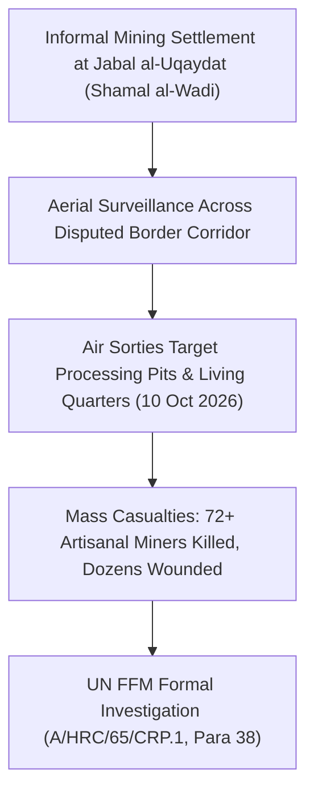

# 2026-10-10 Jabal al-Uqaydat Artisanal Gold Mine Airstrikes

## 1. Event Anchor & 5W1H Summary

> [!NOTE] 5W1H Remote Violence Intelligence Anchor
> - **What**: Devastating aerial bombardment targeting informal artisanal gold mining camps and processing facilities.
> - **Who**: Allegedly conducted by Egyptian Air Force fighter jets; victims were Sudanese artisanal gold miners and migrant laborers.
> - **When**: 10 October 2026 ($t_{\text{valid}}$); formally investigated and documented in UN Human Rights Council report `A/HRC/65/CRP.1` published 28 October 2026 ($t_{\text{reported}}$).
> - **Where**: Jabal al-Uqaydat in the Shamal al-Wadi area along the disputed desert frontier between northern Sudan and southern Egypt.
> - **Why**: Struck amidst escalating geopolitical anxiety over cross-border smuggling networks, informal gold trafficking financing belligerents, and border militarization.
> - **How**: Multiple sorties of high-explosive aerial munitions struck concentration points of artisanal mining pits, crushing processing equipment, tents, and water storage depots, killing at least 72 miners and wounding dozens.

## 2. Chronological Sequence & Tactical Mechanics ("What & How")

In the morning hours of 10 October 2026, combat aircraft carried out coordinated strikes against artisanal mining encampments located in the rugged terrain of Jabal al-Uqaydat. The strikes targeted clusters of artisanal miners utilizing metal detectors and rudimentary mechanical crushers. The high-explosive ordnance tore through dense concentrations of civilian workers, causing immediate catastrophic fatalities among miners trapped in shallow excavation trenches and makeshift shelters.

## 3. Causal Drivers & Strategic Motives ("Why")

- **Interdiction of War Economy Conduits**: Artisanal gold mining represents Sudan's primary foreign currency generator during the war. Cross-border mining operations in the northern desert corridor have been subjected to heightened surveillance due to illicit gold flows financing armed factions.
- **Border Security and Anti-Smuggling Doctrinal Posture**: Cairo has maintained rigid military border controls along its southern frontier, deploying kinetic air power to interdict unauthorized vehicular convoys, cross-border infiltration, and unregulated extractive activities.
- **Regionalization of Conflict Dynamics**: Illustrates the expanding geographic footprint of kinetic operations beyond traditional combat theatres into previously quiet border hinterlands.

## 4. Humanitarian, Territorial & Geopolitical Impact

- **Severe Civilian Death Toll**: With at least 72 verified fatalities and scores injured, the strike ranks among the deadliest single remote violence incidents along the northern border.
- **Absence of Trauma Care**: Remote desert geography prevented timely medical evacuations, leading to secondary deaths from hemorrhage and dehydration before informal rescue convoys could reach the site.
- **UN Human Rights Council Scrutiny**: The UN Fact-Finding Mission formally launched an ongoing investigation into the incident, examining state responsibility and compliance with international humanitarian law.

## 5. Competing Narratives, Attribution & Contradictions

| Attribution Angle | Claimed Position | Epistemic Status & Evidence |
| :--- | :--- | :--- |
| **UN Fact-Finding Mission** | Investigating reported Egyptian airstrikes on artisanal miners killing at least 72 civilians. | **`A2` Probable**: Directly cited in `A/HRC/65/CRP.1` (Para 38) based on field incident reports; active inquiry underway. |
| **Egyptian Military Authorities** | Unconfirmed; historically frames border strikes as counter-trafficking and anti-smuggling interdiction operations. | **Contested**: Official silence maintained regarding specific target coordinates and casualty figures. |

## Related Primitives

- **Sources**: [[sources/2026-10-28-un-hrc-crp1-el-obeid-civilian-devastation]]
- **Actors**: [[Independent International Fact-Finding Mission for the Sudan]], [[Sudanese Armed Forces]]
- **Locations**: [[Red Sea State]], [[Port Sudan]]
- **Themes**: [[International Accountability and Fact-Finding Mechanisms in Sudan]], [[Regional Proxy Warfare and Transnational Drone Supply Networks in Sudan]]
- **Timelines**: [[2026-10 Sudan Conflict Chronicle]], [[Sudan Accountability and International Justice Timeline]]
