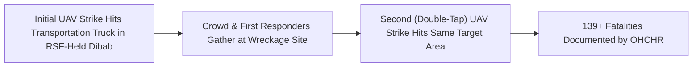

# 2026-10-18 Dibab Double-Tap Drone Strike

## 1. Event Anchor & 5W1H Summary

> [!IMPORTANT] 5W1H Intelligence Anchor (`EVENT_ANCHOR`)
> - **What**: A repeat ("double-tap") unmanned aerial vehicle (UAV / drone) strike against a transportation truck in Dibab, [[West Kordofan]], killing **at least 139 people**—the single deadliest mass-casualty incident documented during the [[2026-10 Sudan Drone Warfare Escalation]] ([[sources/2026-10-23-un-news-sudan-drone-strikes-306-killed]]).
> - **When**: `2026-10-18` ($t_{\text{valid}}$) | **Reported**: `2026-10-23` ($t_{\text{reported}}$) by [[OHCHR]] and [[UN News]].
> - **Where**: Dibab, [[West Kordofan]] (`SD18`), an area under the territorial control of the [[Rapid Support Forces]].
> - **Who**:
>   - **Target**: Passengers and bystanders around a transportation truck in [[Rapid Support Forces]]-controlled Dibab.
>   - **Territorial Controller**: [[Rapid Support Forces]].
>   - **Monitoring Body**: [[OHCHR]] (UN High Commissioner [[Volker Türk]] and spokesperson [[Seif Magango]]).
> - **Why**: Interdiction of vehicular transit and logistics inside [[Rapid Support Forces]]-controlled [[West Kordofan]] using sequential strike tactics that maximize casualties among rescuers and crowds ([[Drone Proliferation and Double-Tap Strike Doctrine in Sudan]]).
> - **Epistemic Rating**: **`A2`** (`0.90`) — Fatality floor of `139` verified by [[OHCHR]]; specific operator attribution remains unconfirmed in initial UN reporting (`ATTRIBUTION_CONFLICT`).

---

## 2. Chronological Sequence & Tactical Mechanics ("What & How")

On **18 October 2026**, an unmanned aerial vehicle struck a transportation truck in the town of Dibab in [[West Kordofan]] (`SD18`), a locality held by the [[Rapid Support Forces]] ([[sources/2026-10-23-un-news-sudan-drone-strikes-306-killed]]).

1. **Initial Strike**: A drone munition hit a transportation truck transiting through Dibab, [[West Kordofan]].
2. **Follow-On ("Double-Tap") Strike**: As survivors, bystanders, and local responders gathered around the struck vehicle, a repeat drone strike hit the same site ([[Drone Proliferation and Double-Tap Strike Doctrine in Sudan]]).
3. **Mass Casualty Outcome**: According to [[OHCHR]] monitoring released on 23 October 2026, the sequential strikes killed **at least 139 people**, accounting for nearly half of the 306 drone-related fatalities recorded across Sudan during the first three weeks of October 2026 ([[2026-10 Sudan Drone Warfare Escalation]]).

---

## 3. Causal Drivers & Strategic Motives ("Why")

- **Targeting of Transit Corridors in RSF-Controlled Territory**: Dibab lies along key transport arteries in [[West Kordofan]] (`SD18`), where aerial interdiction is frequently employed against commercial and dual-use transport trucks operating inside [[Rapid Support Forces]] control zones.
- **Lethality Amplification via Double-Tap Doctrine**: Executing a second strike after an initial impact ensures destruction of the vehicle payload while inflicting catastrophic casualties on anyone attempting recovery or medical rescue ([[Drone Proliferation and Double-Tap Strike Doctrine in Sudan]]).

---

## 4. Humanitarian, Territorial & Geopolitical Impact

- **Catastrophic Single-Incident Toll**: With **at least 139 killed**, the Dibab strike represented the deadliest single drone attack documented in the October 2026 reporting window, prompting UN High Commissioner [[Volker Türk]] to warn that drone strikes now account for the majority of conflict-related civilian deaths in Sudan ([[2026-10-23 Volker Türk Condemnation of Sudan Drone Escalation and Arms Influx]]).
- **Paralysis of Civilian Mobility in West Kordofan**: Combined with earlier October strikes on IDP shelters in Ghubeish and El Nuhud ([[West Kordofan]]), the destruction of civilian transport in Dibab severely restricted civilian flight and commercial supply movement across the Kordofan corridor ([[2026-10-23 Seif Magango Statement on Evisceration of Civilian Infrastructure in Sudan]]).

---

## 5. Competing Narratives, Attribution & Contradictions

| Dispute Dimension | Source / Claim A | Source / Claim B | Epistemic Status & Contradiction Flag |
| :--- | :--- | :--- | :--- |
| **Perpetrator Attribution & Target Framing** | [[OHCHR]] confirmed that at least 139 people were killed in a "double-tap" repeat drone strike on a transportation truck in Dibab, noting explicitly that Dibab is an area controlled by the [[Rapid Support Forces]] ([[sources/2026-10-23-un-news-sudan-drone-strikes-306-killed]]). | While territorial context (an [[Rapid Support Forces]]-held town in [[West Kordofan]] where earlier 6–10 Oct strikes were attributed to [[Sudanese Armed Forces]]) points toward aerial interdiction of RSF-held territory, [[OHCHR]] did not formally assign perpetrator attribution for the 18 October Dibab strike in its 23 October briefing. | `ATTRIBUTION_CONFLICT` — Casualties (`139+`) confirmed by [[OHCHR]]; perpetrator attribution requires corroborating flight/munition forensics. |

---

## Related Primitives

- **Parent Campaign**: [[2026-10 Sudan Drone Warfare Escalation]]
- **Sibling Incident**: [[2026-10-19 Abyei Amiet Market and Todach Drone Strike]]
- **Actors Involved**: [[Rapid Support Forces]], [[Sudanese Armed Forces]], [[OHCHR]], [[UN News]]
- **Quoted Persons & Citations**: [[Volker Türk]] ([[2026-10-23 Volker Türk Condemnation of Sudan Drone Escalation and Arms Influx]]), [[Seif Magango]] ([[2026-10-23 Seif Magango Statement on Evisceration of Civilian Infrastructure in Sudan]])
- **Location**: [[West Kordofan]]
- **Structural Theme**: [[Drone Proliferation and Double-Tap Strike Doctrine in Sudan]]
- **Originating Source**: [[sources/2026-10-23-un-news-sudan-drone-strikes-306-killed]]
