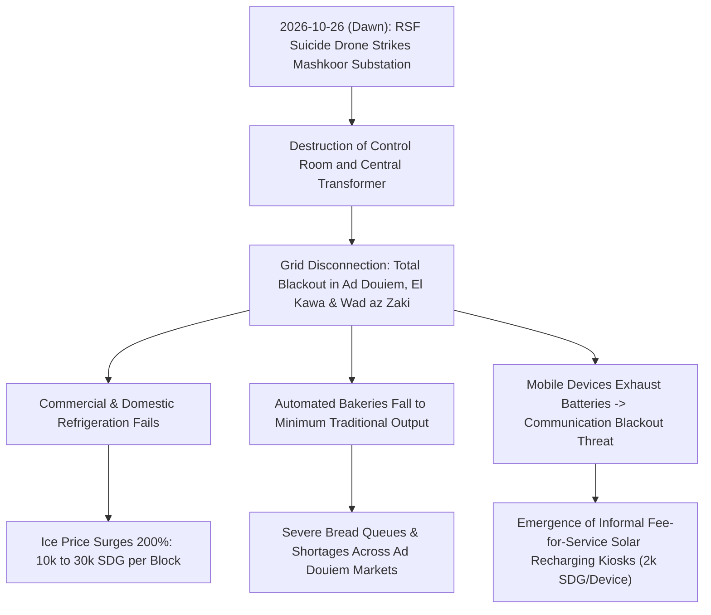

# 2026-10-26 White Nile Power Grid Blackout and Economic Crisis

> [!NOTE] 5W1H Event Anchor
> - **What**: Protracted multi-day electrical blackout across northern White Nile State following the RSF drone destruction of the Mashkoor transformer substation, driving massive hyperinflation for refrigeration, collapsing bakery production, and creating an informal commercial mobile charging economy.
> - **Who**: Caused by [[Rapid Support Forces]] (RSF) drone strikes; impacting civilian residents in Ad Douiem, El Kawa, and Wad az Zaki; witnessed by [[Mohamed Idris]] and [[Mubarak Ali]].
> - **Where**: [[Ad Douiem]] (`SD16003`), El Kawa, and Wad az Zaki in [[White Nile State]], Sudan.
> - **When**: Initiated dawn of Monday, 26 October 2026, persisting through late October 2026.
> - **Why**: Cascade effect of deliberate military destruction of high-voltage transmission equipment on household survivability and the local war economy.

---

## 1. Event Anchor & 5W1H Summary

At dawn on Monday, 26 October 2026, an aerial drone attack by the [[Rapid Support Forces]] (RSF) targeted the Mashkoor transformer substation (`محطة مشكور التحويلية`) in [[White Nile State]], destroying the central control room and a high-capacity electrical transformer. The attack knocked the regional transmission grid completely out of service, plunging the major urban centers of [[Ad Douiem]], El Kawa, and Wad az Zaki into an indefinite, total power blackout.

By 30 October 2026, the protracted blackout generated an acute humanitarian and economic crisis across Ad Douiem. The loss of electric refrigeration caused commercial ice block prices to triple from 10,000 SDG to 30,000 SDG, threatening household food preservation and cold drinking water in extreme heat. Concurrently, regional bakeries suffered a collapse in bread production as they reverted to manual wood-fired methods, while commercial shopkeepers and kiosks with solar panels began monetizing electricity, charging impoverished citizens 2,000 SDG per mobile phone charge.

---

## 2. Chronological Sequence & Tactical Mechanics ("What & How")

1. **Physical Strike on Node**: RSF suicide drones struck the Mashkoor electrical substation outside Ad Douiem, destroying the automated control facility and fracturing core oil-cooled transformers.
2. **Immediate Power Disruption**: Transmission cut simultaneously across three municipal networks in northern White Nile State.
3. **Food and Water Chain Breakdown**: Families without private diesel generators lost cold drinking water and perishable provisions within 24 hours.
4. **Informal Market Adaptation**: Small commercial operators rapidly installed solar panels or ran small diesel generators, charging extortionate fees for basic cold storage and device charging.

---

## 3. Causal Drivers & Strategic Motives ("Why")

- **Economic Warfare via Infrastructure**: Striking electrical distribution nodes in SAF rear territory inflicts indirect economic paralysis, straining civilian coping mechanisms and creating social discontent.
- **Weaponizing Scarcity**: Power disruptions multiply the transaction costs of basic food items (bread, ice, water), draining household cash reserves in a hyperinflationary environment.

---

## 4. Humanitarian, Territorial & Geopolitical Impact

- **Humanitarian Shock**: Displaced families from Khartoum and Gezira sheltering in Ad Douiem faced unaffordable survival costs, forcing many to forgo food cooling and phone connectivity.
- **Micro-Economic Extraction**: Household expenditure became dominated by tertiary survival costs (2,000 SDG phone charge, 30,000 SDG ice blocks), illustrating how infrastructure destruction extracts wealth from vulnerable populations.
- **Public Health Risks**: Paralyzed water pumping along the White Nile increased reliance on untreated river water, raising the specter of waterborne disease epidemics.

---

## 5. Competing Narratives, Attribution & Contradictions

| Dimension | Civilian Eyewitness & Commercial Reality | Belligerent Conduct Framing |
| :--- | :--- | :--- |
| **Operational Impact** | Severe civilian victimization, tripling of ice prices, and bakery collapse across three towns | Strike framed as degrading military communications and power supply to SAF garrison nodes |
| **Attribution** | Direct RSF drone deployment against unfortified electrical transformation infrastructure | RSF acknowledges general long-range campaign against state logistical centers |

---

## Related Primitives

- **Sources**: [[sources/2026-10-30-dabanga-white-nile-power-grid-collapse-inflation]]
- **Locations**: [[Ad Douiem]], [[White Nile State]]
- **Actors**: [[Rapid Support Forces]], [[Mohamed Idris]], [[Mubarak Ali]]
- **Citations**: [[2026-10-30 Mohamed Idris Statement on Ad Douiem Power Blackout Impact]], [[2026-10-30 Mubarak Ali Statement on Ad Douiem Ice and Bread Inflation]]
- **Themes**: [[Energy Infrastructure Targeting in the Sudan War]], [[War Economy and Commercial Blockades in Sudan]]
- **Timelines**: [[2026-10 Sudan Conflict Chronicle]]
