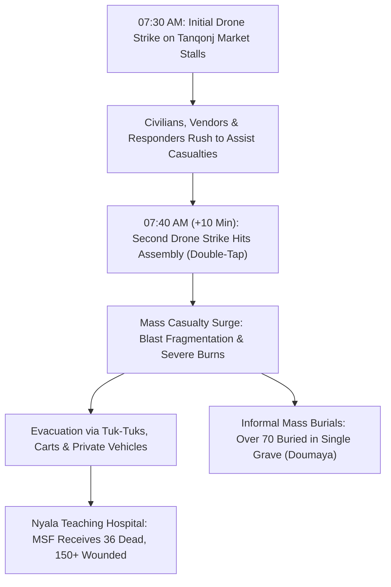

# 2026-10-27 Nyala Tanqonj Market Drone Strike

> [!NOTE] 5W1H Event Anchor
> - **What**: Mass-casualty aerial strike drone attack executed via a double-tap sequence against a crowded civilian marketplace and adjacent residential quarter, killing between 36 and 188 people (best estimate 102) and injuring hundreds.
> - **Who**: Attributed to the [[Sudanese Armed Forces]] (SAF) targeting RSF-controlled municipal territory; SAF sources claim targeting an RSF training camp and 16th Infantry Division HQ.
> - **Where**: Tanqonj / Dumaya Market in [[Nyala]] (`SD03001`), capital of [[South Darfur]] (`SD03`).
> - **When**: Monday, 27 October 2026, commencing at 07:30 AM local time with a second strike 10 minutes later.
> - **Why**: SAF aerial interdiction campaign punishing urban commercial centers in the RSF's de facto administrative capital ("Tasees").

---

## 1. Event Anchor & 5W1H Summary

On Monday morning, 27 October 2026, an unmanned aerial vehicle (strike drone) operated by the [[Sudanese Armed Forces]] executed a devastating double-tap attack on the bustling Tanqonj / Dumaya Market and adjoining residential streets in [[Nyala]] (`SD03001`), the capital of [[South Darfur]]. Arriving at peak morning trading hours around 07:30 AM, the first strike detonated in central market stalls where civilian vendors—including women selling tea, bread, and produce—were gathered. Ten minutes later, as survivors, vendor neighbors, and informal rescue teams rushed into the blast zone to extract casualties, a second drone strike impacted the identical location, inflicting catastrophic fragmentation trauma.

The attack produced severe casualty discrepancies across reporting bodies: international medical charity [[Médecins Sans Frontières]] (MSF) received 36 bodies and treated over 150 critically wounded civilians at Nyala Teaching Hospital; independent human rights network [[Emergency Lawyers]] verified 102 civilian deaths and 113 injuries; while the Health Ministry of the RSF-backed [[Tasees]] regional administration reported a toll of 188 dead and 356 injured. UN Secretary-General António Guterres declared himself "appalled" by the massacre, reiterating that indiscriminate aerial strikes on markets violate international humanitarian law.

---

## 2. Chronological Sequence & Tactical Mechanics ("What & How")

- **07:30 AM**: An armed military drone releases precision-guided explosive ordnance directly into Tanqonj Market, hitting transport vehicles, produce stalls, and morning shoppers.
- **07:40 AM (Double-Tap Mechanics)**: Exactly ten minutes after the initial detonation, a second projectile strikes the exact blast footprint, decimating citizen first-responders and relatives.
- **Immediate Evacuation**: Due to collapsed municipal ambulance infrastructure, over 150 wounded are transported across Nyala in three-wheeled tuk-tuks, pickup trucks, and donkey carts.
- **Burial Realities**: Because local morgues rapidly overflowed and customary Islamic burial rites dictate prompt interment, dozens of victims were buried without hospital intake. Resident [[Hamdan Suleiman]] confirmed burying his 19-year-old son alongside more than 70 other victims in a collective mass grave in Doumaya.
- **31 October 2026**: UN Spokesperson [[Stéphane Dujarric]] delivers a formal warning on behalf of Secretary-General [[António Guterres]], condemning drone warfare against non-combatants.

---

## 3. Causal Drivers & Strategic Motives ("Why")

- **SAF Interdiction of Paramilitary Rear Command**: Since capturing Nyala in October 2023, the RSF transformed the city into its primary military logistics hub and the seat of its nascent civilian governance initiative ([[Tasees]]). The SAF aerial campaign aims to destabilize rear paramilitary economic lifelines.
- **Tactical Double-Tap Doctrine**: The 10-minute interval between missile strikes reflects a deliberate tactical doctrine observed across Sudanese frontlines, designed to maximize attrition among responding personnel and demoralize urban populations.
- **Asymmetric Response**: SAF drone deployment in Darfur seeks to offset RSF's long-range drone offensives targeting government utility infrastructure across eastern and northern Sudan.

---

## 4. Humanitarian, Territorial & Geopolitical Impact

- **Civilian Devastation**: Confirmed as one of the deadliest single air strikes in Darfur during 2026, claiming between 36 and 188 civilian lives. Among the dead were five members of a single family affiliated with [[Sudan Liberation Movement (al-Nur)]] (Iman Mohammed Abulgasim, Fatima Ismail, Sara Yacoub, Hassan Abdel Moneim, and Mawahib Ali).
- **Healthcare Overwhelm**: Nyala Teaching Hospital, supported by [[Médecins Sans Frontières]], faced acute shortages of trauma kits, blood units, and burn dressings amid a broader medical supply siege.
- **Food Access Shock**: Market bombings directly compound acute food insecurity, terrorizing rural food traders who supply Nyala’s urban consumer base.

---

## 5. Competing Narratives, Attribution & Contradictions

| Attribution & Casualty Lens | Perpetrator / Target Framing | Documented Fatalities / Injuries |
| :--- | :--- | :--- |
| **MSF Hospital Intake** (Independent Ground NGO) | Drone strike on Dumaya market; 21 arrived in civilian clothes | 36 bodies received (21 civilian clothes); 150+ treated |
| **Emergency Lawyers** (Sudanese Legal Monitor) | SAF drone deliberately struck crowded public commercial market | 102 civilian deaths verified; 113 injured (women and children) |
| **Tasees Health Ministry** (RSF-Backed Administration) | "Barbaric SAF aerial bombardment of innocent traders and shoppers" | 188 fatalities; 356 wounded (cumulative regional reports) |
| **Pro-SAF Military Sources** (Loyalist Briefings) | Deny civilian market target; claim strikes hit RSF training depot | No casualty figures released; claim zero civilian collateral |
| **Eyewitness Mass Burials** (Hamdan Suleiman et al.) | Double-tap strike on market stalls and assembled neighborhood helpers | >70 buried in single collective mass grave in Doumaya district |

- **Attribution Conflict**: Pro-SAF military sources maintain that strikes targeted RSF military assets (16th Infantry Division HQ and training depots), whereas international observers, MSF, and Emergency Lawyers corroborated that the blast struck civilian market stalls and tea vendors.
- **Magnitude Discrepancy**: MSF’s count of 36 dead reflects only hospital-admitted corpses; when informal community burials and mass graves (such as the 70-person grave in Doumaya documented by BBC Arabic) are combined, the death toll aligns closely with Emergency Lawyers' figure of 102, while Tasees claims up to 188.

---

## Related Primitives

- **Parent Campaign**: [[2026-10 Sudan Drone Warfare Escalation]]
- **Location Nodes**: [[Nyala]], [[South Darfur]]
- **Involved Belligerents**: [[Sudanese Armed Forces]], [[Rapid Support Forces]], [[Tasees]]
- **Civil Society & Monitors**: [[Emergency Lawyers]], [[Médecins Sans Frontières]], [[Del Koninckx]], [[Hamdan Suleiman]]
- **Factional Entities**: [[Sudan Liberation Movement (al-Nur)]]
- **Thematic Context**: [[Drone Proliferation and Double-Tap Strike Doctrine in Sudan]], [[Systemic Healthcare Collapse and Hospital Militarization in Sudan]]
- **Chronology**: [[2026-10 Sudan Conflict Chronicle]], [[Sudan Drone Warfare and Double-Tap Strike Timeline]]
- **Direct Citations**:
  - [[2026-10-31 Stéphane Dujarric Arab News Statement Condemning Nyala Market Drone Strike]]
  - [[2026-10-28 Del Koninckx MSF Statement on Nyala Market Drone Casualties]]
  - [[2026-10-28 Emergency Lawyers Condemnation of Nyala Market Drone Strike]]
  - [[2026-10-28 Hamdan Suleiman Eyewitness Account of Nyala Market Bombing]]
