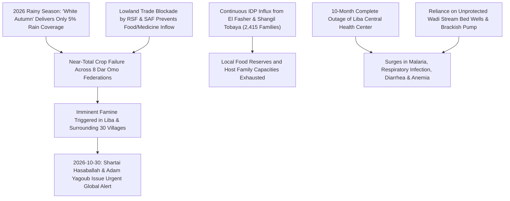

# 2026-10-30 Dar Omo Famine and Humanitarian Crisis Alert

> [!NOTE] 5W1H Event Anchor
> - **What**: Public alarm and emergency humanitarian alert issued by traditional authorities and displacement committees warning of imminent mass starvation across eight federations in East Jebel Marra caused by a 95% crop failure ("white autumn"), a 10-month healthcare shutdown, and an influx of thousands of displaced families.
> - **Who**: Issued by Shartai [[Ibrahim Suleiman Hasaballah]] and [[Adam Yagoub Mohamed Abdallah]]; in territory administered by the [[Sudan Liberation Movement (al-Nur)]] (SLM-AW).
> - **Where**: [[Dar Omo]] (`SD02008-OMO`) and [[Liba]] (`SD02008-LIB`) in East [[Jebel Marra]], Darfur, Sudan.
> - **When**: 30 October 2026.
> - **Why**: Synergistic catastrophe combining acute rainfall failure (5% coverage), regional commercial blockade, and the complete withdrawal of domestic and international humanitarian organizations.

---

## 1. Event Anchor & 5W1H Summary

On 30 October 2026, customary leadership and displacement coordinators in [[Dar Omo]], East [[Jebel Marra]], sounded an emergency alarm warning that over 14,000 residents and newly arrived displaced persons across eight federations are facing imminent famine (IPC Phase 5). Paramount Shartai [[Ibrahim Suleiman Hasaballah]] appealed to local, regional, and international aid agencies for urgent life-saving intervention to halt widespread starvation in areas controlled by the [[Sudan Liberation Movement (al-Nur)]] (SLM-AW).

Field telemetry released by [[Adam Yagoub Mohamed Abdallah]], head of the Liba Federation Displaced Persons Committee, documented that seasonal rainfall in 2026 covered barely 5% of agricultural land, precipitating a "white autumn" (`خريف أبيض`) characterized by near-total crop loss. The crisis was exacerbated by the 10-month closure of the sole regional health center serving 30 villages, the consumption of contaminated wadi water driving epidemics of malaria and severe diarrhea, and the complete departure of all humanitarian relief organizations from the mountain redoubt.

---

## 2. Chronological Sequence & Tactical Mechanics ("What & How")

1. **Hydrological Drought**: Throughout the summer of 2026, East Jebel Marra experienced severe localized drought, with rain coverage reaching only 5% of arable soil.
2. **Displacement Influx**: Even as crops failed, thousands of civilians fleeing heavy artillery shelling and famine in [[El Fasher]] and Shangil Tobaya ascended into Liba and adjacent camps (Kankli, Bale Sereif, Feina).
3. **Institutional and Medical Desertion**: Humanitarian NGOs that previously provided nutritional support and medical staffing withdrew completely from East Jebel Marra due to insecurity and logistical bottlenecks.
4. **Customary Alert Declaration**: On 30 October 2026, Shartai Hasaballah and Committee Head Adam Yagoub broadcast formal declarations via Radio Dabanga documenting the threat of famine.

---

## 3. Causal Drivers & Strategic Motives ("Why")

- **The Neutrality Sanctuary Trap**: Because Jebel Marra remained neutral under SLM-AW control, it absorbed massive demographic displacement without receiving commensurate external aid or logistics corridors.
- **Encirclement by Belligerents**: While SLM-AW maintained non-belligerency, the surrounding lowlands were controlled and blockaded by RSF forces, suffocating trade flows of commercial grain and pharmaceuticals into the mountain enclaves.

---

## 4. Humanitarian, Territorial & Geopolitical Impact

- **IPC Phase 5 Risk**: Dar Omo represents an acute famine pocket where lack of baseline food access threatens hundreds of lives, particularly young children and elderly displaced persons.
- **Child Health & Educational Collapse**: Severe economic distress forced massive school attrition, reducing enrolled students in Liba from 800 to 560 as families could no longer cover basic transport or materials.
- **Public Health Emergency**: Waterborne illnesses spread uncontrollably from unprotected wadi wells in the absence of antibiotics, antimalarials, and oral rehydration salts.

---

## 5. Competing Narratives, Attribution & Contradictions

| Dimension | Customary Administration & IDP Committee Account | Belligerent & International Posture |
| :--- | :--- | :--- |
| **Crisis Causation** | Attributed to extreme drought combined with total institutional abandonment and commercial siege | Warring parties focus on frontline clashes; international donors constrained by access denials and bureaucratic blockades |
| **Relief Presence** | Confirmed zero active humanitarian organizations currently operating in Liba or Dar Omo | UN and international agencies cite severe funding gaps and insecurity on access roads into Jebel Marra |

---

## Related Primitives

- **Sources**: [[sources/2026-10-30-dabanga-dar-omo-east-jebel-marra-famine-warning]]
- **Locations**: [[Dar Omo]], [[Liba]], [[Jebel Marra]]
- **Actors**: [[Ibrahim Suleiman Hasaballah]], [[Adam Yagoub Mohamed Abdallah]], [[Sudan Liberation Movement (al-Nur)]], [[Suleiman Sirri]]
- **Citations**: [[2026-10-30 Ibrahim Hasaballah Statement on Dar Omo Famine and Agricultural Collapse]], [[2026-10-30 Adam Yagoub Statement on Liba White Autumn and Health Disaster]]
- **Themes**: [[War Economy and Commercial Blockades in Sudan]], [[Systemic Healthcare Collapse and Hospital Militarization in Sudan]]
- **Timelines**: [[2026-10 Sudan Conflict Chronicle]]
