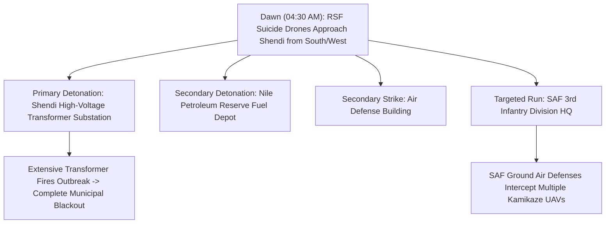

# 2026-10-30 Shendi Power Substation Drone Strike

> [!NOTE] 5W1H Event Anchor
> - **What**: Suicide drone strike targeting the Shendi electrical transformer substation, setting fire to transformers and causing a complete municipal blackout, while concurrent strikes targeted air defense facilities, a Nile Petroleum Company fuel depot, and the SAF 3rd Infantry Division HQ.
> - **Who**: Perpetrated by the [[Rapid Support Forces]] (RSF); targeting the [[Sudanese Armed Forces]] (SAF) and municipal infrastructure.
> - **Where**: [[Shendi]] (`SD08004`), [[River Nile State]], Sudan.
> - **When**: Dawn of Friday, 30 October 2026 (~04:30 AM local time).
> - **Why**: Part of an orchestrated RSF campaign targeting electrical grid and fuel logistics across government-controlled rear states.

---

## 1. Event Anchor & 5W1H Summary

At dawn on Friday, 30 October 2026, the [[Rapid Support Forces]] (RSF) launched an attack using long-range suicide drones on the city of [[Shendi]] in southern [[River Nile State]]. The strike scored direct hits on the Shendi electrical transformer substation (`محطة كهرباء شندي التحويلية`), igniting extensive fires that gutted key transformer banks and completely severed electrical power across the city and neighboring agricultural schemes.

Concurrently, suicide drones targeted nearby military and fuel logistics facilities, including a reserve fuel storage depot belonging to the [[Nile Petroleum Company]], an air defense installation, and the headquarters of the SAF [[Third Infantry Division]]. While ground air defenses engaged and downed several inbound drones, the physical destruction of the substation knocked Shendi off the national electricity grid, marking the seventh major power station disabled by RSF drones in late October 2026.

---

## 2. Chronological Sequence & Tactical Mechanics ("What & How")

1. **Approach and Ingress**: Inbound suicide drones penetrated River Nile airspace at low altitude during pre-dawn darkness (~04:30 AM local time), likely deployed from staging areas in western Khartoum or the Gezira desert axis.
2. **Terminal Dive on Substation**: A kamikaze drone made a direct terminal dive onto the transformer yard, detonating high-explosive payloads into transformer fluid, sparking a major blaze and disabling the control circuits.
3. **Multi-Target Dispersion**: Supplementary drones targeted industrial fuel tanks managed by the [[Nile Petroleum Company]] and military installations housing the SAF 3rd Infantry Division.
4. **Air Defense Interception**: SAF 3rd Division ground anti-aircraft batteries engaged inbound drones over the military quarter, shooting down several incoming airframes before they struck barracks compounds.

---

## 3. Causal Drivers & Strategic Motives ("Why")

- **Rear Infrastructure Attrition**: Having struggled to capture heavily fortified urban bastions in northern Sudan through conventional infantry assaults, the RSF has deployed asymmetric long-range suicide drone strikes to paralyze utility infrastructure deep in SAF-controlled rear zones.
- **Degrading State Legitimacy**: Disabling power in major urban centers such as Shendi, Atbara, and Port Sudan undermines government claims of stability and administrative competence.
- **Logistical Interdiction**: Targeting the Nile Petroleum reserve depot aimed to disrupt diesel and fuel supplies needed for SAF mechanized movements and agricultural water pumping.

---

## 4. Humanitarian, Territorial & Geopolitical Impact

- **Municipal Blackout**: The complete loss of electrical transmission plunged Shendi into total darkness, cutting off power to municipal water treatment plants, district hospitals, cold chains, and residential neighborhoods.
- **Agricultural Shock**: Power disruptions paralyzed electric irrigation pumps operating along the fertile Nile agricultural basin.
- **Geopolitical Repercussions**: The strike intensified Sudanese government accusations against regional states, specifically allegations that [[Government of Ethiopia]] territory was being utilized as an operational corridor or launchpad for long-range drone platforms.

---

## 5. Competing Narratives, Attribution & Contradictions

| Dimension | RSF Framing / Operational Posture | SAF & Shendi Security Committee Account | Independent Human Rights / FFM Finding |
| :--- | :--- | :--- | :--- |
| **Target Characterization** | Strategic strikes directed against military supply lines and air defense garrisons | Flagrant terror attack intentionally targeting civilian utility infrastructure, transformers, and fuel reserves | UN Fact-Finding Mission warns pattern of drone strikes violates distinction and proportionality, potentially amounting to war crimes |
| **Damage & Interception** | Claims successful disruption of northern military logistical depth | Confirms total loss of transformer station but notes ground air defenses foiled direct assault on 3rd Division HQ | Corroborates total civilian power outage and destruction of critical transformers |

---

## Related Primitives

- **Sources**: [[sources/2026-10-30-dabanga-shendi-power-station-drone-strike]]
- **Locations**: [[Shendi]], [[River Nile State]]
- **Actors**: [[Rapid Support Forces]], [[Sudanese Armed Forces]], [[Third Infantry Division]], [[Shendi Locality Security Committee]], [[Nile Petroleum Company]]
- **Themes**: [[Energy Infrastructure Targeting in the Sudan War]], [[Drone Proliferation and Double-Tap Strike Doctrine in Sudan]]
- **Timelines**: [[2026-10 Sudan Conflict Chronicle]], [[Sudan Drone Warfare and Double-Tap Strike Timeline]]
