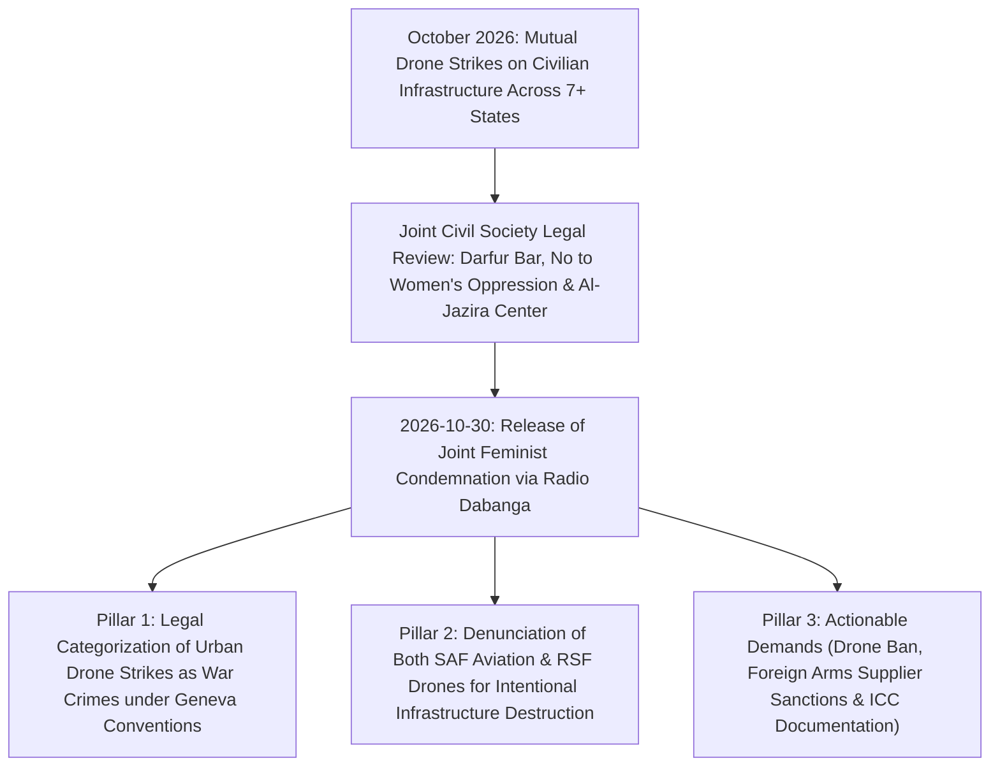

# 2026-10-30 Sudanese Feminist Coalition Condemnation of Drone Warfare

> [!NOTE] 5W1H Event Anchor
> - **What**: Unified joint declaration and high-level legal advocacy appeal issued by prominent Sudanese feminist and human rights organizations condemning the proliferation of weaponized drones, the bombardment of essential survival infrastructure, and the indiscriminate slaughter of women and children.
> - **Who**: Convened by [[No to Women's Oppression Initiative]], [[Darfur Bar Association]], and [[Al-Jazira Center for Human Rights]]; led by [[Ihsan Fagiri]], [[Nafisa Hagar]], [[Noon Kashkoush]], and [[Amira Osman]].
> - **Where**: Nairobi, Amsterdam, and national scope across Sudan.
> - **When**: 30 October 2026.
> - **Why**: Denouncing the mutual destruction of civic infrastructure (markets, schools, power stations, fuel depots) by the SAF and RSF, and demanding external arms supplier accountability.

---

## 1. Event Anchor & 5W1H Summary

On 30 October 2026, a prominent coalition of Sudanese feminist platforms, legal defense bars, and human rights bodies issued a joint condemnation decrying the dangerous normalization and exponential surge in the use of long-range suicide drones and indiscriminate explosive weapons across Sudan. Spearheaded by the [[No to Women's Oppression Initiative]], the [[Darfur Bar Association]], and the [[Al-Jazira Center for Human Rights]], the coalition featured leading public interventions from Dr. [[Ihsan Fagiri]], attorney [[Nafisa Hagar]], human rights director [[Noon Kashkoush]], and civic leader [[Amira Osman]].

The joint declaration characterized urban drone warfare as a grave breach of the 1949 Geneva Conventions and international humanitarian law, arguing that deploying unguided or precision-guided loitering munitions into densely populated neighborhoods, displacement centers, and critical utility sites constitutes a full-fledged war crime incurring individual criminal liability. The leaders forcefully rejected the military logic of both warring parties, framing SAF aerial bombardment of markets and schools in RSF-held territory alongside RSF drone strikes on power plants and fuel reserves in SAF-held territory as a unified counter-revolutionary war against civilian survival and the December 2018 revolution.

---

## 2. Chronological Sequence & Tactical Mechanics ("What & How")

1. **Escalation Trigger**: Rapid succession of drone strikes against hospitals, markets (e.g. Nyala), and power grids (Abu Hamad, Al Dabbah, Shendi, Mashkoor) in late October 2026.
2. **Coalition Mobilization**: Cross-border consultations between exiled civil society platforms in Nairobi and Kampala and frontline grassroots actors in Sudan.
3. **Formal Release & Broadcast**: On 30 October 2026, the coalition broadcast their joint positions through Radio Dabanga, releasing formal statements on international humanitarian law and civilian protection.

---

## 3. Causal Drivers & Strategic Motives ("Why")

- **Challenging Normalization of Indiscriminate Weapons**: Reversing the domestic and international acclimation to daily drone massacres and utility destruction.
- **Centering Gendered Impact**: Highlighting how the erosion of civic life support systems (electricity, water, hospitals) and physical casualties disproportionately impact women as primary family caregivers.
- **External Proxy Exposure**: Directing international accountability toward third-party supplier states facilitating the transfer of drone airframes and electronic warfare systems into Sudan.

---

## 4. Humanitarian, Territorial & Geopolitical Impact

- **Advocacy Pressure on UN Human Rights Council**: Strengthened calls by the UN Independent International Fact-Finding Mission for an expanded international arms embargo covering all of Sudan.
- **Reframing Conflict Narrative**: Countered elite military propaganda by highlighting how both the SAF and RSF actively coordinate in turning civilian existence inside Sudan into an unlivable nightmare.

---

## 5. Competing Narratives, Attribution & Contradictions

| Dimension | Feminist Coalition Consensus | Belligerent Military Narratives |
| :--- | :--- | :--- |
| **Symmetry of Blame** | Both SAF (warplane bombing of schools and markets) and RSF (drone bombing of power stations and fuel tanks) are equally culpable for destroying Sudan | SAF frames operations as legitimate sovereign counter-insurgency; RSF frames drone strikes as targeted retaliation against Islamist garrison rear depth |
| **Legal Characterization** | All drone strikes in populated or utility areas are grave breaches and war crimes with individual liability | Both parties claim operational compliance with military necessity |

---

## Related Primitives

- **Sources**: [[sources/2026-10-30-dabanga-feminist-coalition-condemnation-drone-warfare]]
- **Civil Society Actors**: [[No to Women's Oppression Initiative]], [[Darfur Bar Association]], [[Al-Jazira Center for Human Rights]]
- **Leaders & Jurists**: [[Ihsan Fagiri]], [[Nafisa Hagar]], [[Noon Kashkoush]], [[Amira Osman]]
- **Citations**:
  - [[2026-10-30 Ihsan Fagiri Statement on Drone Warfare and Infrastructure Destruction]]
  - [[2026-10-30 Nafisa Hagar Statement on Indiscriminate Drone Warfare as War Crimes]]
  - [[2026-10-30 Noon Kashkoush Statement Calling for Immediate Halt to Drones and External Arms Supplies]]
  - [[2026-10-30 Amira Osman Statement on War Against Civilian Survival and December Revolution]]
- **Themes**: [[Drone Proliferation and Double-Tap Strike Doctrine in Sudan]], [[Energy Infrastructure Targeting in the Sudan War]], [[International Accountability and Fact-Finding Mechanisms in Sudan]]
- **Timelines**: [[2026-10 Sudan Conflict Chronicle]]
