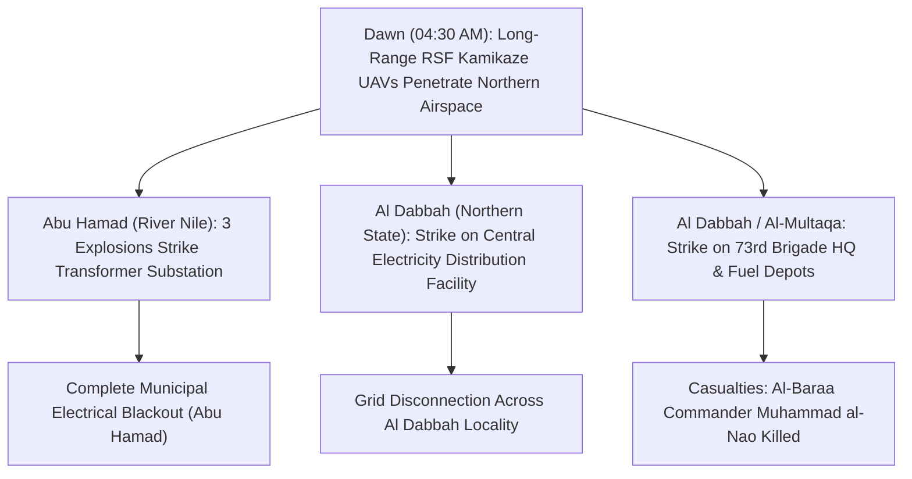

# 2026-11-01 Abu Hamad and Al Dabbah Power Stations Drone Strikes

> [!NOTE] 5W1H Event Anchor
> - **What**: Coordinated long-range kamikaze drone strikes targeting electrical transformer stations and military command installations in northern Sudan, causing total municipal power outages and killing an allied Islamist brigade commander.
> - **Who**: Perpetrated by the [[Rapid Support Forces]] (RSF); targeting the [[Sudanese Armed Forces]] (SAF) and the [[Al-Baraa Ibn Malik Brigade]].
> - **Where**: [[Abu Hamad]] (`SD04006`) in [[River Nile State]] and [[Al Dabbah]] (`SD05004`) in [[Northern State]].
> - **When**: Dawn of Sunday, 1 November 2026 (~04:00 to 05:30 AM local time).
> - **Why**: RSF campaign to degrade state-held strategic rear depth, disrupt the national electrical grid, and target allied Islamist militia leadership.

---

## 1. Event Anchor & 5W1H Summary

At dawn on Sunday, 1 November 2026, the [[Rapid Support Forces]] (RSF) launched coordinated long-range strike drones against critical civilian utility infrastructure and military command nodes across northern Sudan. In [[River Nile State]], three consecutive drone detonations struck the primary electrical transformer substation in the gold-mining center of [[Abu Hamad]], knocking out power across the city. Concurrently in [[Northern State]], an RSF drone struck the central power distribution station in the strategic Nile river bend hub of [[Al Dabbah]], precipitating a complete district-wide electrical blackout.

In addition to utility infrastructure, the attack on Al Dabbah struck the command headquarters of the SAF 73rd Infantry Brigade and two fuel filling stations in the nearby "Al-Multaqa" (`المتلقى`) sector. The military strike resulted in several casualties, including the confirmed death of **[[Muhammad al-Nao]]**, local commander of the allied Islamist **[[Al-Baraa Ibn Malik Brigade]]**. The strikes marked the 10th electrical power facility targeted by drones across seven Sudanese states in late October and early November 2026.

---

## 2. Chronological Sequence & Tactical Mechanics ("What & How")

- **04:30 AM**: Multiple fixed-wing suicide drones penetrate northern airspace from southern/western launch corridors.
- **04:45 AM**: In Abu Hamad, residents report three heavy explosions inside the power substation perimeter; high-voltage transformers ignite, cutting all electrical supply.
- **05:15 AM**: In Al Dabbah, a direct drone hit incapacitates the main electrical distribution hub. Simultaneously, a drone hits the 73rd Brigade military base and nearby fuel depots at Al-Multaqa.
- **Casualty Recovery**: Local medical teams in Al Dabbah confirm the death of Al-Baraa commander Muhammad al-Nao and injuries to military personnel.
- **2 November 2026**: The Dongola Resistance Committees issue a formal statement condemning the strikes for severing essential water and health services.

---

## 3. Causal Drivers & Strategic Motives ("Why")

- **Interdiction of SAF Safe Havens**: Northern State and River Nile State had served as secure rear staging territories for the SAF, hosting federal administrative offices and military logistics corridors connected to Egypt. RSF drone incursions shatter this sanctuary perception.
- **Asymmetric Infrastructure Attrition**: Striking electrical nodes inflicts widespread socioeconomic disruption without requiring ground territorial invasion.
- **Targeted Attrition of Islamist Auxiliaries**: Eliminating Al-Baraa commanders directly targets the ideological and shock-troop backbone of the SAF's mobilization network.

---

## 4. Humanitarian, Territorial & Geopolitical Impact

- **Municipal Utility Collapse**: Tens of thousands of residents and displaced persons in Abu Hamad and Al Dabbah were left without electricity, shutting down municipal water pumping stations and hospital emergency generators.
- **Targeted Assassination Telemetry**: The killing of Muhammad al-Nao marks a rare confirmed decapitation of an Al-Baraa field commander by RSF remote violence in Northern State.

---

## 5. Competing Narratives, Attribution & Contradictions

| Attribution Dimension | Sudanese Armed Forces / Dongola Resistance Committees (`B2`) | Rapid Support Forces Operational Posture (`D2`) |
| :--- | :--- | :--- |
| **Target Framing** | Indiscriminate attack on civilian electrical infrastructure and essential public utilities. | Deep interdiction strike on military logistics depots and Islamist militia command posts. |
| **Grid Responsibility** | Denounces deliberate destruction of non-combatant electricity networks. | Frames power disruptions as unavoidable collateral of targeting military and fuel infrastructure. |

---

## Related Primitives

- **Parent Campaign**: [[2026-10 Sudan Drone Warfare Escalation]]
- **Location Nodes**: [[Abu Hamad]], [[Al Dabbah]], [[River Nile State]], [[Northern State]]
- **Involved Belligerents**: [[Rapid Support Forces]], [[Sudanese Armed Forces]], [[Al-Baraa Ibn Malik Brigade]], [[Muhammad al-Nao]]
- **Civil Society Observers**: Dongola Resistance Committees, [[Radio Dabanga]]
- **Thematic Context**: [[Energy Infrastructure Targeting in the Sudan War]], [[Drone Proliferation and Double-Tap Strike Doctrine in Sudan]]
- **Chronology**: [[2026-11 Sudan Conflict Chronicle]]
