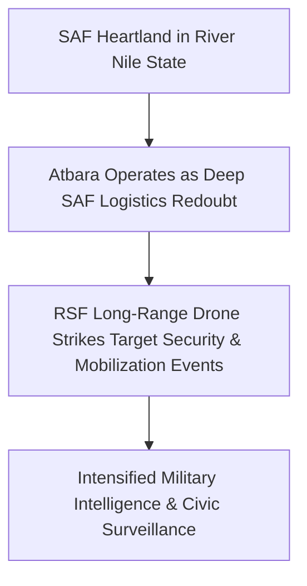

# Atbara

## 1. Geopolitical Identity & Strategic Significance

> [!NOTE] Industrial Rail Hub & Revolutionary Heartland
> **Atbara** (عطبرة), situated in River Nile State at the confluence of the Nile and Atbara rivers, is renowned as Sudan's historic "Railway City" and the cradle of the nation's labor movement and modern revolutionary uprisings. Strategically positioned along the vital transport artery connecting Khartoum to [[Port Sudan]], Atbara serves as a central industrial logistics nexus and commercial hub for northern Sudan.

## 2. Territorial Control History & Armed Presence

Atbara has remained under firm [[Sudanese Armed Forces]] (SAF) territorial control throughout the war. The city hosts major military installations, artillery depots, and training facilities for newly mobilized popular defense brigades. However, its strategic rear-echelon status has rendered it a frequent target for long-range suicide drone strikes conducted by the [[Rapid Support Forces]] (RSF).

## 3. Key Infrastructure, Trade Corridors & Resources

- **Sudan Railways Network**: Headquarters of the national railway network, housing central repair workshops, locomotive depots, and marshalling yards.
- **National Transportation Junction**: Strategic crossing point for the Atbara River Bridge, linking the agricultural hinterlands of the Nile valley to the Red Sea highway passing through [[Haiya]].
- **Industrial Cement & Manufacturing Plants**: Major cement factories (including Berber and Atbara plants) that provide essential industrial capacity.

## 4. Humanitarian Status, Displacement & Civil Services

- **IDP Haven and Regional Staging Post**: Hosted tens of thousands of displaced families fleeing Khartoum and Gezira, absorbing significant pressure on public education and health facilities.
- **Civic Crackdown on Independent Networks**: SAF Military Intelligence (GI) has subjected local [[Sudanese Resistance Committees]] and trade union organizers to arbitrary detentions, house raids, and restrictions on civic gatherings under emergency decrees.

## 5. Chronological Log of Major Conflict Events

- **2018-12-19**: High school students and workers in Atbara ignite the nationwide revolution against Omar al-Bashir by torching the ruling party headquarters.
- **2024-04-02**: A suicide drone strike targets an iftar gathering organized by the SAF-aligned Baraa ibn Malik brigade in Atbara, killing 12 people and wounding over 30.
- **2026-10-31**: Power station disruptions triggered by the [[2026-10-31 Haiya Oil Pumping and Power Station Drone Strike]] cascade into the River Nile State grid, causing blackouts across Atbara.

## Related Primitives

- **Events**:
  - [[2026-10-31 Haiya Oil Pumping and Power Station Drone Strike]]
- **Actors**:
  - [[Sudanese Armed Forces]]
  - [[Rapid Support Forces]]
  - [[Sudanese Resistance Committees]]
- **Locations**:
  - [[Port Sudan]]
  - [[Haiya]]
  - [[Khartoum State]]
- **Themes**:
  - [[Energy Infrastructure Targeting in the Sudan War]]
  - [[State Surveillance and Civic Space Contraction in Sudan]]
