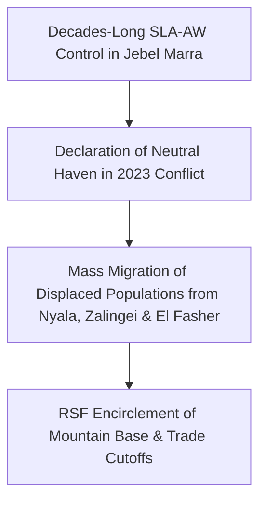

# Jebel Marra

> [!NOTE] Mountain Bastion & Humanitarian Enclave
> **Jebel Marra** (`جبل مرة` / `SD04003`) is an elevated volcanic mountain range straddling Central, South, and North Darfur. Controlled for decades by the non-signatory [[Sudan Liberation Movement (al-Nur)]] (SLA-AW), the fertile and rugged massif has served as a strategic mountain bastion and refuge for hundreds of thousands of displaced Darfuri civilians seeking safety from RSF and SAF offensives.

---

## 1. Geopolitical Identity & Strategic Significance

Jebel Marra represents a unique geopolitical enclave within the broader Darfur theatre. Unlike lowland urban capitals captured by the [[Rapid Support Forces]], the mountain redoubt remains under the administrative and military dominance of the [[Sudan Liberation Movement (al-Nur)]] led by Abdul Wahid al-Nur. Its mountainous topography, fertile volcanic soils, and subterranean caves provide defensive protection and agricultural sustenance, making it an independent actor outside both SAF and RSF alliances.

---

## 2. Territorial Control History & Armed Presence

SLA-AW forces maintain checkpoints and civil administrative bodies across upper Jebel Marra localities (including Rokero, Golo, and Deribat). While SLA-AW has officially maintained non-belligerency toward both the SAF and RSF during the current conflict, RSF units have established encircling perimeters around lowland foothill approaches, severely constricting commercial access.

---

## 3. Key Infrastructure, Trade Corridors & Resources

- **Terraced Mountain Agriculture**: Produces temperate fruit, wheat, and vegetables that historically fed central Darfuri markets in Nyala and Zalingei.
- **Foothill Trade Chokepoints**: Mountain passes connecting Jebel Marra to [[Nyala]] (`SD03001`) and Zalingei are heavily taxed and monitored by RSF checkpoints.
- **Natural Cave Defenses**: Extensive volcanic caverns provide protection against high-altitude aerial bombardment and drone reconnaissance.

---

## 4. Humanitarian Status, Displacement & Civil Services

- **Acute Malnutrition Crisis**: Severe isolation and commercial blockades have triggered catastrophic child malnutrition alerts, with independent monitors and MSF reporting child fatalities from starvation and preventable illnesses.
- **Overburdened IDP Settlements**: Over 200,000 internally displaced persons from El Fasher, Nyala, and Tawila have sought refuge in makeshift mountain camps without adequate winter clothing, sanitation, or medicine.
- **Isolated Medical Posts**: Primary healthcare clinics in Golo and Rokero operate with exhausted pharmaceutical supplies and no electricity.

---

## 5. Chronological Log of Major Conflict Events

- **2023-04-15**: SLA-AW declares Jebel Marra an open humanitarian haven for fleeing civilians of all ethnic backgrounds.
- **2023-11-01**: Influx of tens of thousands of IDPs following the RSF takeover of Nyala and Zalingei.
- **2026-10-28**: Dispatches from Nyala and Jebel Marra document severe acute child malnutrition and deaths in mountain settlements due to the total siege of commercial supply lines.

---

## Related Primitives

- **Parent Region**: [[South Darfur]], Central Darfur
- **Controlling Movement**: [[Sudan Liberation Movement (al-Nur)]]
- **Adjacent Urban Hubs**: [[Nyala]]
- **Key Themes**: [[War Economy and Commercial Blockades in Sudan]], [[Ethnic Cleansing and Genocidal Patterns in Darfur]]
