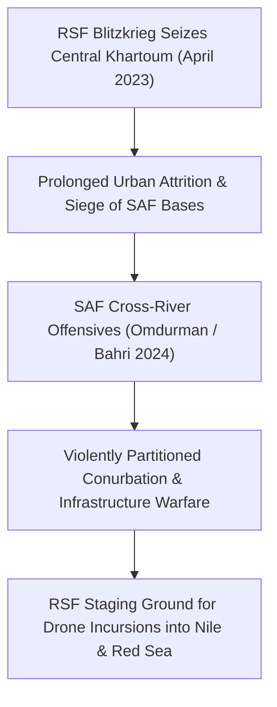

# Khartoum State

## 1. Geopolitical Identity & Strategic Significance

> [!NOTE] Capital State & Core Political Epicentre
> **Khartoum State** (ولاية الخرطوم) is the political, economic, and cultural heartland of Sudan, comprising the tri-city capital conurbation of Khartoum, Omdurman, and Khartoum North (Bahri) situated at the confluence of the Blue and White Niles. As the seat of sovereign ministries, financial institutions, national armed forces headquarters, and major industrial hubs, control over Khartoum State represents the ultimate geopolitical prize of the Sudan conflict.

## 2. Territorial Control History & Armed Presence

At the onset of fighting on 15 April 2023, the [[Rapid Support Forces]] (RSF) rapidly seized strategic sites including the Republican Palace, Khartoum International Airport, and major civilian ministries. The [[Sudanese Armed Forces]] (SAF) retained control of entrenched military redoubts (Wadi Seidna Air Base, Karari, and the Armored Corps). SAF launched counter-offensives regaining significant sections of Old Omdurman and crossing the Halfaya Bridge into northern Bahri in late 2024, leaving the state fiercely contested and deeply fragmented.

## 3. Key Infrastructure, Trade Corridors & Resources

- **Strategic Bridges & River Crossings**: Key Nile bridges—including Halfaya, Shambat (destroyed Nov 2023), Tuti, Kobar, and White Nile Bridge—serve as heavily contested tactical bottlenecks.
- **Energy and Industrial Assets**: Houses the Khartoum Oil Refinery (al-Jaili), high-voltage transformer stations (Markhiyat, Bahri), and transmission corridors connecting eastern hydropower to the national grid.
- **Communications Hubs**: Core national telecommunications exchanges, server farms, and satellite uplinks concentrated in downtown Khartoum.

## 4. Humanitarian Status, Displacement & Civil Services

- **Mass Exodus and Ghost City Dynamics**: Over 3.5 million residents displaced from urban neighborhoods, creating catastrophic depopulation in central and southern Khartoum.
- **Collapse of Urban Public Health**: Complete devastation of major tertiary hospitals, systematic looting of pharmaceuticals, and frequent destruction of water purification plants.
- **Grassroots Resilience**: The lifeline of civilian survival has been anchored by neighborhood [[Emergency Response Rooms]] operating communal feeding centers amid sniper fire and artillery bombardment.

## 5. Chronological Log of Major Conflict Events

- **2023-04-15**: Simultaneous armed outbreaks across Khartoum State initiate the nationwide civil war.
- **2023-11-11**: Strategic Shambat Bridge connecting Omdurman and Khartoum North is blown up, disrupting RSF resupply routes.
- **2024-02-16**: SAF breaks the RSF siege of the Engineer Corps in Omdurman, marking a major turning point in urban fighting.
- **2024-09-26**: SAF launches major multi-axis cross-river assault from Omdurman into Bahri and central Khartoum.
- **2026-10-31**: Sabotage and drone strikes against eastern power stations reverberate across Khartoum State grids, worsening widespread electricity blackouts.

## Related Primitives

- **Events**:
  - [[2026-10 Sudan Drone Warfare Escalation]]
  - [[2026-10-31 Haiya Oil Pumping and Power Station Drone Strike]]
- **Actors**:
  - [[Sudanese Armed Forces]]
  - [[Rapid Support Forces]]
  - [[Emergency Response Rooms]]
  - [[Sudanese Resistance Committees]]
- **Locations**:
  - [[Port Sudan]]
  - [[Atbara]]
- **Themes**:
  - [[Energy Infrastructure Targeting in the Sudan War]]
  - [[State Surveillance and Civic Space Contraction in Sudan]]
