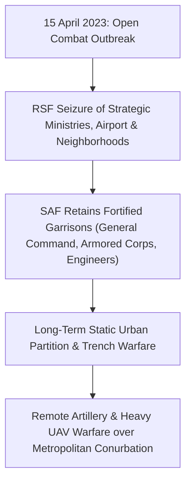

# Khartoum

> [!NOTE] National Capital & Urban Centre
> **Khartoum** (`الخرطوم` / `SD01001`) is the national capital of the Republic of the Sudan, situated at the confluence of the White Nile and Blue Nile. The city anchors the greater tripartite metropolitan area alongside Omdurman and Bahri, representing the historical political, economic, administrative, and cultural epicentre of the modern Sudanese state.

---

## 1. Geopolitical Identity & Strategic Significance

Khartoum is the sovereign administrative centre of Sudan, hosting the Republican Palace, General Command headquarters of the [[Sudanese Armed Forces]], government ministries, central banking institutions, and foreign embassies. Following the outbreak of the war on 15 April 2023, the city became an intense urban combat theatre, resulting in extensive physical devastation, mass civilian displacement, and the relocation of executive sovereign functions to [[Port Sudan]].

---

## 2. Territorial Control History & Armed Presence

From the opening days of hostilities, the [[Rapid Support Forces]] established control over large residential areas, central avenues, and key infrastructure across Khartoum, while the [[Sudanese Armed Forces]] entrenched within fortified military garrisons (including the General Command compound, the Armored Corps in Al-Shajara, and the Airborne Corps in Jabal Awliya). The city remains divided into contested sectors marked by static sniper perimeters, tactical drone strikes, and heavy artillery exchanges.

---

## 3. Key Infrastructure, Trade Corridors & Resources

- **Confluence Bridges**: Strategic bridges spanning the Blue and White Nile (including Mac Nimir, Blue Nile Bridge, Kober, Tuti, and Omdurman bridges) serve as heavily fortified chokepoints between Khartoum, Bahri, and Omdurman.
- **Tertiary Healthcare Nexus**: Centre of national medical infrastructure, including the Radiation and Isotopes Centre Khartoum ([[Khartoum Oncology Hospital]]), Khartoum Teaching Hospital, and central pharmaceutical storage depots.
- **Airport & Transportation**: Khartoum International Airport has remained closed and contested since April 2023, with runways and hangars heavily damaged by fire and airstrikes.

---

## 4. Humanitarian Status, Displacement & Civil Services

- **Acute Service Deprivation**: Prolonged power outages, shattered municipal water networks, and fuel blockades have deprived residual civilian populations of basic services, plunging residential areas into IPC Phase 4 (Emergency) hunger conditions.
- **Mutual Aid Response**: Grassroots civilian collectives, including the [[Emergency Response Rooms]] and local resistance committees, operate volunteer kitchens, emergency clinics, and evacuation corridors amid persistent detention risks.
- **Medical Emergency**: Blackouts and generator fuel shortages at facilities like [[Khartoum Oncology Hospital]] have paralyzed specialized oncology treatments and dialysis for hundreds of daily patients.

---

## 5. Chronological Log of Major Conflict Events

- **2023-04-15**: Rapid Support Forces assault the Republican Palace, Khartoum International Airport, and SAF General Command, igniting nationwide war.
- **2023-05-11**: SAF and RSF sign the Jeddah Declaration of Commitment to Protect the Civilians of Sudan, which is repeatedly violated across metropolitan Khartoum.
- **2024-03-12**: SAF breaks the RSF siege of Omdurman state radio and television headquarters, initiating a slow counter-offensive across the Nile conurbation.
- **2026-11-01**: Radiation and oncology linear accelerators at [[Khartoum Oncology Hospital]] cease operations due to power grid failure and fuel shortages.
- **2026-11-01**: [[Sudanese Teachers Committee]] declares a general civil strike from Khartoum over unpaid salaries.

---

## Related Primitives

- **Parent State**: [[Khartoum State]]
- **Tripartite Hubs**: Omdurman, Bahri
- **Active Belligerents**: [[Sudanese Armed Forces]], [[Rapid Support Forces]]
- **Civil Entities**: [[Emergency Response Rooms]], [[Sudanese Teachers Committee]]
- **Critical Infrastructure**: [[Khartoum Oncology Hospital]]
- **Connected Events**: [[2026-11-01 Ahmed Omar Appeal for Khartoum Oncology Radiotherapy]]
