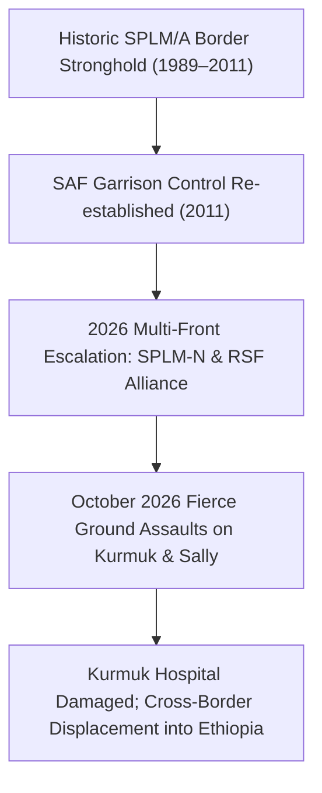

# Kurmuk

## 1. Geopolitical Identity & Strategic Significance

> [!NOTE] Strategic Border Gateway & Southern Conflict Epicentre
> **Kurmuk** (الكرمك) is a major border locality and historic trading town in [[Blue Nile State]], situated directly on Sudan's international frontier with Ethiopia opposite the Benishangul-Gumuz region and within proximate transit distance to [[Assosa]]. Due to its border topography, customs gateway, and historical role in Sudanese civil wars, Kurmuk represents a crucial strategic prize contested between the [[Sudanese Armed Forces]] (SAF) and the [[Sudan People's Liberation Movement-North (al-Hilu)]].

## 2. Territorial Control History & Armed Presence

Since the outbreak of the April 2023 conflict, Kurmuk has served as a heavily fortified SAF military redoubt. However, as documented in UN Human Rights Council report `A/HRC/65/CRP.1`, territorial control in and around Kurmuk and neighbouring Geissan has shifted repeatedly since early 2026, with major ground offensives launched by SPLM-N (al-Hilu) combatants in October 2026 to sever SAF supply lines.

## 3. Key Infrastructure, Trade Corridors & Resources

- **International Customs & Cross-Border Corridor**: Houses the primary land crossing linking southeastern Sudan directly into western Ethiopia and transit roads toward Assosa.
- **Kurmuk Hospital**: The sole secondary healthcare facility serving southern Blue Nile State; damaged during October 2026 ground fighting and artillery exchanges.
- **Agricultural & Extractive Hinterlands**: Gateway to valuable gum arabic, sesame, and artisanal gold mining zones in the Ingessana hills and southern foothills.

## 4. Humanitarian Status, Displacement & Civil Services

- **Mass Civilian Displacement**: Intense shelling and ground assaults have forced thousands of residents to flee north towards Ed Damazin or cross into Ethiopian refugee camps.
- **Severe Healthcare Breakdown**: The direct targeting and damage to Kurmuk Hospital deprived over 80,000 residents of surgical, obstetric, and trauma medical care.
- **Food Security Crisis**: Elevated to IPC Phase 4 (Emergency) as frontline fighting halted seasonal harvest activities and severed commercial trucking.

## 5. Chronological Log of Major Conflict Events

- **2011-09-01**: Eruption of the Blue Nile conflict between SAF and SPLM-N forces centered around Kurmuk.
- **2026-03-15**: Intense drone and artillery exchanges between SAF and RSF/SPLM-N units begin along the Kurmuk–Geissan border axis.
- **2026-10-19**: Heavy ground fighting between SAF and SPLM-N (al-Hilu) forces erupts in the immediate perimeter of Kurmuk.
- **2026-10-28**: UN Fact-Finding Mission report `A/HRC/65/CRP.1` confirms significant damage to Kurmuk Hospital and civilian displacement resulting from the October clashes.
- **2026-10-31**: An SAF drone strike targets the commercial market in Belila, Kurmuk locality, killing 5 civilians and injuring 4 others ([[2026-10-31 Belila Kurmuk Drone Strike]]).

## Related Primitives

- **Events**: [[2026-10-31 Belila Kurmuk Drone Strike]], [[2026-10 Sudan Drone Warfare Escalation]]
  - [[2026-10 Sudan Drone Warfare Escalation]]
- **Actors**:
  - [[Sudan People's Liberation Movement-North (al-Hilu)]]
  - [[Sudanese Armed Forces]]
  - [[Rapid Support Forces]]
- **Locations**:
  - [[Blue Nile State]]
  - [[Assosa]]
- **Themes**:
  - [[Regional Proxy Warfare and Transnational Drone Supply Networks in Sudan]]
- **Timelines**:
  - [[2026-10 Sudan Conflict Chronicle]]
