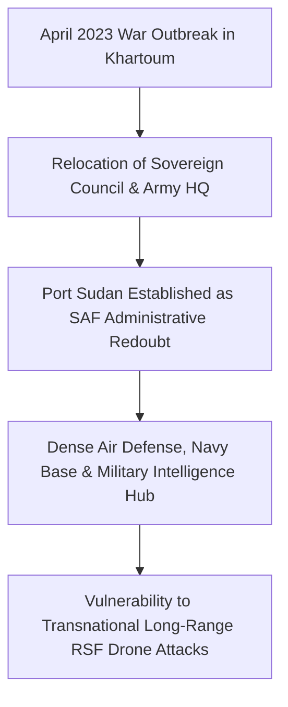

# Port Sudan

## 1. Geopolitical Identity & Strategic Significance

> [!NOTE] Strategic Coastal Hub & Wartime De Facto Capital
> **Port Sudan** (بورتسودان) is the capital of [[Red Sea State]] and Sudan's primary maritime commercial port on the Red Sea. Following the eruption of intense urban warfare in Khartoum in April 2023, Port Sudan transformed into the de facto wartime administrative capital and diplomatic seat of the [[Transitional Sovereignty Council]], government ministries, foreign embassies, and United Nations humanitarian country teams.

## 2. Territorial Control History & Armed Presence

Port Sudan has remained under absolute control of the [[Sudanese Armed Forces]] (SAF) throughout the conflict. As the central logistical redoubt of the state, the city hosts the General Command headquarters of General Abdel Fattah al-Burhan, the Port Sudan Naval Base, and military intelligence directorates. The SAF maintains fortified security rings and air defense coverage around the city and its international airport.

## 3. Key Infrastructure, Trade Corridors & Resources

- **Maritime Terminals**: Houses Port Sudan Harbor, Southern Container Terminal, and Bashayer Marine Oil Terminal, handling over 90% of Sudan's foreign trade and crude oil exports.
- **Critical Transport Corridors**: Terminal hub for the vital national highway connecting the Red Sea coast through [[Haiya]] and [[Atbara]] to Khartoum and northern state agricultural breadbaskets.
- **Port Sudan International Airport**: The primary operational gateway for international diplomatic delegations, humanitarian cargo flights, and civilian commercial aviation.

## 4. Humanitarian Status, Displacement & Civil Services

- **Displacement Influx**: Absorbed over 500,000 internally displaced persons (IDPs) fleeing fighting in Khartoum, Gezira, and Darfur, severely straining municipal water, power, and sanitation systems.
- **UN Humanitarian Lifeline**: Acts as the staging base for UN OCHA, WFP, UNICEF, and international non-governmental organizations managing relief convoys into the interior.
- **Civic Space Contraction**: Subject to heightened wartime surveillance, military intelligence screenings, and arbitrary detentions of independent activists, lawyers, and aid coordinators.

## 5. Chronological Log of Major Conflict Events

- **2023-04-18**: International evacuation operations begin via Port Sudan harbor and airport.
- **2023-08-27**: Sovereign Council Chairman Abdel Fattah al-Burhan arrives in Port Sudan, formally designating it the wartime government seat.
- **2024-05-06**: SAF air defenses intercept hostile surveillance and suicide drones targeting Port Sudan airport.
- **2026-10-31**: RSF long-range drone strikes strike the critical Haiya pumping station 200 km southwest, threatening electricity supply and fuel corridors to Port Sudan.

## Related Primitives

- **Events**:
  - [[2026-10-31 Haiya Oil Pumping and Power Station Drone Strike]]
- **Actors**:
  - [[Transitional Sovereignty Council]]
  - [[Sudanese Armed Forces]]
  - [[Ministry of Foreign Affairs (Sudan)]]
- **Locations**:
  - [[Red Sea State]]
  - [[Haiya]]
  - [[Atbara]]
- **Themes**:
  - [[Energy Infrastructure Targeting in the Sudan War]]
  - [[State Surveillance and Civic Space Contraction in Sudan]]
