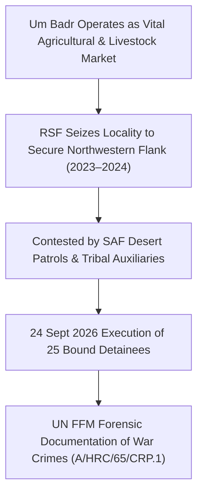

# Um Badr

## 1. Geopolitical Identity & Strategic Significance

> [!NOTE] Rural Trade Nexus & Northwestern Transit Gateway
> **Um Badr** (أم بادر) is a major locality and commercial oasis settlement located in northwestern [[North Kordofan]], approximately 270 kilometers northwest of [[El Obeid]]. Renowned for its natural freshwater lake (Lake Um Badr) and vibrant livestock and agricultural market, Um Badr sits strategically along historical trade and nomadic transhumance corridors linking Kordofan with Northern State and Darfur.

## 2. Territorial Control History & Armed Presence

Following the outbreak of civil war in 2023, the [[Rapid Support Forces]] (RSF) established garrisons across Um Badr to protect their logistical corridors connecting North Kordofan to North Darfur. The locality experienced heightened military pressure in September 2026 as the [[Sudanese Armed Forces]] (SAF) launched counter-offensives recapturing nearby Sodari, triggering punitive and coercive violence by RSF militia elements.

## 3. Key Infrastructure, Trade Corridors & Resources

- **Um Badr Commercial Market**: A primary trading center for gum arabic, sesame, millet, and livestock supplying regional markets in El Obeid and Omdurman.
- **Lake Um Badr Water Basin**: One of the few permanent freshwater reservoirs in the semi-arid Sahelian belt of North Kordofan, essential for pastoralist herds.
- **Desert Supply Trails**: Strategic desert tracks connecting Kordofan directly into Northern State and western Chad border pipelines.

## 4. Humanitarian Status, Displacement & Civil Services

- **Acute Humanitarian Protection Risks**: The absence of civilian rule of law and the presence of heavily armed non-state actors has created an environment of widespread extortion, looting, and summary violence.
- **Severe Displacement**: The 24 September 2026 market executions triggered panic and mass displacement into remote desert scrublands with minimal access to water or medical supplies.
- **Food Security Stress**: Classified as IPC Phase 4 (Emergency) due to market disruptions and armed blockades.

## 5. Chronological Log of Major Conflict Events

- **2023-08-10**: RSF mobile columns occupy Um Badr town center, establishing checkpoint networks.
- **2026-09-24**: RSF combatants summarily execute approximately 25 blindfolded detainees with bound hands in Um Badr market on accusations of looting.
- **2026-10-28**: United Nations Fact-Finding Mission formally qualifies the Um Badr execution as a war crime under Common Article 3 of the Geneva Conventions (`A/HRC/65/CRP.1`, Para 37).

## Related Primitives

- **Events**:
  - [[2026-09-24 Um Badr Market Summary Executions]]
- **Actors**:
  - [[Rapid Support Forces]]
  - [[Sudanese Armed Forces]]
  - [[Independent International Fact-Finding Mission for the Sudan]]
- **Locations**:
  - [[North Kordofan]]
  - [[El Obeid]]
- **Themes**:
  - [[Arbitrary Detention and Custodial Torture in the Sudan War]]
  - [[International Accountability and Fact-Finding Mechanisms in Sudan]]
- **Timelines**:
  - [[2026-09 Sudan Conflict Chronicle]]
  - [[Sudan Accountability and International Justice Timeline]]
