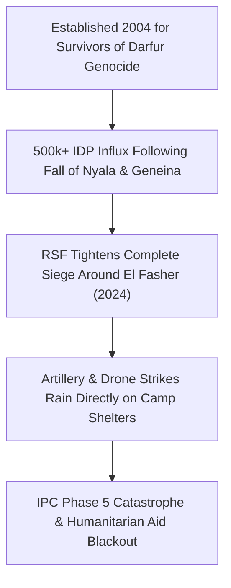

# Zamzam IDP Camp

## 1. Geopolitical Identity & Strategic Significance

> [!NOTE] Epicentre of Famine & Darfur Displacement Crisis
> **Zamzam IDP Camp** (مخيم زمزم) is one of Sudan's largest and oldest internally displaced persons camps, located approximately 15 kilometers south of [[El Fasher]] in [[North Darfur]]. Originally established during the 2003–2005 Darfur genocide to shelter survivors of Janjaweed ethnic cleansing, Zamzam ballooned to over 500,000 residents following fresh waves of displacement during the 2023–2024 war. In August 2024, the UN-backed Famine Review Committee (FRC) formally declared that IPC Phase 5 (Famine) conditions had taken hold in Zamzam Camp.

## 2. Territorial Control History & Armed Presence

Throughout 2024 and 2025, Zamzam Camp was defended by local self-defense volunteers and elements of the [[Joint Darfur Force]]. Surrounding positions have been subjected to relentless encircling assaults, long-range artillery shelling, and sniper fire from the [[Rapid Support Forces]] (RSF), turning the sprawling tent settlement into a frontline combat zone.

## 3. Key Infrastructure, Trade Corridors & Resources

- **Rudimentary Humanitarian Facilities**: Primitive clay brick clinics, makeshift community schools, and communal water hand-pumps, most of which were damaged or ran dry due to fuel shortages.
- **Severed Supply Corridors**: Straddles the southern approach road to El Fasher; completely blockaded by RSF checkpoints that confiscate food, therapeutic nutritional pastes, and fuel tankers.
- **Informal Relief Lifelines**: Highly vulnerable camel and donkey caravans attempting to smuggle flour and life-saving medications across siege lines.

## 4. Humanitarian Status, Displacement & Civil Services

- **IPC Phase 5 (Famine)**: Formally confirmed by international food security experts in August 2024. Child mortality rates soared above emergency thresholds, with a child dying every two hours from acute malnutrition.
- **Healthcare Devastation**: Field clinics run by Médecins Sans Frontières (MSF) and local volunteers were repeatedly forced to suspend operations after receiving direct hits from artillery and rifle fire.
- **Targeted Atrocities**: Human rights monitors recorded systematic executions, looting of food rations, and sexual violence targeting women venturing outside camp perimeters to gather firewood.

## 5. Chronological Log of Major Conflict Events

- **2024-05-22**: RSF artillery shells strike residential quarters of Zamzam Camp, killing dozens of displaced civilians and destroying hundreds of plastic-sheet shelters.
- **2024-08-01**: Integrated Food Security Phase Classification (IPC) Famine Review Committee officially declares IPC Phase 5 Famine in Zamzam IDP Camp.
- **2025-10-15**: The catastrophic culmination of the El Fasher siege cuts all remaining relief access to Zamzam Camp, precipitating unprecedented civilian casualties from starvation and disease.
- **2026-02-19**: UN Special Adviser on the Prevention of Genocide Alice Wairimu Nderitu cites conditions in Zamzam Camp as bearing all the hallmarks of genocide.

## Related Primitives

- **Events**:
  - [[2025-10 El Fasher Siege and RSF Takeover Atrocities]]
- **Actors**:
  - [[Joint Darfur Force]]
  - [[Rapid Support Forces]]
  - [[Sudanese Armed Forces]]
- **Locations**:
  - [[El Fasher]]
  - [[North Darfur]]
- **Themes**:
  - [[Ethnic Cleansing and Genocidal Patterns in Darfur]]
  - [[International Accountability and Fact-Finding Mechanisms in Sudan]]
- **Timelines**:
  - [[El Fasher Siege and Genocide Investigation Timeline]]
