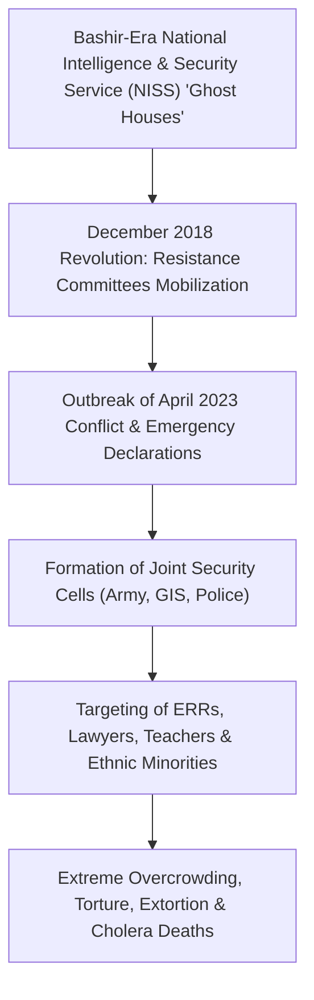

# Arbitrary Detention and Custodial Torture in the Sudan War

## 1. Core Thesis & Structural Mechanism ("Why")

> [!NOTE] Definitional Anchor & Structural Thesis
> In the Sudanese civil war, **arbitrary detention, enforced disappearance, and custodial torture** operate not merely as incidental abuses of power, but as a deliberate, institutionalized mechanism of political control and population pacification deployed by both the [[Sudanese Armed Forces]] (SAF) and the [[Rapid Support Forces]] (RSF). Through joint military-intelligence apparatuses such as the SAF "Security Cells" (*Al-Khaliyya al-Amniyya*) and RSF detention compounds, the warring parties weaponize loosely framed emergency decrees to systematically criminalize civil society, pro-democracy activists, trade unionists, and humanitarian responders under pretextual accusations of collaboration with opposing forces.

## 2. Historical Roots & Political Economy Anatomy

The infrastructure of custodial repression in wartime Sudan represents the direct continuity and militarized reconstitution of the National Intelligence and Security Service (NISS) "ghost houses" (*buyut al-ashbah*) that underpinned the 30-year dictatorship of Omar al-Bashir. Following the October 2021 coup and the outbreak of open hostilities in April 2023, state security agencies resurrected emergency powers, creating specialized municipal Security Cells that combine army military intelligence, the General Intelligence Service (GIS), and police forces into unmonitored enforcement arms exempt from civilian judicial oversight.

## 3. Operational Manifestations Across Frontlines

The operational anatomy of custodial repression documented by the United Nations Fact-Finding Mission in `A/HRC/65/CRP.1` reveals consistent patterns across combat theatres:
- **Sub-Human Detention Conditions**: At the SAF-controlled El Obeid Central Prison, over 2,000 detainees were packed into a facility with an official capacity of 450. In unofficial Security Cell holding cells, between 35 and 40 individuals were crammed into rooms measuring 2.5 by 2 meters, denying detainees space to sit or lie down.
- **Systematic Torture and Coercion**: Interrogations routinely feature beatings with water hoses, iron rods, and whips, accompanied by death threats, tribal slurs, and coercive demands to sign unread confessions.
- **Custodial Deaths & Infectious Outbreaks**: Contaminated saline drinking water and catastrophic sanitary conditions (up to 200 detainees sharing a single toilet) fostered lethal outbreaks of cholera and dysentery, leading to multiple uninvestigated deaths in custody.
- **Gendered Violence and Abuse of Power**: Female detainees, including pregnant women and mothers detained with infants, face harassment, denial of basic menstrual hygiene supplies, and documented demands for sexual acts by security personnel in exchange for release or family visitations.

## 4. Humanitarian, Regional & Diplomatic Consequences

- **Evisceration of Frontline Humanitarian Mutual Aid**: Arbitrary arrests specifically targeting [[Emergency Response Rooms]] (ERRs) and community soup kitchens paralyze local survival networks in besieged zones where international aid agencies are physically absent.
- **Chilling Effect on Human Rights Documentation**: Fear of custodial reprisals deters survivors and eyewitnesses from recording drone strikes, photographing munitions fragments, or providing evidence to international accountability bodies.
- **War Crimes Qualification**: Under international humanitarian law (Common Article 3 of the Geneva Conventions) and international human rights law, torture, outrages upon personal dignity, and summary executions of persons in custody constitute grave war crimes carrying individual criminal liability.

## 5. Empirical Debates, Uncertainties & Competing Analyses

| Dimension | State / SAF Security Perspective | RSF Militia Counter-Perspective | Independent International Forensic Consensus (FFM) |
| :--- | :--- | :--- | :--- |
| **Justification for Detention** | Essential wartime counter-espionage against internal fifth-column "sleeper cells" aiding RSF drone and artillery targeting. | Claims detention centers hold captured army combatants and looters to maintain public order in liberated areas. | **State Repression & War Crimes**: Wholesale targeting of civilians based on ethnicity, peaceful civic activism, or professional activities; complete denial of due process. |
| **Judicial Oversight** | Claims emergency state laws permit preventative detention under Sovereign Council decrees. | Denies operating illegal detention compounds. | **Systematic Impunity**: Total absence of prompt judicial review, denial of legal counsel, and reliance on confessions extracted under torture. |

## Related Primitives

- **Events**:
  - [[2026-09-24 Um Badr Market Summary Executions]]
  - [[2026-10 El Obeid Siege and Drone Warfare Escalation]]
- **Actors**:
  - [[Sudanese Armed Forces]]
  - [[Rapid Support Forces]]
  - [[Independent International Fact-Finding Mission for the Sudan]]
  - [[International Criminal Court]]
  - [[Emergency Response Rooms]]
  - [[Sudanese Resistance Committees]]
- **Locations**:
  - [[El Obeid]]
  - [[North Kordofan]]
  - [[Um Badr]]
- **Timelines**:
  - [[Sudan Accountability and International Justice Timeline]]
  - [[2026-09 Sudan Conflict Chronicle]]
