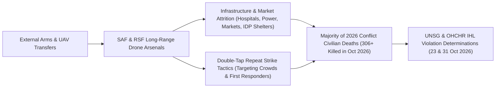

# Drone Proliferation and Double-Tap Strike Doctrine in Sudan

## 1. Core Thesis & Structural Mechanism ("Why")

> [!IMPORTANT] Structural Mechanism Anchor (`DEFINITIONAL_ANCHOR`)
> By late 2026, unmanned aerial vehicles (UAVs / drones) operated by both the [[Sudanese Armed Forces]] and the [[Rapid Support Forces]] evolved from auxiliary reconnaissance platforms into the **primary instrument of conflict-related civilian mortality in Sudan** ([[2026-10-23 Volker Türk Condemnation of Sudan Drone Escalation and Arms Influx]]). Sustained external arms transfers enabled both belligerents to conduct deep-rear bombardment of markets, hospitals, IDP shelters, and transport arteries across Sudan and [[Abyei]], amplified by **"double-tap" repeat strikes** that target survivors and first responders in direct violation of international humanitarian law ([[sources/2026-10-23-un-news-sudan-drone-strikes-306-killed]], [[sources/2026-10-31-unsg-spokesperson-escalating-drone-attacks-sudan]]).

---

## 2. Historical Roots & Political Economy Anatomy

The structural shift toward drone-dominated attrition warfare in Sudan rests on three political-economy pillars:

1. **Unchecked External Arms Transfers**: As highlighted by UN High Commissioner for Human Rights [[Volker Türk]], continuous inflows of foreign-supplied UAVs, loitering munitions, and guidance components allowed both [[Sudanese Armed Forces]] and [[Rapid Support Forces]] to bypass ground stalemates and project lethal force across Kordofan, Darfur, [[Blue Nile State]], and Khartoum State ([[2026-10-23 Volker Türk Condemnation of Sudan Drone Escalation and Arms Influx]]).
2. **Low-Cost Stand-Off Interdiction**: Drones provide a low-risk alternative to manned aircraft or ground offensives, enabling strikes inside rival-held territory—such as [[Rapid Support Forces]]-controlled Dibab in [[West Kordofan]] or displacement hubs in [[Blue Nile State]].
3. **War Economy & Livelihood Targeting**: Belligerents systematically target economic congregation points in rival zones, including artisanal gold-mining sites worked by displaced families (such as Abu Shendi in [[Blue Nile State]]) and regional commercial markets (such as Amiet Market in [[Abyei]]) ([[2026-10 Sudan Drone Warfare Escalation]]).

---

## 3. Operational Manifestations Across Frontlines

During the [[2026-10 Sudan Drone Warfare Escalation]] (`2026-10-01` to `2026-10-31`), [[OHCHR]], [[UNISFA]], and the [[United Nations]] Secretariat documented five signature operational patterns across Sudan ([[sources/2026-10-23-un-news-sudan-drone-strikes-306-killed]], [[sources/2026-10-31-unsg-spokesperson-escalating-drone-attacks-sudan]]):

| Tactical Pattern | Frontline Manifestation (October 2026) | Attributed Actor | Documented Impact |
| :--- | :--- | :--- | :--- |
| **Double-Tap Transport Interdiction** | [[2026-10-18 Dibab Double-Tap Drone Strike]] in [[West Kordofan]] (`SD18`) | Unspecified operator (in [[Rapid Support Forces]]-held zone) | Repeat strike on a transportation truck killed **at least 139 people**. |
| **Commercial Market Bombardment in Demilitarized Zones** | [[2026-10-19 Abyei Amiet Market and Todach Drone Strike]] in [[Abyei]] (`SD18001`) | Unspecified operator | **80+ killed**, **27+ injured**, market stalls burned down ([[2026-10-23 Muhammad Farooq First-Responder Account of Amiet Market Fire]]). |
| **IDP Shelter Strikes** | Ghubeish and El Nuhud strikes (`2026-10-06` to `2026-10-10`) in [[West Kordofan]] (`SD18`) | Alleged [[Sudanese Armed Forces]] | **25+ displaced civilians killed**, including women and children. |
| **War-Economy / IDP Livelihood Strikes** | Abu Shendi artisanal gold-mining strike (`2026-10-09`) in [[Blue Nile State]] (`SD17`) | Alleged [[Rapid Support Forces]] | **31+ displaced people killed**, predominantly women and children. |
| **Medical & Utility Infrastructure Evisceration** | Um Darfa hospital strike (`2026-10-11`) in [[Blue Nile State]] (`SD17`) + power/water strikes | [[Rapid Support Forces]] & [[Sudanese Armed Forces]] | **2 health workers seriously injured**; hospital closed ([[2026-10-23 Seif Magango Statement on Evisceration of Civilian Infrastructure in Sudan]], [[2026-10-31 Stéphane Dujarric UNSG Statement Condemning Escalating Drone Attacks in Sudan and Abyei]]). |

---

## 4. Humanitarian, Regional & Diplomatic Consequences

- **Evisceration of Vital Civilian Services**: [[OHCHR]] spokesperson [[Seif Magango]] warned that drone strikes on hospitals, water networks, and power stations have *"eviscerated"* essential services and triggered secondary displacement of already uprooted populations ([[2026-10-23 Seif Magango Statement on Evisceration of Civilian Infrastructure in Sudan]]).
- **Collapse of Household Survival Strategies**: Survivors at Amiet Market such as [[Angelina Musa Diaw]] lost all commercial stock and means of supporting their children ([[2026-10-23 Angelina Musa Diaw Survivor Testimony on Amiet Market Destruction]]).
- **International Humanitarian Law & Executive Ceasefire Demands (`2026-10-23` & `2026-10-31`)**: Both the UN Security Council and High Commissioner [[Volker Türk]] warned on 23 October 2026 that these strikes violate international humanitarian law (IHL) principles of distinction and proportionality and may amount to **war crimes**, pressing states to halt arms transfers fueling the conflict ([[2026-10-23 Volker Türk Condemnation of Sudan Drone Escalation and Arms Influx]]). On 31 October 2026, [[United Nations]] Secretary-General [[António Guterres]] (via Spokesperson [[Stéphane Dujarric]]) formally declared that the drone attacks across Sudan and [[Abyei]] killing hundreds of civilians—including women and children—and striking health facilities **constitute violations of international humanitarian law**, calling on the parties to agree without delay to a cessation of hostilities and engage in good-faith mediation ([[2026-10-31 Stéphane Dujarric UNSG Statement Condemning Escalating Drone Attacks in Sudan and Abyei]], [[2026-10-31 António Guterres Appeal for Immediate Cessation of Hostilities and Good-Faith Mediation in Sudan]]).

---

## 5. Empirical Debates, Uncertainties & Competing Analyses

- **Forensic Attribution Deniability**: Because long-range UAVs and loitering munitions can be launched from distant staging bases without aircrew identification, both [[Sudanese Armed Forces]] and [[Rapid Support Forces]] routinely exploit plausible deniability in high-casualty incidents such as the [[2026-10-18 Dibab Double-Tap Drone Strike]] and the [[2026-10-19 Abyei Amiet Market and Todach Drone Strike]].

---

## Related Primitives

- **Grounded Events & Timelines**: [[2026-10 Sudan Drone Warfare Escalation]], [[2026-10-18 Dibab Double-Tap Drone Strike]], [[2026-10-19 Abyei Amiet Market and Todach Drone Strike]], [[2026-10 Sudan Conflict Chronicle]], [[Sudan Drone Warfare and Double-Tap Strike Timeline]]
- **Actors**: [[Sudanese Armed Forces]], [[Rapid Support Forces]], [[United Nations]], [[OHCHR]], [[UNISFA]], [[UN News]], [[Office of the Spokesperson for the Secretary-General]]
- **Quoted Persons**: [[António Guterres]], [[Stéphane Dujarric]], [[Volker Türk]], [[Seif Magango]], [[Muhammad Farooq]], [[Adebowale Ajabge]], [[Angelina Musa Diaw]]
- **Standalone Citations**: [[2026-10-31 Stéphane Dujarric UNSG Statement Condemning Escalating Drone Attacks in Sudan and Abyei]], [[2026-10-31 António Guterres Appeal for Immediate Cessation of Hostilities and Good-Faith Mediation in Sudan]], [[2026-10-23 Volker Türk Condemnation of Sudan Drone Escalation and Arms Influx]], [[2026-10-23 Seif Magango Statement on Evisceration of Civilian Infrastructure in Sudan]], [[2026-10-23 Muhammad Farooq First-Responder Account of Amiet Market Fire]], [[2026-10-23 Adebowale Ajabge Report on UNISFA Emergency Response and Todach Evacuations]], [[2026-10-23 Angelina Musa Diaw Survivor Testimony on Amiet Market Destruction]]
- **Locations**: [[West Kordofan]], [[Blue Nile State]], [[Abyei]]
- **Originating Sources**: [[sources/2026-10-23-un-news-sudan-drone-strikes-306-killed]], [[sources/2026-10-31-unsg-spokesperson-escalating-drone-attacks-sudan]]
