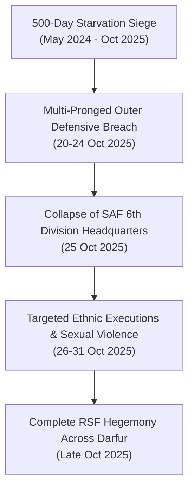

# 2025-10 Sudan Conflict Chronicle

> [!NOTE] Bitemporal Monthly Chronicle Anchor
> - **Temporal Horizon**: `2025-10-01` to `2025-10-31` (focusing on the final assault, fall, and mass atrocities in El Fasher).
> - **Primary Theatre**: Darfur Theatre ([[El Fasher]], [[North Darfur]]).
> - **Cumulative Fatalities**: Estimated `1,500` to `5,000+` civilians and combatants.
> - **Admiralty Composite Rating**: **`A1`** (`reliability_score: 0.95`).

---

## 1. Temporal Scope, Theatre Coverage & Strategic Periodization

October 2025 marked the decisive strategic turning point in the war in western Sudan. Following a grueling 500-day siege that subjected approximately 1.5 million civilians and IDPs to starvation and bombardment, the [[Rapid Support Forces]] (RSF) breached the defensive perimeter of [[El Fasher]], overrunning the [[Sudanese Armed Forces]] 6th Infantry Division and Joint Darfur Force positions. The month culminated in large-scale ethnically targeted massacres of non-Arab Fur and Zaghawa civilians, which the UN Fact-Finding Mission subsequently determined bore the hallmarks of genocide.

---

## 2. Chronological Event & Citation Ledger (Bitemporal Sequence)

| $t_{\text{valid}}$ | $t_{\text{reported}}$ | Entity / Incident / Document | Type | Location (`ADM1/ADM2`) | Key Belligerents | Fatalities / Impact | Primary Citation | Rating |
| :--- | :--- | :--- | :--- | :--- | :--- | :--- | :--- | :--- |
| `2025-10-05` | `2025-10-06` | Final Siege Defense Collapse | Ground Combat | [[El Fasher]], [[North Darfur]] | [[Rapid Support Forces]] vs. [[Sudanese Armed Forces]], [[Joint Darfur Force]] | Heavy artillery barrages; collapse of outer defensive lines. | Vault Records | `A2` |
| `2025-10-22` | `2025-10-23` | Overrun of Southern & Eastern Sectors | Urban Assault | [[El Fasher]] | [[Rapid Support Forces]] | Penetration into residential quarters; thousands flee toward Tawila. | Vault Records | `A2` |
| `2025-10-25` | `2025-10-26` | Fall of SAF 6th Division Garrison | City Fall | [[El Fasher]] | [[Rapid Support Forces]] | RSF declares capture of military headquarters; mass executions begin. | [[2025-10 El Fasher Siege and RSF Takeover Atrocities]] | `A1` |
| `2025-10-26` | `2026-02-19` | Targeted Ethnic Massacres in El Fasher | Atrocity Incident | [[El Fasher]] | [[Rapid Support Forces]] | Systematic execution of Zaghawa and Fur men; widespread sexual violence. | [[2026-02-19 Mona Rishmawi Statement on RSF Genocidal Intent Against Zaghawa and Fur Communities]] | `A1` |
| `2025-10-31` | `2025-11-01` | Consolidation of RSF Hegemony | Territorial Shift | [[North Darfur]] | [[Rapid Support Forces]] | RSF achieves control of all 5 Darfur state capitals. | [[sources/2026-02-19-un-news-el-fasher-hallmarks-of-genocide]] | `A1` |

---

## 3. Causal Escalation Chains, Turning Points & Tempo Analysis

---

## 4. Cumulative Humanitarian, Territorial & Attribution Telemetry

- **Territorial Shift**: Complete loss of SAF and Joint Darfur Force territorial presence across all Darfur state capitals.
- **Displacement**: Over 500,000 civilians displaced into rural North Darfur, Jebel Marra, and eastern Chad.
- **Attribution**: Primary responsibility for mass killings, sexual violence, and starvation siege attributed directly to the [[Rapid Support Forces]] and allied tribal militias.

---

## Related Primitives

- **Ground Incident**: [[2025-10 El Fasher Siege and RSF Takeover Atrocities]]
- **Geographic Center**: [[El Fasher]], [[North Darfur]]
- **Active Belligerents**: [[Rapid Support Forces]], [[Sudanese Armed Forces]], [[Joint Darfur Force]]
- **Forensic Findings**: [[Ethnic Cleansing and Genocidal Patterns in Darfur]], [[Independent International Fact-Finding Mission for the Sudan]]
