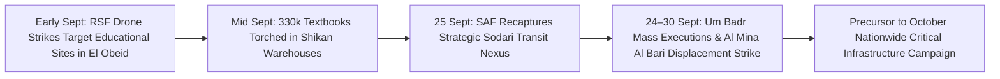

# 2026-09 Sudan Conflict Chronicle

## 1. Temporal Scope, Theatre Coverage & Strategic Periodization

> [!NOTE] Monthly Chronicle Anchor
> - **Temporal Horizon**: 1 September 2026 – 30 September 2026 ($t_{\text{valid}}$).
> - **Theatres Covered**: North Kordofan (El Obeid urban perimeter, Sodari, Um Badr, Bara corridor), Khartoum State conurbation, and Greater Darfur.
> - **Strategic Periodization**: Characterized by the SAF 5th Infantry Division's multi-axis western counter-offensive breaking rural RSF encirclement routes in North Kordofan (recapture of Sodari on 25 September), counterbalanced by intensified RSF long-range loitering munition attacks against educational, medical, and displacement infrastructure in El Obeid, and egregious punitive massacres of civilian detainees in Um Badr.

## 2. Chronological Event & Citation Ledger (Bitemporal Sequence)

| Valid Date ($t_{\text{valid}}$) | Reported Date ($t_{\text{reported}}$) | Event / Citation Node | Theatre / Location | Belligerents & Actors | Empirical Summary & Telemetry |
| :--- | :--- | :--- | :--- | :--- | :--- |
| **2026-09-09** | 2026-10-28 | [[2026-10 El Obeid Siege and Drone Warfare Escalation]] | [[El Obeid]], [[North Kordofan]] | [[Rapid Support Forces]] | Precision drone strike strikes the College of Developmental and Technological Sciences, killing a civilian security guard and damaging laboratories. |
| **2026-09-20** | 2026-10-28 | [[2026-10 El Obeid Siege and Drone Warfare Escalation]] | Shikan Locality, [[El Obeid]] | [[Rapid Support Forces]] | Coordinated drone strikes on two municipal storage warehouses destroy over 330,000 educational and learning materials intended for the start of the school year. |
| **2026-09-24** | 2026-10-28 | [[2026-09-24 Um Badr Market Summary Executions]] | [[Um Badr]], [[North Kordofan]] | [[Rapid Support Forces]] | Mass summary execution of approximately 25 bound and blindfolded detainees in RSF custody accused of looting market stalls; verified by UN FFM as a war crime. |
| **2026-09-25** | 2026-10-28 | [[2026-10 El Obeid Siege and Drone Warfare Escalation]] | Sodari, [[North Kordofan]] | [[Sudanese Armed Forces]] | SAF 5th Division and allied forces successfully recapture the strategic transit hub of Sodari, severing key RSF desert corridors connecting Kordofan to Darfur. |
| **2026-09-28** | 2026-10-28 | [[2026-10 El Obeid Siege and Drone Warfare Escalation]] | Sports City, [[El Obeid]] | [[Rapid Support Forces]] | Loitering munition strike hits civilian gatherings in the Sheikan College and Sports City complex, wounding multiple civilians. |
| **2026-09-30** | 2026-10-28 | [[2026-10 El Obeid Siege and Drone Warfare Escalation]] | Al Mina Al Bari, [[El Obeid]] | [[Rapid Support Forces]] | Direct drone strike on the Al Mina Al Bari displacement site kills 1 child and wounds 12 other children, amid fuel shortages jeopardizing clean water distribution to 9,000 families. |

## 3. Causal Escalation Chains, Turning Points & Tempo Analysis

- **Tactical Turning Point**: The SAF capture of Sodari on 25 September marked the operational extension of the army's northern corridor offensive initiated in late July, significantly reducing the RSF's operational mobility between Kordofan and Darfur.
- **Asymmetric Compensation**: Unable to hold ground against concerted SAF infantry and armor pushes, the RSF escalated punitive stand-off loitering munition strikes against civilian facilities and displacement sites inside El Obeid.

## 4. Cumulative Humanitarian, Territorial & Attribution Telemetry

- **Fatalities**: Verified monthly fatalities in North Kordofan conflict events reached an estimated 850, with child casualties sharply climbing due to aerial bombardment of shelters.
- **Child Protection Catastrophe**: UNICEF and UN FFM telemetry confirmed over 400 children killed or injured across Sudan by September 2026, with drone strikes representing the primary causal weapon.
- **Civic Crackdown**: Intensified military intelligence screenings in El Obeid Central Prison, with detainee counts exceeding 2,000 in late September.

## Related Primitives

- **Sources**: [[sources/2026-10-28-un-hrc-crp1-el-obeid-civilian-devastation]]
- **Events**:
  - [[2026-09-24 Um Badr Market Summary Executions]]
  - [[2026-10 El Obeid Siege and Drone Warfare Escalation]]
- **Actors**:
  - [[Sudanese Armed Forces]]
  - [[Rapid Support Forces]]
  - [[Al-Baraa Ibn Malik Brigade]]
  - [[Independent International Fact-Finding Mission for the Sudan]]
- **Locations**:
  - [[El Obeid]]
  - [[North Kordofan]]
  - [[Um Badr]]
- **Themes**:
  - [[Drone Proliferation and Double-Tap Strike Doctrine in Sudan]]
  - [[Arbitrary Detention and Custodial Torture in the Sudan War]]
