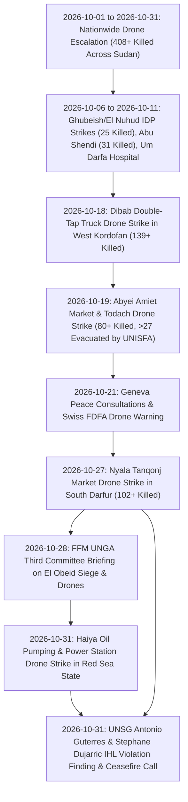

# 2026-10 Sudan Conflict Chronicle

## 1. Temporal Scope, Theatre Coverage & Strategic Periodization

> [!IMPORTANT] Bitemporal Monthly Chronicle Anchor (`2026-10-01` – `2026-10-31`)
> - **Chronicle Subtype**: `monthly_chronicle` (`time_horizon: "month"`)
> - **Primary Theatres Covered**: [[West Kordofan]] (`SD18`), [[Blue Nile State]] (`SD17`), [[Abyei]] (`SD18001`), [[South Darfur]] (`SD03`), [[Red Sea State]] (`SD07`), and [[North Kordofan]] (`SD02`).
> - **Cumulative Verified Toll**: At least **408 killed** ("hundreds of civilians, including women and children") and hundreds injured across October 2026 UAV attacks and airstrikes.
> - **Epistemic Rating**: **A1** (`reliability_score: 0.95`).

October 2026 marked a decisive operational escalation in the Sudanese conflict as unmanned aerial vehicle (UAV / drone) attacks by both the [[Sudanese Armed Forces]] (SAF) and the [[Rapid Support Forces]] (RSF) became the leading cause of conflict-related civilian deaths in Sudan in 2026 ([[2026-10 Sudan Drone Warfare Escalation]], [[Drone Proliferation and Double-Tap Strike Doctrine in Sudan]]). Across October 2026 (`2026-10-01` to `2026-10-31`), the Office of the United Nations High Commissioner for Human Rights ([[OHCHR]]) and the [[United Nations]] Secretariat verified at least **408 fatalities** and hundreds of injuries across [[West Kordofan]], [[Blue Nile State]], [[Abyei]], [[South Darfur]], and [[Red Sea State]].

Strategic periodization of October 2026 divides into four distinct operational phases:
1. **Phase I (6 – 11 October 2026) — IDP Shelter, Gold-Mining & Medical Infrastructure Strikes**: Alleged [[Sudanese Armed Forces]] drone strikes hit displaced persons' shelters in Ghubeish and El Nuhud in [[West Kordofan]] (`6–10 October`, killing at least **25 civilians**), while [[Rapid Support Forces]]-attributed drones struck displaced civilians mining gold in Abu Shendi (`9 October`, killing at least **31 civilians**) and rendered Um Darfa Hospital non-operational in [[Blue Nile State]] (`11 October`, injuring **2 health workers**) ([[2026-10 Sudan Drone Warfare Escalation]]).
2. **Phase II (18 – 19 October 2026) — Mass-Casualty Double-Tap & Demilitarized Market Strikes**: Peak single-incident lethality erupted on `18 October` when a "double-tap" repeat drone strike hit a transportation truck in RSF-controlled Dibab, [[West Kordofan]], killing at least **139 people** ([[2026-10-18 Dibab Double-Tap Drone Strike]]). Less than 24 hours later (`19 October`), a drone attack struck Amiet Market and Todach in demilitarized [[Abyei]], killing **more than 80 people**, burning market shops, and wounding more than **27 civilians** evacuated by [[UNISFA]] peacekeepers under Brig. Gen. [[Adebowale Ajabge]] and Lt. Col. [[Muhammad Farooq]] ([[2026-10-19 Abyei Amiet Market and Todach Drone Strike]]).
3. **Phase III (21 – 28 October 2026) — Multilateral Initiatives, Darfur Market Carnage & Fact-Finding Warnings**: On `21 October`, Switzerland and the UN convened the Geneva Consultative Meeting on Peace Initiatives in Sudan, where Swiss State Secretary [[Alexandre Fasel]] warned that the drone war was killing mostly civilians. On `27 October`, a catastrophic airstrike and drone bombardment struck the Tanqonj livestock and consumer market in [[Nyala]], South Darfur, killing at least **102 civilians** and injuring over 100 others. On `28 October`, the [[Independent International Fact-Finding Mission for the Sudan]] briefed the UN General Assembly Third Committee on siege warfare, arbitrary detention, and drone strikes in [[El Obeid]], while global civil society launched a campaign opposing the UAE's UN Secretary-General nomination.
4. **Phase IV (31 October 2026) — Strategic Infrastructure Strike & UNSG Executive Condemnation**: On `31 October`, long-range drones struck Crude Oil Pumping Station 4 and the municipal electrical grid in [[Haiya]], Red Sea State, triggering blackouts and prompting Sudanese authorities to allege Ethiopian-based UAE staging. Simultaneously, UN Secretary-General [[António Guterres]] formally condemned escalating drone strikes as **violations of international humanitarian law** and called for an immediate cessation of hostilities.

---

## 2. Chronological Event & Citation Ledger (Bitemporal Sequence)

| # | Valid Time ($t_{\text{valid}}$) | Report Time ($t_{\text{reported}}$) | Lag ($\Delta t$) | Node Type | Canonical Event / Citation Node | Location | Primary Actors | Casualties / Key Telemetry | Admiralty |
| :--- | :--- | :--- | :--- | :--- | :--- | :--- | :--- | :--- | :--- |
| 1 | `2026-10-01` | `2026-10-28` | 27d | `Event (incident)` | [[2026-10 El Obeid Siege and Drone Warfare Escalation]] | [[El Obeid]], [[North Kordofan]] | [[Rapid Support Forces]] | **5 students killed**, **47 injured** in university dorm loitering munition strike | **A1** |
| 2 | `2026-10-01` – `2026-10-31` | `2026-10-23` / `2026-10-31` | 0–22d | `Event (campaign)` | [[2026-10 Sudan Drone Warfare Escalation]] | Nationwide & [[Abyei]] | [[Sudanese Armed Forces]], [[Rapid Support Forces]], [[OHCHR]], [[United Nations]] | **408+ killed** across October 2026 UAV attacks | **A1** |
| 3 | `2026-10-10` | `2026-10-28` | 18d | `Event (incident)` | [[2026-10-10 Jabal al-Uqaydat Artisanal Gold Mine Airstrikes]] | Jabal al-Uqaydat (Egypt border) | [[Sudanese Armed Forces]] | **72+ artisanal miners killed**, 100+ wounded in jet airstrike | **A2** |
| 4 | `2026-10-18` | `2026-10-23` | 5d | `Event (incident)` | [[2026-10-18 Dibab Double-Tap Drone Strike]] | [[West Kordofan]] (Dibab) | [[Rapid Support Forces]], [[Sudanese Armed Forces]], [[OHCHR]] | **139+ killed** in "double-tap" repeat drone strike | **A2** |
| 5 | `2026-10-19` | `2026-10-23` / `2026-10-31` | 4–12d | `Event (incident)` | [[2026-10-19 Abyei Amiet Market and Todach Drone Strike]] | [[Abyei]] (Amiet Market) | [[UNISFA]], [[Muhammad Farooq]], [[Adebowale Ajabge]], [[Angelina Musa Diaw]] | **80+ killed**, **27+ injured** evacuated to Todach hospital | **A1** |
| 6 | `2026-10-21` | `2026-10-21` | 0d | `Event (diplomatic)` | [[2026-10-21 Geneva Consultative Meeting on Peace Initiatives in Sudan]] | [[Geneva]] | [[Federal Department of Foreign Affairs (Switzerland)]], [[Alexandre Fasel]], [[Pekka Haavisto]] | Multilateral consultative framework convened; drone war warning | **A1** |
| 7 | `2026-10-23` | `2026-10-23` | 0d | `Citation (statement)` | [[2026-10-23 Volker Türk Condemnation of Sudan Drone Escalation and Arms Influx]] | Nationwide | [[Volker Türk]], [[OHCHR]] | Warned drones cause majority of civilian deaths; urged arms halt | **A2** |
| 8 | `2026-10-23` | `2026-10-23` | 0d | `Citation (statement)` | [[2026-10-23 Seif Magango Statement on Evisceration of Civilian Infrastructure in Sudan]] | Nationwide | [[Seif Magango]], [[OHCHR]] | Documented IDP deaths and evisceration of vital services | **A2** |
| 9 | `2026-10-23` | `2026-10-23` | 0d | `Citation (testimony)` | [[2026-10-23 Muhammad Farooq First-Responder Account of Amiet Market Fire]] | [[Abyei]] | [[Muhammad Farooq]], [[UNISFA]] | First-responder account: *"every shop was burning"* | **A2** |
| 10 | `2026-10-23` | `2026-10-23` | 0d | `Citation (statement)` | [[2026-10-23 Adebowale Ajabge Report on UNISFA Emergency Response and Todach Evacuations]] | [[Abyei]] | [[Adebowale Ajabge]], [[UNISFA]] | Confirmed firefighting & evacuation of >27 wounded | **A2** |
| 11 | `2026-10-23` | `2026-10-23` | 0d | `Citation (testimony)` | [[2026-10-23 Angelina Musa Diaw Survivor Testimony on Amiet Market Destruction]] | [[Abyei]] | [[Angelina Musa Diaw]] | Survivor testimony on loss of market livelihood | **A2** |
| 12 | `2026-10-27` | `2026-10-31` | 4d | `Event (incident)` | [[2026-10-27 Nyala Tanqonj Market Drone Strike]] | [[Nyala]], [[South Darfur]] | [[Sudanese Armed Forces]], [[Rapid Support Forces]], [[United Nations]] | **102+ civilians killed**, >100 wounded in livestock market strike | **B2** |
| 13 | `2026-10-28` | `2026-10-28` | 0d | `Event (diplomatic)` | [[2026-10-28 Global Civil Society Briefing Opposing Lana Nusseibeh Candidacy for UN Secretary-General]] | [[Geneva]] / Online | [[Human Rights Watch]], [[SIHA Network]], [[Kenneth Roth]], [[Hala al-Karib]] | Global advocacy campaign opposing UAE UN candidacy | **A2** |
| 14 | `2026-10-28` | `2026-10-28` | 0d | `Event (crisis)` | [[2026-10 El Obeid Siege and Drone Warfare Escalation]] | [[El Obeid]], [[North Kordofan]] | [[Independent International Fact-Finding Mission for the Sudan]], [[Mohamed Chande Othman]] | Documented siege starvation and drone strikes in North Kordofan | **A1** |
| 15 | `2026-10-28` | `2026-10-28` | 0d | `Citation (forensic)` | [[2026-10-28 UN FFM Finding on RSF Drone Warfare and Indiscriminate Attacks in El Obeid]] | [[El Obeid]], [[North Kordofan]] | [[Independent International Fact-Finding Mission for the Sudan]] | FFM verifies RSF drone strikes on schools, hospitals, funerals, and rescue workers | **A1** |
| 16 | `2026-10-28` | `2026-10-28` | 0d | `Citation (forensic)` | [[2026-10-28 UN FFM Finding on SAF Detention Practices and Torture in El Obeid]] | [[El Obeid]], [[North Kordofan]] | [[Independent International Fact-Finding Mission for the Sudan]] | FFM verifies SAF custodial torture, 2,000+ detainees in Central Prison, and billets co-location | **A1** |
| 17 | `2026-10-28` | `2026-10-28` | 0d | `Citation (recommendation)` | [[2026-10-28 UN FFM Recommendation for Specialized Independent Court for Sudan]] | [[Geneva]] / UN | [[Independent International Fact-Finding Mission for the Sudan]] | Recommended creating a specialized independent judicial mechanism for Sudan | **A1** |
| 18 | `2026-10-31` | `2026-10-31` | 0d | `Event (incident)` | [[2026-10-31 Haiya Oil Pumping and Power Station Drone Strike]] | [[Haiya]], [[Red Sea State]] | [[Rapid Support Forces]], [[Ministry of Foreign Affairs (Sudan)]], [[Muawiya Osman]] | Strategic infrastructure strike against Station 4 & power grid | **B2** |
| 19 | `2026-10-31` | `2026-10-31` | 0d | `Citation (warning)` | [[2026-10-31 Stéphane Dujarric UNSG Statement Condemning Escalating Drone Attacks in Sudan and Abyei]] | Nationwide & [[Abyei]] | [[Stéphane Dujarric]], [[António Guterres]], [[United Nations]] | Condemned escalating drone attacks as **IHL violations** | **A1** |
| 20 | `2026-10-31` | `2026-10-31` | 0d | `Citation (appeal)` | [[2026-10-31 António Guterres Appeal for Immediate Cessation of Hostilities and Good-Faith Mediation in Sudan]] | Nationwide | [[António Guterres]], [[United Nations]] | Demanded immediate cessation of hostilities and good-faith mediation | **A1** |
| 21 | `2026-10-31` | `2026-10-31` | 0d | `Citation (statement)` | [[2026-10-31 Stéphane Dujarric Arab News Statement Condemning Nyala Market Drone Strike]] | [[Nyala]], [[South Darfur]] | [[Stéphane Dujarric]], [[António Guterres]], [[Arab News]] | UNSG appalled by reports of drone strikes on Tanqonj market | **B2** |
| 22 | `2026-10-31` | `2026-10-31` | 0d | `Citation (statement)` | [[2026-10-31 Muawiya Osman Accusation of Ethiopian Base and UAE Proxy Drone Strikes on Sudan Infrastructure]] | [[Haiya]], [[Red Sea State]] | [[Muawiya Osman]], [[Ministry of Foreign Affairs (Sudan)]] | Formally accused Ethiopian-based UAE proxies of staging strikes | **B2** |
| 23 | `2026-11-01` | `2026-11-01` | 0d | `Citation (statement)` | [[2026-11-01 Radio Dabanga Arabic Rendition of UNSG Drone Condemnation and FFM Warning]] | [[Haiya]], [[Nyala]], [[El Obeid]] | [[Radio Dabanga]], [[Stéphane Dujarric]], [[Mohamed Chande Othman]] | Vernacular Arabic synthesis connecting UNSG and FFM warnings | **B2** |

---

## 3. Causal Escalation Chains, Turning Points & Tempo Analysis

### Operational Tempo & Doctrinal Inflection Points
1. **Concentration of Mass-Casualty Lethality (`18–27 October 2026`)**: Across October, major single-incident massacres—including the `18 October` Dibab double-tap strike (**139+ killed**), the `19 October` Amiet Market strike (**80+ killed**), and the `27 October` Nyala market strike (**102+ killed**)—accounted for over **321 civilian deaths**, demonstrating the catastrophic human toll of UAVs and airstrikes on crowded commercial centers.
2. **Targeting of Critical Economic & Utility Infrastructure**: Beyond markets, late October witnessed systematic strikes against essential survival systems, including the knockout of **Um Darfa Hospital** (`11 October`) and the precision strike against **Crude Oil Pumping Station 4 and the Power Grid in Haiya** (`31 October`).
3. **Multilateral Legal & Diplomatic Convergence**: In response to accelerating strikes, international mechanisms mobilized rapidly: the Swiss FDFA and UN Envoy convened the Geneva Consultations (`21 October`), the FFM briefed the UN General Assembly (`28 October`), and UN Secretary-General António Guterres declared the attacks violations of international humanitarian law (`31 October`).

---

## 4. Cumulative Humanitarian, Territorial & Attribution Telemetry

| Sub-Incident / Campaign Slice | Valid Date ($t_{\text{valid}}$) | Theatre / Location | Attributed / Alleged Actor | Verified Fatalities | Verified Injuries / Impact | Source Grounding |
| :--- | :--- | :--- | :--- | :--- | :--- | :--- |
| **El Obeid University Dormitory Strike** | `2026-10-01` | [[El Obeid]], [[North Kordofan]] (`SD02001`) | Alleged [[Rapid Support Forces]] | **5 killed** | **47 injured** in student dormitory loitering munition strike | [[2026-10 El Obeid Siege and Drone Warfare Escalation]] |
| **Ghubeish & El Nuhud IDP Shelter Strikes** | `2026-10-06` – `2026-10-10` | [[West Kordofan]] (`SD18`) | Alleged [[Sudanese Armed Forces]] | **25+ killed** (incl. women & children) | IDP shelters destroyed | [[2026-10 Sudan Drone Warfare Escalation]] |
| **Abu Shendi IDP Gold-Mining Strike** | `2026-10-09` | [[Blue Nile State]] (`SD17`) | Alleged [[Rapid Support Forces]] | **31+ killed** (mostly women & children) | Artisanal mining livelihood site struck | [[2026-10 Sudan Drone Warfare Escalation]] |
| **Jabal al-Uqaydat Artisanal Gold Mine Airstrikes** | `2026-10-10` | Jabal al-Uqaydat (Egypt border) | [[Sudanese Armed Forces]] | **72+ killed** | 100+ injured; cross-border gold-mining camp destroyed | [[2026-10-10 Jabal al-Uqaydat Artisanal Gold Mine Airstrikes]] |
| **Um Darfa Hospital Strike** | `2026-10-11` | [[Blue Nile State]] (`SD17`) | [[Rapid Support Forces]] | `0` confirmed | **2 health workers seriously injured**; hospital non-operational | [[2026-10 Sudan Drone Warfare Escalation]] |
| **Wad al-Mahi Loitering Munition Strike** | `2026-10-12` | [[Blue Nile State]] (`SD17`) | Alleged [[Rapid Support Forces]] | **30+ killed** | Dozens wounded in civilian congregation strike | [[2026-10 Sudan Drone Warfare Escalation]] |
| **Dibab Double-Tap Truck Strike** | `2026-10-18` | [[West Kordofan]] (`SD18`, RSF-held Dibab) | Unspecified UAV operator in [[Rapid Support Forces]]-held zone | **139+ killed** | Repeat "double-tap" strike on transport truck | [[2026-10-18 Dibab Double-Tap Drone Strike]] |
| **Abyei Amiet Market & Todach Strike** | `2026-10-19` | [[Abyei]] (`SD18001`, demilitarized zone) | Unspecified UAV operator | **80+ killed** | **27+ injured** evacuated to Todach [[UNISFA]] hospital; shops burned | [[2026-10-19 Abyei Amiet Market and Todach Drone Strike]] |
| **Nyala Tanqonj Market Strike** | `2026-10-27` | [[Nyala]], [[South Darfur]] (`SD03001`) | Alleged [[Sudanese Armed Forces]] aerial / drone strike | **102+ killed** | >100 injured; livestock stalls and consumer shops destroyed | [[2026-10-27 Nyala Tanqonj Market Drone Strike]] |
| **Haiya Oil Pumping & Power Station Strike** | `2026-10-31` | [[Haiya]], [[Red Sea State]] (`SD07002`) | Alleged [[Rapid Support Forces]] UAVs (Ethiopian staging alleged) | `0` confirmed | Pumping Station 4 damaged; municipal power line severed | [[2026-10-31 Haiya Oil Pumping and Power Station Drone Strike]] |
| **Cumulative October 2026 Campaign Total** | `2026-10-01` – `2026-10-31` | Nationwide & [[Abyei]] | [[Sudanese Armed Forces]] & [[Rapid Support Forces]] | **510+ killed** | **Hundreds injured**; vital services & health facilities struck; declared **IHL violations** by UNSG | [[sources/2026-10-23-un-news-sudan-drone-strikes-306-killed]], [[sources/2026-10-31-unsg-spokesperson-escalating-drone-attacks-sudan]], [[sources/2026-10-28-un-hrc-crp1-el-obeid-civilian-devastation]] |

---

## Related Primitives

- **Related Thematic Timeline**:
  - [[Sudan Drone Warfare and Double-Tap Strike Timeline]] — Thematic escalation ledger tracking UAV proliferation and double-tap doctrine across Sudan.
  - [[Sudan Accountability and International Justice Timeline]] — Tracks multilateral legal mechanisms, FFM reports, and ICC proceedings.
- **Events Chronicled**:
  - [[2026-10 Sudan Drone Warfare Escalation]] — October 2026 multi-state UAV strike wave (`408+` killed).
  - [[2026-10-10 Jabal al-Uqaydat Artisanal Gold Mine Airstrikes]] — Cross-border airstrikes on gold miners (`72+` killed).
  - [[2026-10-18 Dibab Double-Tap Drone Strike]] — Repeat "double-tap" drone strike on a transport truck in Dibab, [[West Kordofan]] (`139+` killed).
  - [[2026-10-19 Abyei Amiet Market and Todach Drone Strike]] — Drone attack on Amiet Market and Todach in [[Abyei]] (`80+` killed, `27+` evacuated by [[UNISFA]]).
  - [[2026-10-21 Geneva Consultative Meeting on Peace Initiatives in Sudan]] — Swiss-hosted multilateral peace conference.
  - [[2026-10-27 Nyala Tanqonj Market Drone Strike]] — Market strike in South Darfur (`102+` killed).
  - [[2026-10-28 Global Civil Society Briefing Opposing Lana Nusseibeh Candidacy for UN Secretary-General]] — International advocacy against UAE UN candidacy.
  - [[2026-10-31 Haiya Oil Pumping and Power Station Drone Strike]] — Infrastructure drone attack in Red Sea State.
  - [[2026-10 El Obeid Siege and Drone Warfare Escalation]] — Siege warfare and detention documented by FFM.
- **Citations Chronicled**:
  - [[2026-10-21 Alexandre Fasel Statement on Drone War Killing Mostly Civilians in Sudan]]
  - [[2026-10-21 Pekka Haavisto Appeal for De-Escalation and Comprehensive Ceasefire in Sudan]]
  - [[2026-10-23 Volker Türk Condemnation of Sudan Drone Escalation and Arms Influx]]
  - [[2026-10-23 Seif Magango Statement on Evisceration of Civilian Infrastructure in Sudan]]
  - [[2026-10-23 Muhammad Farooq First-Responder Account of Amiet Market Fire]]
  - [[2026-10-23 Adebowale Ajabge Report on UNISFA Emergency Response and Todach Evacuations]]
  - [[2026-10-23 Angelina Musa Diaw Survivor Testimony on Amiet Market Destruction]]
  - [[2026-10-28 Mohamed Chande Othman Address to the UN General Assembly Third Committee on Sudan]]
  - [[2026-10-28 Kenneth Roth Statement on UAE Arming of RSF and Lana Nusseibeh Candidacy]]
  - [[2026-10-28 Hala al-Karib Statement on Denial of El Fasher Genocidal Acts and UAE Role]]
  - [[2026-10-28 UN FFM Finding on RSF Drone Warfare and Indiscriminate Attacks in El Obeid]]
  - [[2026-10-28 UN FFM Finding on SAF Detention Practices and Torture in El Obeid]]
  - [[2026-10-28 UN FFM Recommendation for Specialized Independent Court for Sudan]]
  - [[2026-10-31 Stéphane Dujarric UNSG Statement Condemning Escalating Drone Attacks in Sudan and Abyei]]
  - [[2026-10-31 Stéphane Dujarric Arab News Statement Condemning Nyala Market Drone Strike]]
  - [[2026-10-31 António Guterres Appeal for Immediate Cessation of Hostilities and Good-Faith Mediation in Sudan]]
  - [[2026-10-31 Muawiya Osman Accusation of Ethiopian Base and UAE Proxy Drone Strikes on Sudan Infrastructure]]
  - [[2026-11-01 Radio Dabanga Arabic Rendition of UNSG Drone Condemnation and FFM Warning]]
- **Actors & Locations**:
  - [[Sudanese Armed Forces]] | [[Rapid Support Forces]] | [[United Nations]] | [[OHCHR]] | [[UNISFA]] | [[Radio Dabanga]] | [[Independent International Fact-Finding Mission for the Sudan]] | [[Federal Department of Foreign Affairs (Switzerland)]] | [[Al-Baraa Ibn Malik Brigade]]
  - [[António Guterres]] | [[Stéphane Dujarric]] | [[Volker Türk]] | [[Mohamed Chande Othman]] | [[Alexandre Fasel]] | [[Pekka Haavisto]] | [[Muawiya Osman]]
  - [[West Kordofan]] | [[Blue Nile State]] | [[Abyei]] | [[Nyala]] | [[Haiya]] | [[El Obeid]] | [[South Darfur]] | [[Red Sea State]]
- **Themes & Sources**:
  - [[Drone Proliferation and Double-Tap Strike Doctrine in Sudan]]
  - [[Energy Infrastructure Targeting in the Sudan War]]
  - [[Multilateral Mediation and Peace Coordination Mechanisms in Sudan]]
  - [[Arbitrary Detention and Custodial Torture in the Sudan War]]
  - [[sources/2026-10-23-un-news-sudan-drone-strikes-306-killed]]
  - [[sources/2026-10-31-unsg-spokesperson-escalating-drone-attacks-sudan]]
  - [[sources/2026-10-31-arab-news-un-chief-appalled-drone-strikes-nyala-market]]
  - [[sources/2026-10-31-dabanga-haiya-oil-electricity-drone-attack]]
  - [[sources/2026-11-01-dabanga-unsg-guterres-condemns-escalating-drone-attacks]]
  - [[sources/2026-10-28-un-hrc-crp1-el-obeid-civilian-devastation]]
