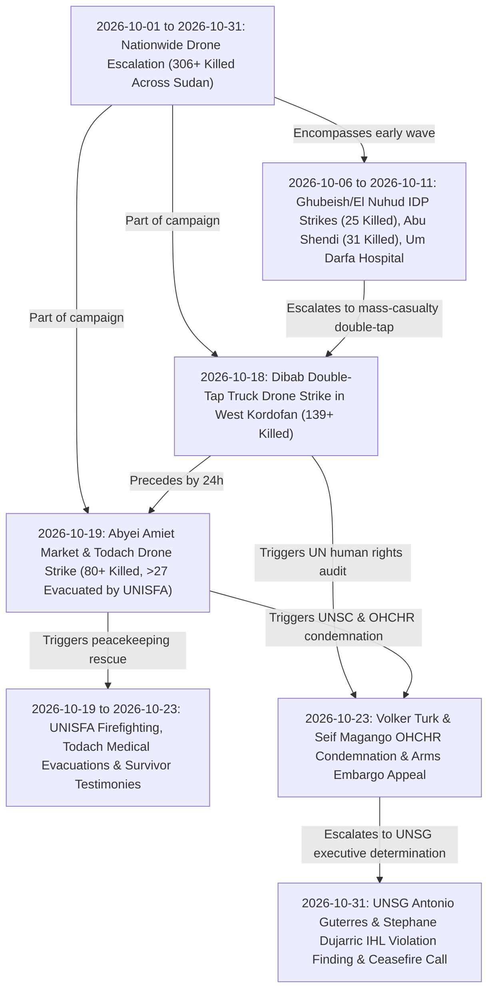

# 2026-10 Sudan Conflict Chronicle

## 1. Temporal Scope, Theatre Coverage & Strategic Periodization

> [!IMPORTANT] Bitemporal Monthly Chronicle Anchor (`2026-10-01` – `2026-10-31`)
> - **Chronicle Subtype**: `monthly_chronicle` (`time_horizon: "month"`)
> - **Primary Theatres Covered**: [[West Kordofan]] (`SD18`), [[Blue Nile State]] (`SD17`), [[Abyei]] (`SD18001`), plus Darfur and **Khartoum State**
> - **Cumulative Verified Toll**: At least **306 killed** ("hundreds of civilians, including women and children") and hundreds injured across October 2026 UAV attacks ([[sources/2026-10-23-un-news-sudan-drone-strikes-306-killed]], [[sources/2026-10-31-unsg-spokesperson-escalating-drone-attacks-sudan]])
> - **Epistemic Rating**: **A1** (`reliability_score: 0.95`)

October 2026 marked a decisive operational escalation in the Sudanese conflict as unmanned aerial vehicle (UAV / drone) attacks by both the [[Sudanese Armed Forces]] (SAF) and the [[Rapid Support Forces]] (RSF) became the leading cause of conflict-related civilian deaths in Sudan in 2026 ([[2026-10 Sudan Drone Warfare Escalation]], [[Drone Proliferation and Double-Tap Strike Doctrine in Sudan]]). Across October 2026 (`2026-10-01` to `2026-10-31`), the Office of the United Nations High Commissioner for Human Rights ([[OHCHR]]) and the [[United Nations]] Secretariat verified at least **306 fatalities** and hundreds of injuries across [[West Kordofan]], [[Blue Nile State]], [[Abyei]], Darfur, and **Khartoum State** ([[sources/2026-10-23-un-news-sudan-drone-strikes-306-killed]], [[sources/2026-10-31-unsg-spokesperson-escalating-drone-attacks-sudan]]).

Strategic periodization of October 2026 divides into three distinct operational phases:
1. **Phase I (6 – 11 October 2026) — IDP Shelter, Gold-Mining & Medical Infrastructure Strikes**: Alleged [[Sudanese Armed Forces]] drone strikes hit displaced persons' shelters in **Ghubeish** and **El Nuhud** in [[West Kordofan]] (`6–10 October`, killing at least **25 civilians**), while [[Rapid Support Forces]]-attributed drones struck displaced civilians mining gold in **Abu Shendi** (`9 October`, killing at least **31 civilians**) and rendered **Um Darfa Hospital** non-operational in [[Blue Nile State]] (`11 October`, injuring **2 health workers**) ([[2026-10 Sudan Drone Warfare Escalation]]).
2. **Phase II (18 – 19 October 2026) — Mass-Casualty Double-Tap & Demilitarized Market Strikes**: Peak single-incident lethality erupted on `18 October` when a "double-tap" repeat drone strike hit a transportation truck in RSF-controlled **Dibab**, [[West Kordofan]], killing at least **139 people** ([[2026-10-18 Dibab Double-Tap Drone Strike]]). Less than 24 hours later (`19 October`), a drone attack struck **Amiet Market** and **Todach** in demilitarized [[Abyei]], killing **more than 80 people**, burning market shops, and wounding more than **27 civilians** evacuated by [[UNISFA]] peacekeepers under Brig. Gen. [[Adebowale Ajabge]] and Lt. Col. [[Muhammad Farooq]] ([[2026-10-19 Abyei Amiet Market and Todach Drone Strike]]).
3. **Phase III (23 – 31 October 2026) — UN Security Council, OHCHR & UN Secretary-General Condemnations**: On `23 October`, UN High Commissioner [[Volker Türk]], [[OHCHR]] spokesperson [[Seif Magango]], and the **United Nations Security Council** issued formal warnings condemning the drone campaign and demanding an end to external arms transfers ([[2026-10-23 Volker Türk Condemnation of Sudan Drone Escalation and Arms Influx]], [[2026-10-23 Seif Magango Statement on Evisceration of Civilian Infrastructure in Sudan]]). On `31 October`, [[United Nations]] Secretary-General [[António Guterres]], via Spokesperson [[Stéphane Dujarric]] ([[Office of the Spokesperson for the Secretary-General]]), formally declared the drone strikes across Sudan and [[Abyei]] to be **violations of international humanitarian law** and called for an immediate cessation of hostilities and good-faith mediation ([[2026-10-31 Stéphane Dujarric UNSG Statement Condemning Escalating Drone Attacks in Sudan and Abyei]], [[2026-10-31 António Guterres Appeal for Immediate Cessation of Hostilities and Good-Faith Mediation in Sudan]]).

---

## 2. Chronological Event & Citation Ledger (Bitemporal Sequence)

The Bitemporal Ledger tracks both **Valid Time ($t_{\text{valid}}$)**—when kinetic events or statements occurred on the ground—and **Report Time ($t_{\text{reported}}$)**—when they were publicly documented by [[UN News]], [[Office of the Spokesperson for the Secretary-General]], [[OHCHR]], and [[UNISFA]].

| # | Valid Time ($t_{\text{valid}}$) | Report Time ($t_{\text{reported}}$) | Lag ($\Delta t$) | Node Type | Canonical Event / Citation Node | Location | Primary Actors | Casualties / Key Telemetry | Admiralty |
| :--- | :--- | :--- | :--- | :--- | :--- | :--- | :--- | :--- | :--- |
| 1 | `2026-10-01` – `2026-10-31` | `2026-10-23` / `2026-10-31` | 0–22d | `Event (campaign)` | [[2026-10 Sudan Drone Warfare Escalation]] | [[West Kordofan]], [[Blue Nile State]], [[Abyei]] | [[Sudanese Armed Forces]], [[Rapid Support Forces]], [[OHCHR]], [[United Nations]] | **306+ killed** across October 2026 (incl. 25 killed in Ghubeish/El Nuhud, 31 in Abu Shendi, 2 injured at Um Darfa hospital) | **A1** |
| 2 | `2026-10-18` | `2026-10-23` | 5d | `Event (incident)` | [[2026-10-18 Dibab Double-Tap Drone Strike]] | [[West Kordofan]] (Dibab) | [[Rapid Support Forces]], [[Sudanese Armed Forces]], [[OHCHR]] | **139+ killed** in "double-tap" repeat drone strike on a transportation truck in RSF-held Dibab | **A2** |
| 3 | `2026-10-19` | `2026-10-23` / `2026-10-31` | 4–12d | `Event (incident)` | [[2026-10-19 Abyei Amiet Market and Todach Drone Strike]] | [[Abyei]] (Amiet Market & Todach) | [[UNISFA]], [[Muhammad Farooq]], [[Adebowale Ajabge]], [[Angelina Musa Diaw]], [[United Nations]] | **80+ killed**, **27+ injured** evacuated to Todach [[UNISFA]] hospital; shops burned across Amiet Market | **A1** |
| 4 | `2026-10-23` | `2026-10-23` | 0d | `Citation (statement)` | [[2026-10-23 Volker Türk Condemnation of Sudan Drone Escalation and Arms Influx]] | [[West Kordofan]], [[Blue Nile State]], [[Abyei]] | [[Volker Türk]], [[OHCHR]] | Warned drones account for the majority of 2026 civilian deaths in Sudan; urged ceasefire & halt to arms influx | **A2** |
| 5 | `2026-10-23` | `2026-10-23` | 0d | `Citation (statement)` | [[2026-10-23 Seif Magango Statement on Evisceration of Civilian Infrastructure in Sudan]] | [[West Kordofan]], [[Blue Nile State]], [[Abyei]] | [[Seif Magango]], [[OHCHR]] | Documented scores of civilians and IDPs killed and vital infrastructure/services eviscerated | **A2** |
| 6 | `2026-10-23` | `2026-10-23` | 0d | `Citation (testimony)` | [[2026-10-23 Muhammad Farooq First-Responder Account of Amiet Market Fire]] | [[Abyei]] (Amiet Market) | [[Muhammad Farooq]], [[UNISFA]] | First-responder peacekeeper testimony confirming *"every shop was burning"* at Amiet Market | **A2** |
| 7 | `2026-10-23` | `2026-10-23` | 0d | `Citation (statement)` | [[2026-10-23 Adebowale Ajabge Report on UNISFA Emergency Response and Todach Evacuations]] | [[Abyei]] (Amiet Market & Todach) | [[Adebowale Ajabge]], [[UNISFA]] | Confirmed [[UNISFA]] firefighting response and evacuation of >27 wounded civilians to Todach hospital | **A2** |
| 8 | `2026-10-23` | `2026-10-23` | 0d | `Citation (testimony)` | [[2026-10-23 Angelina Musa Diaw Survivor Testimony on Amiet Market Destruction]] | [[Abyei]] (Amiet Market) | [[Angelina Musa Diaw]] | Survivor testimony on total loss of market livelihoods (*"No work, everything is gone..."*) | **A2** |
| 9 | `2026-10-31` | `2026-10-31` | 0d | `Citation (warning)` | [[2026-10-31 Stéphane Dujarric UNSG Statement Condemning Escalating Drone Attacks in Sudan and Abyei]] | [[West Kordofan]], [[Blue Nile State]], [[Abyei]] | [[Stéphane Dujarric]], [[António Guterres]], [[United Nations]] | Condemned escalating drone attacks across Sudan & [[Abyei]] killing hundreds of civilians and hitting health facilities as **IHL violations** | **A1** |
| 10 | `2026-10-31` | `2026-10-31` | 0d | `Citation (appeal)` | [[2026-10-31 António Guterres Appeal for Immediate Cessation of Hostilities and Good-Faith Mediation in Sudan]] | [[West Kordofan]], [[Blue Nile State]], [[Abyei]] | [[António Guterres]], [[United Nations]] | Called on parties to spare civilians/infrastructure, agree without delay to a **cessation of hostilities**, and enter good-faith mediation | **A1** |

---

## 3. Causal Escalation Chains, Turning Points & Tempo Analysis

### Operational Tempo & Doctrinal Inflection Points
1. **Concentration of Mass-Casualty Lethality (`18–19 October 2026`)**: Of the **306+ verified fatalities** recorded across October, **at least 219 fatalities (`71.6%`) occurred in a single 48-hour surge** across the `18 October` Dibab double-tap strike (**139+ killed**) in [[West Kordofan]] and the `19 October` Amiet Market and Todach strike (**80+ killed**) in [[Abyei]] ([[2026-10-18 Dibab Double-Tap Drone Strike]], [[2026-10-19 Abyei Amiet Market and Todach Drone Strike]]).
2. **Targeting of Displaced Populations & Livelihood Nodes**: Between `6` and `11 October`, UAV strikes systematically hit vulnerable displaced communities—killing **25+ IDPs** in shelters in **Ghubeish** and **El Nuhud** ([[West Kordofan]]) and **31+ IDPs** at an artisanal gold-mining site in **Abu Shendi** ([[Blue Nile State]])—before knocking **Um Darfa Hospital** out of service ([[2026-10 Sudan Drone Warfare Escalation]]).
3. **Two-Stage International Legal Escalation (`23 October` $\to$ `31 October 2026`)**: Following [[OHCHR]] and [[UNISFA]] field verification on `23 October`, [[United Nations]] Secretary-General [[António Guterres]] (via Spokesperson [[Stéphane Dujarric]]) issued an `A1` executive communiqué on `31 October` formally declaring the drone strikes across Sudan and [[Abyei]] to be violations of international humanitarian law and demanding an immediate cessation of hostilities ([[2026-10-31 Stéphane Dujarric UNSG Statement Condemning Escalating Drone Attacks in Sudan and Abyei]], [[2026-10-31 António Guterres Appeal for Immediate Cessation of Hostilities and Good-Faith Mediation in Sudan]]).

---

## 4. Cumulative Humanitarian, Territorial & Attribution Telemetry

| Sub-Incident / Campaign Slice | Valid Date ($t_{\text{valid}}$) | Theatre / Location | Attributed / Alleged Actor | Verified Fatalities | Verified Injuries / Impact | Source Grounding |
| :--- | :--- | :--- | :--- | :--- | :--- | :--- |
| **Ghubeish & El Nuhud IDP Shelter Strikes** | `2026-10-06` – `2026-10-10` | [[West Kordofan]] (`SD18`) | Alleged [[Sudanese Armed Forces]] | **25+ killed** (incl. women & children) | IDP shelters destroyed | [[2026-10 Sudan Drone Warfare Escalation]] |
| **Abu Shendi IDP Gold-Mining Strike** | `2026-10-09` | [[Blue Nile State]] (`SD17`) | Alleged [[Rapid Support Forces]] | **31+ killed** (mostly women & children) | Artisanal mining livelihood site struck | [[2026-10 Sudan Drone Warfare Escalation]] |
| **Um Darfa Hospital Strike** | `2026-10-11` | [[Blue Nile State]] (`SD17`) | [[Rapid Support Forces]] | `0` confirmed | **2 health workers seriously injured**; hospital non-operational | [[2026-10 Sudan Drone Warfare Escalation]] |
| **Dibab Double-Tap Truck Strike** | `2026-10-18` | [[West Kordofan]] (`SD18`, RSF-held Dibab) | Unspecified UAV operator in [[Rapid Support Forces]]-held zone | **139+ killed** | Repeat "double-tap" strike on transport truck | [[2026-10-18 Dibab Double-Tap Drone Strike]] |
| **Abyei Amiet Market & Todach Strike** | `2026-10-19` | [[Abyei]] (`SD18001`, demilitarized zone) | Unspecified UAV operator | **80+ killed** | **27+ injured** evacuated to Todach [[UNISFA]] hospital; shops burned | [[2026-10-19 Abyei Amiet Market and Todach Drone Strike]] |
| **Cumulative October 2026 Campaign Total** | `2026-10-01` – `2026-10-31` | [[West Kordofan]], [[Blue Nile State]], [[Abyei]], Darfur, Khartoum | [[Sudanese Armed Forces]] & [[Rapid Support Forces]] | **306+ killed** ("hundreds of civilians") | **Hundreds injured**; vital services & health facilities struck; declared **IHL violations** by UNSG | [[sources/2026-10-23-un-news-sudan-drone-strikes-306-killed]], [[sources/2026-10-31-unsg-spokesperson-escalating-drone-attacks-sudan]] |

---

## Related Primitives

- **Related Thematic Timeline**:
  - [[Sudan Drone Warfare and Double-Tap Strike Timeline]] — Thematic escalation ledger tracking UAV proliferation and double-tap doctrine across Sudan.
- **Events Chronicled**:
  - [[2026-10 Sudan Drone Warfare Escalation]] — October 2026 multi-state UAV strike wave (`306+` killed).
  - [[2026-10-18 Dibab Double-Tap Drone Strike]] — Repeat "double-tap" drone strike on a transport truck in Dibab, [[West Kordofan]] (`139+` killed).
  - [[2026-10-19 Abyei Amiet Market and Todach Drone Strike]] — Drone attack on Amiet Market and Todach in [[Abyei]] (`80+` killed, `27+` evacuated by [[UNISFA]]).
- **Citations Chronicled**:
  - [[2026-10-23 Volker Türk Condemnation of Sudan Drone Escalation and Arms Influx]]
  - [[2026-10-23 Seif Magango Statement on Evisceration of Civilian Infrastructure in Sudan]]
  - [[2026-10-23 Muhammad Farooq First-Responder Account of Amiet Market Fire]]
  - [[2026-10-23 Adebowale Ajabge Report on UNISFA Emergency Response and Todach Evacuations]]
  - [[2026-10-23 Angelina Musa Diaw Survivor Testimony on Amiet Market Destruction]]
  - [[2026-10-31 Stéphane Dujarric UNSG Statement Condemning Escalating Drone Attacks in Sudan and Abyei]]
  - [[2026-10-31 António Guterres Appeal for Immediate Cessation of Hostilities and Good-Faith Mediation in Sudan]]
- **Actors & Locations**:
  - [[Sudanese Armed Forces]] | [[Rapid Support Forces]] | [[United Nations]] | [[OHCHR]] | [[UNISFA]] | [[UN News]] | [[Office of the Spokesperson for the Secretary-General]]
  - [[António Guterres]] | [[Stéphane Dujarric]] | [[Volker Türk]] | [[Seif Magango]] | [[Muhammad Farooq]] | [[Adebowale Ajabge]] | [[Angelina Musa Diaw]]
  - [[West Kordofan]] | [[Blue Nile State]] | [[Abyei]]
- **Themes & Sources**:
  - [[Drone Proliferation and Double-Tap Strike Doctrine in Sudan]]
  - [[sources/2026-10-23-un-news-sudan-drone-strikes-306-killed]]
  - [[sources/2026-10-31-unsg-spokesperson-escalating-drone-attacks-sudan]]
