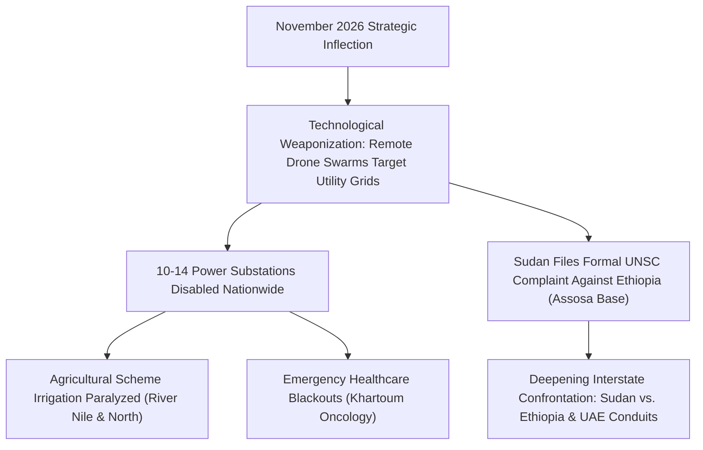

# 2026-11 Sudan Conflict Chronicle

## 1. Temporal Scope, Theatre Coverage & Strategic Periodization

> [!NOTE] Strategic Periodization
> **November 2026** opened with a catastrophic transition in the Sudan conflict characterized by:
> 1. **Systemic Drone Grid Warfare**: Deep remote strikes penetrating northern rear states ([[Northern State]], [[River Nile State]]) to systematically disable regional electrical distribution hubs and assassinate allied militia command figures.
> 2. **Regional Diplomatic Escalation**: Sudan filing formal complaints against the [[Government of Ethiopia]] at the UN Security Council and African Union alleging cross-border proxy drone aggression.
> 3. **Critical Resource & Famine Convergence**: Acute diesel exhaustion and up to 18-hour daily power cuts paralyzing agricultural irrigation schemes in the River Nile heartland, coinciding with total crop failure in North Darfur and general strikes in Khartoum.

---

## 2. Chronological Event & Citation Ledger (Bitemporal Sequence)

| Date ($t_{\text{valid}}$) | Event / Citation Node | Theatre / Location | Categorization | Key Claims & Verified Impact |
| :--- | :--- | :--- | :--- | :--- |
| **2026-11-01** | [[2026-11-01 Abu Hamad and Al Dabbah Power Stations Drone Strikes]] | [[Abu Hamad]] / [[Al Dabbah]] | Explosions/Remote violence | RSF drones strike power substations in northern Sudan, causing total blackouts; strike on 73rd Brigade base kills Al-Baraa commander [[Muhammad al-Nao]]. |
| **2026-11-01** | [[2026-11-01 El Malha Commercial Vehicle Drone Strike]] | [[El Malha]], [[North Darfur]] | Explosions/Remote violence | Combat drone incinerates civilian passenger truck en route to weekly market, killing Muhammad Musa Bakheit Tikras and Ali Ismail Abakar. |
| **2026-11-01** | [[2026-11-01 Sudan UNSC and AU Complaint Against Ethiopia]] | New York / Addis Ababa / Port Sudan | Strategic developments | Sudan formally files complaints charging Ethiopia with violating UN Charter Article 2(4) via [[Assosa]] drone base facilitating strikes on 14 power stations. |
| **2026-11-01** | [[2026-11-01 Egyptian MFA Condemnation of Drone Warfare Escalation]] | Cairo / Regional | Diplomatic resolution | Egyptian MFA condemns strikes on utility infrastructure and demands an end to cross-border arms smuggling to the RSF via neighboring countries. |
| **2026-11-01** | [[2026-11-01 Fathi Fadul Communist Party Warning on Drone Warfare]] | Amsterdam / Sudan | Official statement | SCP spokesperson Fathi Fadul documents 400+ civilian drone deaths, exposing UAE and Islamist proxy networks sustaining the war. |
| **2026-11-01** | [[2026-11-01 SPLM-N Statement on Belila Kurmuk Civilian Drone Casualties]] | [[Kurmuk]], [[Blue Nile State]] | Casualty report | SPLM-N al-Hilu verifies 5 civilian deaths and 4 injuries from SAF drone strike on Belila market complex. |
| **2026-11-01** | [[2026-11-01 National Umma Party Famine Emergency Declaration River Nile]] | [[River Nile State]] | Famine alert | Umma Party warns of imminent famine due to 3-week diesel fuel disappearance and 18-hour daily load shedding, demanding an agricultural state of emergency. |
| **2026-11-01** | [[2026-11-01 El Malha Emergency Response Room Famine Warning]] | [[El Malha]], [[North Darfur]] | Famine alert | Emergency Response Rooms report total agricultural failure, collapse of livestock terms of trade, and open-air displacement under trees. |
| **2026-11-01** | [[2026-11-01 Sudanese Teachers Committee Strike Communique]] | [[Khartoum State]] | Labor action | Teachers Committee extends intermittent general strike for 3rd and 4th weeks over unpaid salary arrears and state fiscal abandonment. |
| **2026-11-01** | [[2026-11-01 Ahmed Omar Appeal for Khartoum Oncology Radiotherapy]] | [[Khartoum]] | Healthcare plea | Hospital Director-General Dr. Ahmed Omar warns of total absence of radiotherapy equipment and recurring power outages threatening cancer patients. |

---

## 3. Causal Escalation Chains, Turning Points & Tempo Analysis

The initial days of November 2026 demonstrate a critical structural mutation in belligerent tactics: having failed to achieve rapid ground victories across entrenched riverine lines, the RSF leveraged long-range drone assets to systematically dismantle the national power transmission grid, transforming electricity and irrigation access into primary instruments of asymmetric economic coercion. In response, the SAF government externalized attribution by lodging sovereign legal complaints against Ethiopia at the UN Security Council.

---

## 4. Cumulative Humanitarian, Territorial & Attribution Telemetry

- **Cumulative Verified Fatalities (Early November)**: Low: 5 | Best: 8 | High: 15.
- **Power Grid Telemetry**: 14 transformer substations disabled across 9 states; up to 18-hour daily power rationing across River Nile and Northern states.
- **Displacement Metrics**: Over 2,000 newly displaced civilians tracked by IOM in northern North Darfur (Karnoi and Um Baru) fleeing toward Chad.

---

## Related Primitives

- **Events Chronicled**: [[2026-11-01 Abu Hamad and Al Dabbah Power Stations Drone Strikes]], [[2026-11-01 El Malha Commercial Vehicle Drone Strike]], [[2026-11-01 Sudan UNSC and AU Complaint Against Ethiopia]]
- **Thematic Frameworks**: [[Energy Infrastructure Targeting in the Sudan War]], [[Regional Proxy Warfare and Transnational Drone Supply Networks in Sudan]], [[War Economy and Commercial Blockades in Sudan]]
- **Chronology**: Preceded by [[2026-10 Sudan Conflict Chronicle]]
