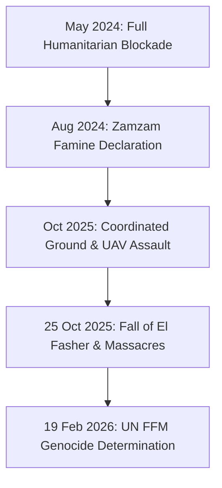

# El Fasher Siege and Genocide Investigation Timeline

> [!NOTE] Campaign & Investigation Timeline Anchor
> - **Temporal Span**: `2024-05-01` (Onset of tight urban siege) to `2026-02-19` (UN Fact-Finding Mission genocide findings).
> - **Campaign Focus**: The 18-month military blockade, fall, and subsequent international legal investigation into atrocities in [[El Fasher]], North Darfur.
> - **NATO Admiralty Composite Rating**: **`A1`** (`reliability_score: 0.95`).

---

## 1. Temporal Scope, Theatre Coverage & Strategic Periodization

This campaign timeline chronicles the 500-day military siege of [[El Fasher]] by the [[Rapid Support Forces]], the collapse of the Sudanese Armed Forces and Joint Darfur Force defensive coalition in late October 2025, and the subsequent forensic investigation conducted by the [[Independent International Fact-Finding Mission for the Sudan]] culminating in its formal determination of genocidal conduct in February 2026.

---

## 2. Chronological Event & Citation Ledger (Bitemporal Sequence)

| $t_{\text{valid}}$ | $t_{\text{reported}}$ | Entity / Incident / Document | Type | Location | Key Actors | Core Finding / Impact | Primary Citation | Rating |
| :--- | :--- | :--- | :--- | :--- | :--- | :--- | :--- | :--- |
| `2024-05-10` | `2024-05-12` | Tightening of Encirclement | Military Siege | [[El Fasher]], [[North Darfur]] | [[Rapid Support Forces]] | Total cut-off of commercial food and medical access. | Vault Records | `A2` |
| `2024-08-01` | `2024-08-01` | Famine Declaration in Zamzam | IPC Finding | [[Zamzam IDP Camp]] | IPC Famine Review Committee | IPC Phase 5 Famine confirmed in Zamzam camp. | Vault Records | `A1` |
| `2025-10-25` | `2025-10-26` | Breaching of Defense & Garrison Fall | Military Capture | [[El Fasher]] | [[Rapid Support Forces]] | Overrun of SAF 6th Division; execution of captured defenders. | [[2025-10 El Fasher Siege and RSF Takeover Atrocities]] | `A1` |
| `2025-10-26` | `2025-10-31` | Post-Capture Ethnic Cleansing | Atrocity Incident | [[El Fasher]] | [[Rapid Support Forces]] | House-to-house killings, rape, and forced expulsion of Fur and Zaghawa. | Vault Records | `A1` |
| `2026-02-19` | `2026-02-19` | FFM Report Presentation | Legal Finding | [[Geneva]] | [[Mohamed Chande Othman]], [[Mona Rishmawi]], [[Joy Ngozi Ezeilo]] | Concludes conduct bore the hallmarks of genocide; genocidal intent confirmed. | [[2026-02-19 Mohamed Chande Othman Statement on Hallmarks of Genocide in El Fasher]] | `A1` |

---

## 3. Causal Escalation Chains, Turning Points & Tempo Analysis

---

## 4. Cumulative Humanitarian, Territorial & Attribution Telemetry

- **Casualties**: Thousands of non-Arab civilians killed during siege shelling and post-capture executions.
- **Displacement**: Entire civilian population of El Fasher displaced into Jebel Marra or cross-border into Chad.
- **Legal Accountability**: Formally documented as statutory genocide, triggering heightened international obligations under the 1948 Genocide Convention.

---

## Related Primitives

- **Core Event**: [[2025-10 El Fasher Siege and RSF Takeover Atrocities]]
- **Location Nodes**: [[El Fasher]], [[North Darfur]]
- **Investigating Organs**: [[Independent International Fact-Finding Mission for the Sudan]], [[OHCHR]], [[UN Human Rights Council]]
- **Thematic Context**: [[Ethnic Cleansing and Genocidal Patterns in Darfur]], [[International Accountability and Fact-Finding Mechanisms in Sudan]]
