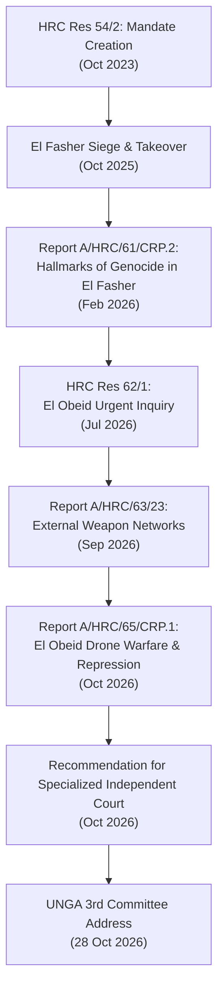

# Sudan Accountability and International Justice Timeline

> [!NOTE] Diplomatic Timeline Anchor
> - **Temporal Coverage**: `2023-10-11` (Adoption of HRC Res 54/2) to `2026-10-28` (UNGA Third Committee Briefing).
> - **Thematic Focus**: Institutional mandate progression, field investigative milestones, landmark reports, and high-level diplomatic presentations of the [[Independent International Fact-Finding Mission for the Sudan]].
> - **NATO Admiralty Rating**: **`A1`** (`reliability_score: 0.95`).

---

## 1. Temporal Scope, Theatre Coverage & Strategic Periodization

This timeline tracks the legal, investigative, and multilateral proceedings establishing accountability for international crimes committed during the Sudan war. It chronicles the trajectory of the UN Human Rights Council's Fact-Finding Mission under Chair [[Mohamed Chande Othman]], capturing its evolution from mandate establishment through forensic findings on ethnic cleansing and genocide in Darfur to inquiries into siege warfare and arbitrary detention in Kordofan.

---

## 2. Chronological Event & Citation Ledger (Bitemporal Sequence)

| $t_{\text{valid}}$ | $t_{\text{reported}}$ | Entity / Incident / Document | Type | Forum / Location | Key Actors & Jurists | Core Determination / Evidence | Primary Citation | Rating |
| :--- | :--- | :--- | :--- | :--- | :--- | :--- | :--- | :--- |
| `2023-10-11` | `2023-10-11` | Resolution A/HRC/RES/54/2 | Mandate Adoption | [[Geneva]] | [[UN Human Rights Council]] | Establishes the Independent International Fact-Finding Mission for the Sudan. | Vault Official | `A1` |
| `2025-10-25` | `2025-10-28` | Fall of El Fasher & Atrocities | Conflict Incident | [[El Fasher]] | [[Rapid Support Forces]] | Overrun of state capital; ethnically targeted mass killings of Zaghawa and Fur. | [[2025-10 El Fasher Siege and RSF Takeover Atrocities]] | `A1` |
| `2026-02-19` | `2026-02-19` | El Fasher Genocide Report Release | Forensic Report | [[Geneva]] | [[Mohamed Chande Othman]], [[Mona Rishmawi]], [[Joy Ngozi Ezeilo]] | Concludes RSF assault bore "hallmarks of genocide" with genocidal intent. | [[2026-02-19 Mohamed Chande Othman Statement on Hallmarks of Genocide in El Fasher]] | `A1` |
| `2026-07-06` | `2026-07-06` | Resolution A/HRC/62/1 | Mandate Expansion | [[Geneva]] | [[UN Human Rights Council]] | Requests urgent inquiry into encirclement and civilian risks in El Obeid. | Vault Official | `A1` |
| `2026-09-03` | `2026-09-03` | External Weapons Report (A/HRC/63/23) | Investigative Report | [[Geneva]] | [[Independent International Fact-Finding Mission for the Sudan]] | Details transnational supply networks and foreign drones fueling RSF and SAF. | Vault Official | `A1` |
| `2026-09-24` | `2026-10-28` | Um Badr Market Summary Executions | Conflict Incident / War Crime | [[Um Badr]], [[North Kordofan]] | [[Rapid Support Forces]] | Summary execution of 25 bound detainees; Common Article 3 war crime verified by FFM. | [[2026-09-24 Um Badr Market Summary Executions]] | `A1` |
| `2026-10-09` | `2026-10-09` | Mandate Renewal Resolution A/HRC/63/L.26 | Mandate Extension | [[Geneva]] | [[UN Human Rights Council]] | Extends FFM Sudan investigative mandate through October 2027. | Vault Official | `A1` |
| `2026-10-28` | `2026-10-28` | El Obeid Report Release (A/HRC/65/CRP.1) | Investigative Report | New York / [[Geneva]] | [[Mohamed Chande Othman]], [[Mona Rishmawi]], [[Joy Ngozi Ezeilo]] | Documents expanding drone warfare, infrastructure strikes, and SAF arbitrary detentions. | [[2026-10-28 Mohamed Chande Othman Statement on Escalating Drone Warfare and Atrocity Risks in El Obeid]] | `A1` |
| `2026-10-28` | `2026-10-28` | FFM Finding on RSF Indiscriminate Drone Warfare | Forensic Finding | [[El Obeid]], [[North Kordofan]] | [[Independent International Fact-Finding Mission for the Sudan]] | Documents RSF strikes on schools, hospitals, funerals, and rescue workers. | [[2026-10-28 UN FFM Finding on RSF Drone Warfare and Indiscriminate Attacks in El Obeid]] | `A1` |
| `2026-10-28` | `2026-10-28` | FFM Finding on SAF Custodial Torture & Co-Location | Forensic Finding | [[El Obeid]], [[North Kordofan]] | [[Independent International Fact-Finding Mission for the Sudan]] | Confirms 2,000+ detainees packed in Central Prison, torture, and billets in residential areas. | [[2026-10-28 UN FFM Finding on SAF Detention Practices and Torture in El Obeid]] | `A1` |
| `2026-10-28` | `2026-10-28` | Recommendation for Specialized Court for Sudan | Judicial Recommendation | [[Geneva]] / UN | [[Independent International Fact-Finding Mission for the Sudan]] | Formally recommends establishing specialized independent judicial mechanism for Sudan. | [[2026-10-28 UN FFM Recommendation for Specialized Independent Court for Sudan]] | `A1` |
| `2026-10-28` | `2026-10-28` | UNGA Third Committee Briefing | Diplomatic Statement | New York | [[Mohamed Chande Othman]] | Briefs UN General Assembly 81st Session on escalating atrocity risks across Sudan. | [[2026-10-28 Mohamed Chande Othman Address to the UN General Assembly Third Committee on Sudan]] | `A1` |

---

## 3. Causal Escalation Chains, Turning Points & Tempo Analysis

---

## 4. Cumulative Humanitarian, Territorial & Attribution Telemetry

- **Reports Published**: 3 comprehensive investigative reports (Genocide in El Fasher, External Weapons Networks, Civilian Devastation in El Obeid).
- **Crimes Documented**: Statutory acts of genocide, summary executions of bound detainees ([[Um Badr]]), indiscriminate drone warfare, torture and sexual violence in detention, starvation siege tactics, and attacks on civilian infrastructure.
- **Accountability Innovations**: Formal proposal for a specialized independent international/hybrid court for Sudan to operate alongside the ICC.
- **Mandate Durability**: Extended through October 2027 by resolution A/HRC/63/L.26 despite intense sovereign and external diplomatic opposition.

---

## Related Primitives

- **Investigative Body**: [[Independent International Fact-Finding Mission for the Sudan]], [[UN Human Rights Council]], [[OHCHR]]
- **Key Experts**: [[Mohamed Chande Othman]], [[Mona Rishmawi]], [[Joy Ngozi Ezeilo]]
- **Linked Events**: [[2025-10 El Fasher Siege and RSF Takeover Atrocities]], [[2026-09-24 Um Badr Market Summary Executions]], [[2026-10 El Obeid Siege and Drone Warfare Escalation]]
- **Standalone Citations**: [[2026-10-28 UN FFM Finding on RSF Drone Warfare and Indiscriminate Attacks in El Obeid]], [[2026-10-28 UN FFM Finding on SAF Detention Practices and Torture in El Obeid]], [[2026-10-28 UN FFM Recommendation for Specialized Independent Court for Sudan]], [[2026-10-28 Mohamed Chande Othman Address to the UN General Assembly Third Committee on Sudan]]
- **Thematic Context**: [[International Accountability and Fact-Finding Mechanisms in Sudan]], [[Ethnic Cleansing and Genocidal Patterns in Darfur]], [[Arbitrary Detention and Custodial Torture in the Sudan War]]
- **Originating Sources**: [[sources/2026-10-28-ohchr-independent-international-fact-finding-mission-sudan-portal]], [[sources/2026-10-28-un-hrc-crp1-el-obeid-civilian-devastation]], [[sources/2026-02-19-un-news-el-fasher-hallmarks-of-genocide]]
