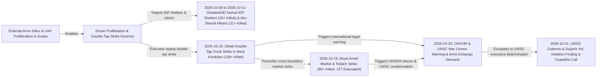

# Sudan Drone Warfare and Double-Tap Strike Timeline

## 1. Temporal Scope, Theatre Coverage & Strategic Periodization

> [!IMPORTANT] Thematic Escalation Timeline Anchor (`2026-10-01` – `2026-10-31`)
> - **Timeline Subtype**: `thematic_timeline` (Anchored to [[Drone Proliferation and Double-Tap Strike Doctrine in Sudan]])
> - **Geographic Footprint**: [[West Kordofan]] (`SD18`), [[Blue Nile State]] (`SD17`), [[Abyei]] (`SD18001`), Darfur, and **Khartoum State**
> - **Doctrinal Significance**: Unmanned aerial vehicles (drones) accounted for the **majority of conflict-related civilian deaths in Sudan in 2026**, driven by external arms transfers and repeat "double-tap" strike tactics and formally condemned on `2026-10-31` by [[United Nations]] Secretary-General [[António Guterres]] as violations of international humanitarian law ([[2026-10-23 Volker Türk Condemnation of Sudan Drone Escalation and Arms Influx]], [[2026-10-31 Stéphane Dujarric UNSG Statement Condemning Escalating Drone Attacks in Sudan and Abyei]])
> - **Cumulative Casualty Toll**: At least **306 killed** ("hundreds of civilians, including women and children") and hundreds injured (`admiralty_rating: A1`, `reliability_score: 0.95`) ([[sources/2026-10-23-un-news-sudan-drone-strikes-306-killed]], [[sources/2026-10-31-unsg-spokesperson-escalating-drone-attacks-sudan]])

The **Sudan Drone Warfare and Double-Tap Strike Timeline** tracks the chronological evolution, tactical target selection, and international legal findings surrounding UAV proliferation and "double-tap" repeat strikes by the [[Sudanese Armed Forces]] (SAF) and the [[Rapid Support Forces]] (RSF) ([[Drone Proliferation and Double-Tap Strike Doctrine in Sudan]]). Across October 2026 (`2026-10-01` to `2026-10-31`), UAV attacks systematically targeted IDP shelters, artisanal gold-mining sites, hospitals, civilian transport trucks, and regional markets across [[West Kordofan]], [[Blue Nile State]], and demilitarized [[Abyei]] ([[2026-10 Sudan Drone Warfare Escalation]]).

---

## 2. Chronological Event & Citation Ledger (Bitemporal Sequence)

| # | Valid Time ($t_{\text{valid}}$) | Report Time ($t_{\text{reported}}$) | Lag ($\Delta t$) | Node Type | Canonical Event / Citation Node | Target Category & Tactical Mechanics | Attribution | Verified Toll | Admiralty |
| :--- | :--- | :--- | :--- | :--- | :--- | :--- | :--- | :--- | :--- |
| 1 | `2026-10-01` – `2026-10-31` | `2026-10-23` / `2026-10-31` | 0–22d | `Event (campaign)` | [[2026-10 Sudan Drone Warfare Escalation]] | October 2026 UAV campaign striking Ghubeish & El Nuhud IDP shelters (`25+` killed), Abu Shendi IDP gold miners (`31+` killed), and Um Darfa hospital (`2` injured) | [[Sudanese Armed Forces]] & [[Rapid Support Forces]] | **306+ killed**, hundreds injured | **A1** |
| 2 | `2026-10-18` | `2026-10-23` | 5d | `Event (incident)` | [[2026-10-18 Dibab Double-Tap Drone Strike]] | Repeat **"double-tap" UAV strike** hitting a transportation truck and congregating victims in RSF-held Dibab, [[West Kordofan]] | Unspecified operator in [[Rapid Support Forces]]-held zone | **139+ killed** | **A2** |
| 3 | `2026-10-19` | `2026-10-23` / `2026-10-31` | 4–12d | `Event (incident)` | [[2026-10-19 Abyei Amiet Market and Todach Drone Strike]] | UAV munitions dropped on Amiet multi-communal market and Todach in demilitarized [[Abyei]], burning every shop | Unspecified UAV operator | **80+ killed**, **27+ injured** | **A1** |
| 4 | `2026-10-23` | `2026-10-23` | 0d | `Citation (statement)` | [[2026-10-23 Volker Türk Condemnation of Sudan Drone Escalation and Arms Influx]] | Formal warning that drones cause the majority of 2026 civilian deaths in Sudan and call to halt external arms transfers | [[Volker Türk]] ([[OHCHR]]) | **306+ killed** in 3 weeks | **A2** |
| 5 | `2026-10-23` | `2026-10-23` | 0d | `Citation (statement)` | [[2026-10-23 Seif Magango Statement on Evisceration of Civilian Infrastructure in Sudan]] | Forensic statement on IDP casualties and the evisceration of vital civilian infrastructure and services | [[Seif Magango]] ([[OHCHR]]) | Scores of IDPs killed; hospitals & services destroyed | **A2** |
| 6 | `2026-10-23` | `2026-10-23` | 0d | `Citation (testimony)` | [[2026-10-23 Muhammad Farooq First-Responder Account of Amiet Market Fire]] | On-scene peacekeeper account confirming *"every shop was burning"* after the Amiet Market UAV strike | Lt. Col. [[Muhammad Farooq]] ([[UNISFA]]) | Total market conflagration | **A2** |
| 7 | `2026-10-23` | `2026-10-23` | 0d | `Citation (statement)` | [[2026-10-23 Adebowale Ajabge Report on UNISFA Emergency Response and Todach Evacuations]] | Operational account of [[UNISFA]] firefighting and medical evacuation of >27 wounded to Todach hospital | Brig. Gen. [[Adebowale Ajabge]] ([[UNISFA]]) | **27+ injured** evacuated | **A2** |
| 8 | `2026-10-23` | `2026-10-23` | 0d | `Citation (testimony)` | [[2026-10-23 Angelina Musa Diaw Survivor Testimony on Amiet Market Destruction]] | Civilian survivor testimony on livelihood destruction at Amiet Market in [[Abyei]] | [[Angelina Musa Diaw]] | Total loss of commercial livelihood | **A2** |
| 9 | `2026-10-31` | `2026-10-31` | 0d | `Citation (warning)` | [[2026-10-31 Stéphane Dujarric UNSG Statement Condemning Escalating Drone Attacks in Sudan and Abyei]] | Executive statement declaring drone attacks across Sudan and [[Abyei]] killing hundreds of civilians and striking health facilities to be **IHL violations** | [[Stéphane Dujarric]] / [[António Guterres]] ([[United Nations]]) | Hundreds of civilians killed (incl. women & children) | **A1** |
| 10 | `2026-10-31` | `2026-10-31` | 0d | `Citation (appeal)` | [[2026-10-31 António Guterres Appeal for Immediate Cessation of Hostilities and Good-Faith Mediation in Sudan]] | Urgent appeal to spare civilians and critical infrastructure, agree without delay to a **cessation of hostilities**, and enter mediation | [[António Guterres]] ([[United Nations]]) | Nationwide ceasefire & mediation demand | **A1** |

---

## 3. Causal Escalation Chains, Turning Points & Tempo Analysis

### Tactical & Doctrinal Escalation Analysis
1. **Repeat "Double-Tap" Lethality Multiplier**: The `18 October 2026` strike in Dibab, [[West Kordofan]] demonstrated the devastating casualty multiplier of "double-tap" UAV doctrine—striking a transportation truck first and then executing a repeat strike that killed at least **139 people**, accounting for **45.4% of the entire three-week national death toll** in a single incident ([[2026-10-18 Dibab Double-Tap Drone Strike]], [[Drone Proliferation and Double-Tap Strike Doctrine in Sudan]]).
2. **Systematic Evisceration of Civilian Survival Infrastructure**: As documented by [[Seif Magango]] and condemned by [[António Guterres]] via [[Stéphane Dujarric]], UAV strikes systematically targeted the survival nodes of displaced populations: IDP shelters in **Ghubeish** and **El Nuhud** (`25+` killed), informal gold-mining livelihoods near **Abu Shendi** (`31+` killed), **Um Darfa Hospital** in [[Blue Nile State]], and the cross-border commercial hub of **Amiet Market** in [[Abyei]] (`80+` killed) ([[2026-10-23 Seif Magango Statement on Evisceration of Civilian Infrastructure in Sudan]], [[2026-10-31 Stéphane Dujarric UNSG Statement Condemning Escalating Drone Attacks in Sudan and Abyei]]).
3. **Breach of Demilitarized Peacekeeping Zones & Executive IHL Determination**: The `19 October 2026` UAV attack on Amiet Market and Todach violated the UN-mandated demilitarized status of [[Abyei]], forcing [[UNISFA]] peacekeepers under Brig. Gen. [[Adebowale Ajabge]] and Lt. Col. [[Muhammad Farooq]] to act as emergency firefighters and mass-casualty trauma responders ([[2026-10-19 Abyei Amiet Market and Todach Drone Strike]]) and culminating in the `31 October 2026` UN Secretary-General determination that the strikes across Sudan and [[Abyei]] violate international humanitarian law ([[2026-10-31 Stéphane Dujarric UNSG Statement Condemning Escalating Drone Attacks in Sudan and Abyei]]).

---

## 4. Cumulative Humanitarian, Territorial & Attribution Telemetry

| Target / Tactical Category | Incident Location(s) | Valid Window ($t_{\text{valid}}$) | Verified Fatalities | Share of 306+ Total | Primary Legal / Humanitarian Impact |
| :--- | :--- | :--- | :--- | :--- | :--- |
| **Double-Tap Transport Strike** | Dibab, [[West Kordofan]] (`SD18`) | `2026-10-18` | **139+ killed** | `45.4%` | Mass-casualty repeat strike in [[Rapid Support Forces]]-controlled territory ([[2026-10-18 Dibab Double-Tap Drone Strike]]) |
| **Demilitarized Market & Town Strike** | Amiet Market & Todach, [[Abyei]] (`SD18001`) | `2026-10-19` | **80+ killed** | `26.1%` | **27+ injured** evacuated to Todach [[UNISFA]] hospital; shops burned; UNSC & UNSG IHL violation warnings ([[2026-10-19 Abyei Amiet Market and Todach Drone Strike]]) |
| **IDP Gold-Mining Livelihood Strike** | Abu Shendi, [[Blue Nile State]] (`SD17`) | `2026-10-09` | **31+ killed** | `10.1%` | Alleged [[Rapid Support Forces]] UAV strike killing mostly displaced women and children ([[2026-10 Sudan Drone Warfare Escalation]]) |
| **IDP Shelter Strikes** | Ghubeish & El Nuhud, [[West Kordofan]] (`SD18`) | `2026-10-06` – `2026-10-10` | **25+ killed** | `8.2%` | Alleged [[Sudanese Armed Forces]] UAV strikes on displaced persons' shelters ([[2026-10 Sudan Drone Warfare Escalation]]) |
| **Medical & Other Infrastructure Strikes** | Um Darfa Hospital ([[Blue Nile State]]), Darfur, Khartoum | `2026-10-01` – `2026-10-31` | **31+ killed** (residual campaign total) | `10.1%` | **2 health workers injured** at Um Darfa hospital (rendered non-operational); power, water & health facilities hit ([[2026-10-31 Stéphane Dujarric UNSG Statement Condemning Escalating Drone Attacks in Sudan and Abyei]]) |
| **Cumulative October 2026 Total** | Nationwide (`SD18`, `SD17`, `SD18001`, Darfur, Khartoum) | `2026-10-01` – `2026-10-31` | **306+ killed** | `100.0%` | Drones confirmed as leading cause of 2026 civilian conflict deaths in Sudan; UNSG demands immediate cessation of hostilities ([[2026-10-23 Volker Türk Condemnation of Sudan Drone Escalation and Arms Influx]], [[2026-10-31 António Guterres Appeal for Immediate Cessation of Hostilities and Good-Faith Mediation in Sudan]]) |

---

## Related Primitives

- **Parent Monthly Chronicle & Linked Theme**:
  - [[2026-10 Sudan Conflict Chronicle]]
  - [[Drone Proliferation and Double-Tap Strike Doctrine in Sudan]]
- **Events Chronicled**:
  - [[2026-10 Sudan Drone Warfare Escalation]]
  - [[2026-10-18 Dibab Double-Tap Drone Strike]]
  - [[2026-10-19 Abyei Amiet Market and Todach Drone Strike]]
- **Citations Chronicled**:
  - [[2026-10-23 Volker Türk Condemnation of Sudan Drone Escalation and Arms Influx]]
  - [[2026-10-23 Seif Magango Statement on Evisceration of Civilian Infrastructure in Sudan]]
  - [[2026-10-23 Muhammad Farooq First-Responder Account of Amiet Market Fire]]
  - [[2026-10-23 Adebowale Ajabge Report on UNISFA Emergency Response and Todach Evacuations]]
  - [[2026-10-23 Angelina Musa Diaw Survivor Testimony on Amiet Market Destruction]]
  - [[2026-10-31 Stéphane Dujarric UNSG Statement Condemning Escalating Drone Attacks in Sudan and Abyei]]
  - [[2026-10-31 António Guterres Appeal for Immediate Cessation of Hostilities and Good-Faith Mediation in Sudan]]
- **Actors & Locations**:
  - [[Sudanese Armed Forces]] | [[Rapid Support Forces]] | [[United Nations]] | [[OHCHR]] | [[UNISFA]] | [[UN News]] | [[Office of the Spokesperson for the Secretary-General]]
  - [[António Guterres]] | [[Stéphane Dujarric]] | [[Volker Türk]] | [[Seif Magango]] | [[Muhammad Farooq]] | [[Adebowale Ajabge]] | [[Angelina Musa Diaw]]
  - [[West Kordofan]] | [[Blue Nile State]] | [[Abyei]]
- **Sources**:
  - [[sources/2026-10-23-un-news-sudan-drone-strikes-306-killed]]
  - [[sources/2026-10-31-unsg-spokesperson-escalating-drone-attacks-sudan]]
