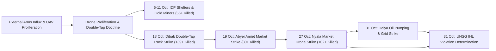

# Sudan Drone Warfare and Double-Tap Strike Timeline

## 1. Temporal Scope, Theatre Coverage & Strategic Periodization

> [!IMPORTANT] Thematic Escalation Timeline Anchor (`2026-10-01` – `2026-10-31`)
> - **Timeline Subtype**: `thematic_timeline` (Anchored to [[Drone Proliferation and Double-Tap Strike Doctrine in Sudan]])
> - **Geographic Footprint**: [[West Kordofan]] (`SD18`), [[Blue Nile State]] (`SD17`), [[Abyei]] (`SD18001`), [[South Darfur]] (`SD03`), [[Red Sea State]] (`SD07`), and [[North Kordofan]] (`SD02`).
> - **Doctrinal Significance**: Unmanned aerial vehicles (drones) accounted for the **majority of conflict-related civilian deaths in Sudan in 2026**, driven by external arms transfers, repeat "double-tap" tactics, and precision strikes against dual-use civilian utility grids.
> - **Cumulative Casualty Toll**: At least **408 killed** ("hundreds of civilians, including women and children") and hundreds injured (`admiralty_rating: A1`, `reliability_score: 0.95`).

The **Sudan Drone Warfare and Double-Tap Strike Timeline** tracks the chronological evolution, tactical target selection, and international legal findings surrounding UAV proliferation, "double-tap" repeat strikes, and long-range infrastructure attacks by the [[Sudanese Armed Forces]] (SAF) and the [[Rapid Support Forces]] (RSF) ([[Drone Proliferation and Double-Tap Strike Doctrine in Sudan]]). Across October 2026 (`2026-10-01` to `2026-10-31`), UAV attacks systematically targeted IDP shelters, artisanal gold-mining sites, hospitals, civilian transport trucks, commercial livestock markets, and crude oil export hubs across Sudan.

---

## 2. Chronological Event & Citation Ledger (Bitemporal Sequence)

| # | Valid Time ($t_{\text{valid}}$) | Report Time ($t_{\text{reported}}$) | Lag ($\Delta t$) | Node Type | Canonical Event / Citation Node | Target Category & Tactical Mechanics | Attribution | Verified Toll | Admiralty |
| :--- | :--- | :--- | :--- | :--- | :--- | :--- | :--- | :--- | :--- |
| 1 | `2026-10-01` – `2026-10-31` | `2026-10-23` / `2026-10-31` | 0–22d | `Event (campaign)` | [[2026-10 Sudan Drone Warfare Escalation]] | October 2026 nationwide UAV campaign striking IDP shelters, gold miners, and infrastructure | [[Sudanese Armed Forces]] & [[Rapid Support Forces]] | **408+ killed**, hundreds injured | **A1** |
| 2 | `2026-10-18` | `2026-10-23` | 5d | `Event (incident)` | [[2026-10-18 Dibab Double-Tap Drone Strike]] | Repeat **"double-tap" UAV strike** hitting a transportation truck and congregating victims in RSF-held Dibab | Unspecified operator in [[Rapid Support Forces]]-held zone | **139+ killed** | **A2** |
| 3 | `2026-10-19` | `2026-10-23` / `2026-10-31` | 4–12d | `Event (incident)` | [[2026-10-19 Abyei Amiet Market and Todach Drone Strike]] | UAV munitions dropped on Amiet multi-communal market and Todach in demilitarized [[Abyei]] | Unspecified UAV operator | **80+ killed**, **27+ injured** | **A1** |
| 4 | `2026-10-21` | `2026-10-21` | 0d | `Citation (statement)` | [[2026-10-21 Alexandre Fasel Statement on Drone War Killing Mostly Civilians in Sudan]] | Swiss State Secretary warns that drone technology proliferation is killing mostly civilians | [[Alexandre Fasel]], [[Federal Department of Foreign Affairs (Switzerland)]] | High-level multilateral warning | **A1** |
| 5 | `2026-10-23` | `2026-10-23` | 0d | `Citation (statement)` | [[2026-10-23 Volker Türk Condemnation of Sudan Drone Escalation and Arms Influx]] | Formal warning that drones cause majority of civilian deaths and call to halt arms transfers | [[Volker Türk]] ([[OHCHR]]) | **306+ killed** in 3 weeks | **A2** |
| 6 | `2026-10-23` | `2026-10-23` | 0d | `Citation (statement)` | [[2026-10-23 Seif Magango Statement on Evisceration of Civilian Infrastructure in Sudan]] | Forensic statement on IDP casualties and the evisceration of vital civilian infrastructure | [[Seif Magango]] ([[OHCHR]]) | Scores of IDPs killed | **A2** |
| 7 | `2026-10-23` | `2026-10-23` | 0d | `Citation (testimony)` | [[2026-10-23 Muhammad Farooq First-Responder Account of Amiet Market Fire]] | Peacekeeper account confirming *"every shop was burning"* after Amiet Market UAV strike | Lt. Col. [[Muhammad Farooq]] ([[UNISFA]]) | Total market conflagration | **A2** |
| 8 | `2026-10-23` | `2026-10-23` | 0d | `Citation (statement)` | [[2026-10-23 Adebowale Ajabge Report on UNISFA Emergency Response and Todach Evacuations]] | Operational account of [[UNISFA]] firefighting and medical evacuation of >27 wounded | Brig. Gen. [[Adebowale Ajabge]] ([[UNISFA]]) | **27+ injured** evacuated | **A2** |
| 9 | `2026-10-23` | `2026-10-23` | 0d | `Citation (testimony)` | [[2026-10-23 Angelina Musa Diaw Survivor Testimony on Amiet Market Destruction]] | Civilian survivor testimony on livelihood destruction at Amiet Market in [[Abyei]] | [[Angelina Musa Diaw]] | Total loss of livelihood | **A2** |
| 10 | `2026-10-27` | `2026-10-31` | 4d | `Event (incident)` | [[2026-10-27 Nyala Tanqonj Market Drone Strike]] | Massive aerial / drone bombardment hitting Tanqonj livestock and consumer market in [[Nyala]] | Alleged [[Sudanese Armed Forces]] | **102+ killed**, >100 injured | **B2** |
| 11 | `2026-10-28` | `2026-10-28` | 0d | `Citation (statement)` | [[2026-10-28 Mohamed Chande Othman Statement on Escalating Drone Warfare and Atrocity Risks in El Obeid]] | FFM address documenting weaponized drone encirclement and siege starvation in [[El Obeid]] | [[Mohamed Chande Othman]], FFM | Severe atrocity warning | **A1** |
| 12 | `2026-10-28` | `2026-10-28` | 0d | `Citation (forensic)` | [[2026-10-28 UN FFM Finding on RSF Drone Warfare and Indiscriminate Attacks in El Obeid]] | FFM verifies RSF drone strikes on schools, hospitals, funerals, and civilians approaching to assist wounded | [[Independent International Fact-Finding Mission for the Sudan]] | Verified double-tap and civilian strikes | **A1** |
| 13 | `2026-10-31` | `2026-10-31` | 0d | `Event (incident)` | [[2026-10-31 Haiya Oil Pumping and Power Station Drone Strike]] | Long-range UAV strike targeting Station 4 and municipal power transmission line in [[Haiya]] | Alleged [[Rapid Support Forces]] (Ethiopian staging alleged) | Export pipeline disrupted | **B2** |
| 14 | `2026-10-31` | `2026-10-31` | 0d | `Citation (warning)` | [[2026-10-31 Stéphane Dujarric UNSG Statement Condemning Escalating Drone Attacks in Sudan and Abyei]] | Executive statement declaring drone attacks killing hundreds of civilians to be **IHL violations** | [[Stéphane Dujarric]] / [[António Guterres]] | Hundreds of civilians killed | **A1** |
| 15 | `2026-10-31` | `2026-10-31` | 0d | `Citation (statement)` | [[2026-10-31 Stéphane Dujarric Arab News Statement Condemning Nyala Market Drone Strike]] | UN Secretary-General appalled by reports of drone strikes on Tanqonj market in South Darfur | [[Stéphane Dujarric]], [[António Guterres]] | Scores of civilians killed | **B2** |
| 16 | `2026-10-31` | `2026-10-31` | 0d | `Citation (statement)` | [[2026-10-31 Muawiya Osman Accusation of Ethiopian Base and UAE Proxy Drone Strikes on Sudan Infrastructure]] | Diplomatic briefing alleging Ethiopian base staging of Haiya infrastructure drone strike | [[Muawiya Osman]], Sudan MFA | State proxy attribution | **B2** |

---

## 3. Causal Escalation Chains, Turning Points & Tempo Analysis

### Tactical & Doctrinal Escalation Analysis
1. **Repeat "Double-Tap" Lethality Multiplier**: The `18 October 2026` strike in Dibab, [[West Kordofan]] demonstrated the devastating casualty multiplier of "double-tap" UAV doctrine—striking a transportation truck first and then executing a repeat strike that killed at least **139 people** ([[2026-10-18 Dibab Double-Tap Drone Strike]], [[Drone Proliferation and Double-Tap Strike Doctrine in Sudan]]).
2. **Expansion to Strategic Hinterland Infrastructure**: The `31 October 2026` strike on [[Haiya]] demonstrated that the drone war had expanded far beyond frontline contact lines into eastern rear infrastructure, severing electricity lines and striking crude oil export pumps along the Red Sea transit corridor ([[2026-10-31 Haiya Oil Pumping and Power Station Drone Strike]]).
3. **Executive Multilateral Determination**: High-casualty urban market massacres like [[Nyala]] (`102+` killed) and [[Abyei]] (`80+` killed) led directly to the UN Secretary-General's formal finding that the drone strikes violate international humanitarian law.

---

## 4. Cumulative Humanitarian, Territorial & Attribution Telemetry

| Target / Tactical Category | Incident Location(s) | Valid Window ($t_{\text{valid}}$) | Verified Fatalities | Share of Total | Primary Legal / Humanitarian Impact |
| :--- | :--- | :--- | :--- | :--- | :--- |
| **Double-Tap Transport Strike** | Dibab, [[West Kordofan]] (`SD18`) | `2026-10-18` | **139+ killed** | `34.1%` | Mass-casualty repeat strike in RSF-controlled territory ([[2026-10-18 Dibab Double-Tap Drone Strike]]) |
| **Urban Livestock & Consumer Market** | Tanqonj Market, [[Nyala]] (`SD03001`) | `2026-10-27` | **102+ killed** | `25.0%` | >100 wounded; widespread slaughter in civilian commercial hub ([[2026-10-27 Nyala Tanqonj Market Drone Strike]]) |
| **Demilitarized Market & Town Strike** | Amiet Market & Todach, [[Abyei]] (`SD18001`) | `2026-10-19` | **80+ killed** | `19.6%` | **27+ injured** evacuated to Todach [[UNISFA]] hospital; shops burned ([[2026-10-19 Abyei Amiet Market and Todach Drone Strike]]) |
| **IDP Gold-Mining Livelihood Strike** | Abu Shendi, [[Blue Nile State]] (`SD17`) | `2026-10-09` | **31+ killed** | `7.6%` | Alleged [[Rapid Support Forces]] UAV strike killing mostly displaced women and children |
| **IDP Shelter Strikes** | Ghubeish & El Nuhud, [[West Kordofan]] (`SD18`) | `2026-10-06` – `2026-10-10` | **25+ killed** | `6.1%` | Alleged [[Sudanese Armed Forces]] UAV strikes on displaced persons' shelters |
| **Crude Oil & Power Infrastructure** | Station 4 & Grid, [[Haiya]] (`SD07002`) | `2026-10-31` | `0` confirmed | `0.0%` | Pumping Station 4 hit; power line severed; blackout in Haiya town |
| **Medical & Other Infrastructure** | Um Darfa Hospital, Darfur, Khartoum | `2026-10-01` – `2026-10-31` | **31+ killed** | `7.6%` | Hospital non-operational; health workers wounded |
| **Cumulative October 2026 Total** | Nationwide (`SD18`, `SD17`, `SD18001`, `SD03`, `SD07`, `SD02`) | `2026-10-01` – `2026-10-31` | **408+ killed** | `100.0%` | Drones confirmed as leading cause of 2026 civilian conflict deaths in Sudan; declared **IHL violations** by UNSG |

---

## Related Primitives

- **Parent Monthly Chronicle & Linked Theme**:
  - [[2026-10 Sudan Conflict Chronicle]]
  - [[Drone Proliferation and Double-Tap Strike Doctrine in Sudan]]
  - [[Energy Infrastructure Targeting in the Sudan War]]
- **Events Chronicled**:
  - [[2026-10 Sudan Drone Warfare Escalation]]
  - [[2026-10-18 Dibab Double-Tap Drone Strike]]
  - [[2026-10-19 Abyei Amiet Market and Todach Drone Strike]]
  - [[2026-10-27 Nyala Tanqonj Market Drone Strike]]
  - [[2026-10-31 Haiya Oil Pumping and Power Station Drone Strike]]
  - [[2026-10 El Obeid Siege and Drone Warfare Escalation]]
- **Citations Chronicled**:
  - [[2026-10-21 Alexandre Fasel Statement on Drone War Killing Mostly Civilians in Sudan]]
  - [[2026-10-23 Volker Türk Condemnation of Sudan Drone Escalation and Arms Influx]]
  - [[2026-10-23 Seif Magango Statement on Evisceration of Civilian Infrastructure in Sudan]]
  - [[2026-10-23 Muhammad Farooq First-Responder Account of Amiet Market Fire]]
  - [[2026-10-23 Adebowale Ajabge Report on UNISFA Emergency Response and Todach Evacuations]]
  - [[2026-10-23 Angelina Musa Diaw Survivor Testimony on Amiet Market Destruction]]
  - [[2026-10-28 Mohamed Chande Othman Statement on Escalating Drone Warfare and Atrocity Risks in El Obeid]]
  - [[2026-10-28 UN FFM Finding on RSF Drone Warfare and Indiscriminate Attacks in El Obeid]]
  - [[2026-10-31 Stéphane Dujarric UNSG Statement Condemning Escalating Drone Attacks in Sudan and Abyei]]
  - [[2026-10-31 Stéphane Dujarric Arab News Statement Condemning Nyala Market Drone Strike]]
  - [[2026-10-31 António Guterres Appeal for Immediate Cessation of Hostilities and Good-Faith Mediation in Sudan]]
  - [[2026-10-31 Muawiya Osman Accusation of Ethiopian Base and UAE Proxy Drone Strikes on Sudan Infrastructure]]
  - [[2026-11-01 Radio Dabanga Arabic Rendition of UNSG Drone Condemnation and FFM Warning]]
- **Actors & Locations**:
  - [[Sudanese Armed Forces]] | [[Rapid Support Forces]] | [[United Nations]] | [[OHCHR]] | [[UNISFA]] | [[Radio Dabanga]] | [[Arab News]] | [[Independent International Fact-Finding Mission for the Sudan]]
  - [[António Guterres]] | [[Stéphane Dujarric]] | [[Volker Türk]] | [[Mohamed Chande Othman]] | [[Alexandre Fasel]] | [[Muawiya Osman]]
  - [[West Kordofan]] | [[Blue Nile State]] | [[Abyei]] | [[Nyala]] | [[Haiya]] | [[El Obeid]] | [[South Darfur]] | [[Red Sea State]]
- **Sources**:
  - [[sources/2026-10-23-un-news-sudan-drone-strikes-306-killed]]
  - [[sources/2026-10-31-unsg-spokesperson-escalating-drone-attacks-sudan]]
  - [[sources/2026-10-31-arab-news-un-chief-appalled-drone-strikes-nyala-market]]
  - [[sources/2026-10-31-dabanga-haiya-oil-electricity-drone-attack]]
  - [[sources/2026-11-01-dabanga-unsg-guterres-condemns-escalating-drone-attacks]]
  - [[sources/2026-10-28-un-hrc-crp1-el-obeid-civilian-devastation]]
